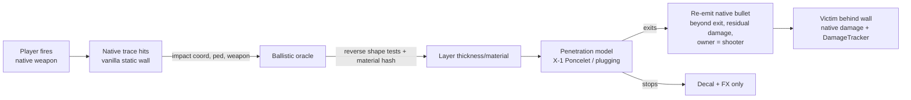
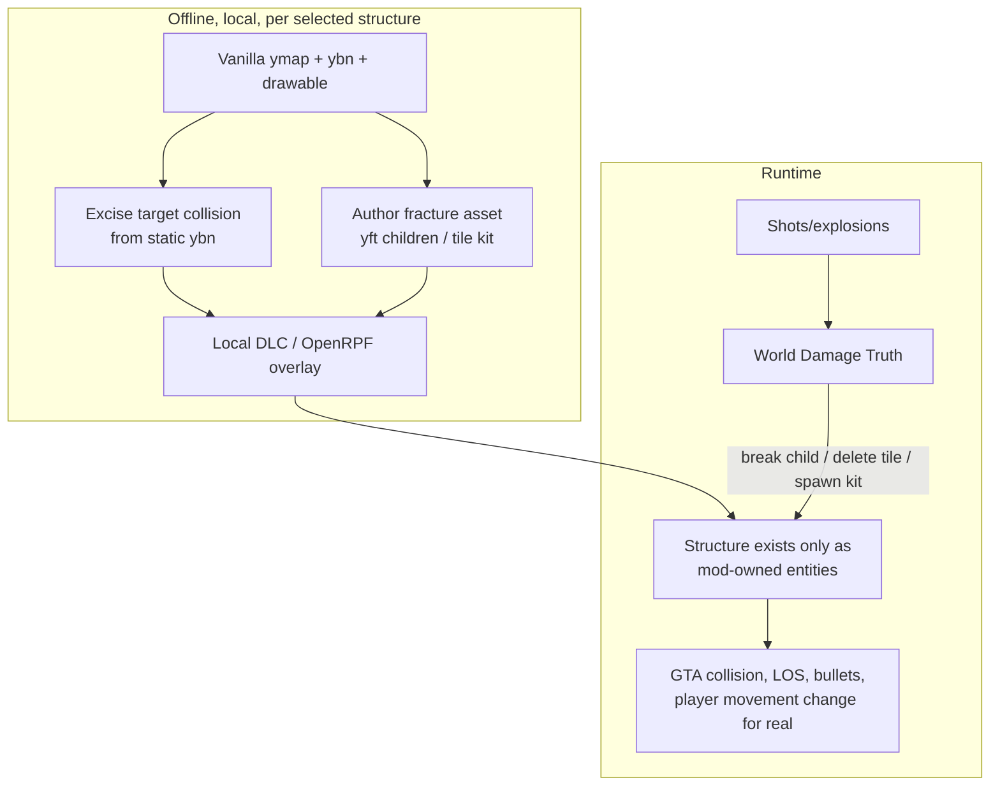
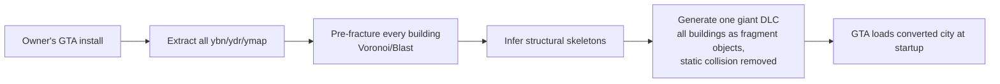
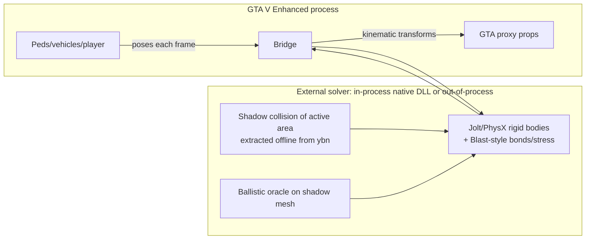
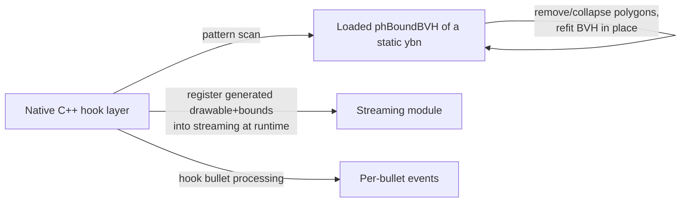
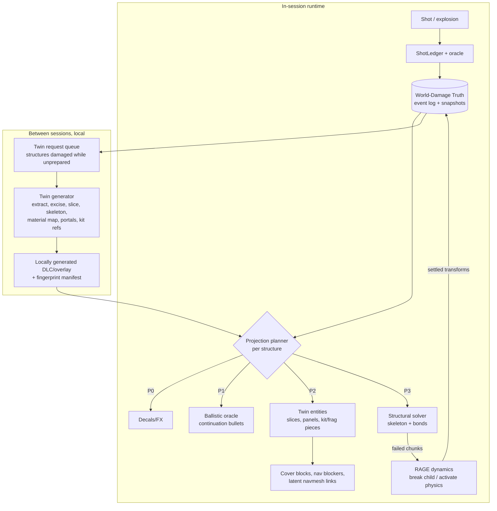

# ASTRA-001 · 02 — Architecture candidates

> Evidence labels and source IDs (`S-nn`, `X-n`) are defined in [01](01-current-capability-and-engine-evidence.md). Nothing here is implemented or GTA-tested.

## 1. The hard constraints any architecture must beat

| ID | Constraint | Evidence | Why it matters |
|---|---|---|---|
| **H1** | Static map collision is a streamed, pre-built cache (`.ybn` bounds store). There is no public API to edit it at runtime, and runtime (un)registration of collision/navmesh is crash-prone even with FiveM-grade hooks. | 01 §3.2, §3.8 (S-04, S-13) | Holes in vanilla walls cannot be "punched" into the original collision by scripting. |
| **H2** | Map buildings are not script entities; hide/swap natives are documented as object-only. | 01 §3.3 (S-08) | You cannot just delete or replace a vanilla building at runtime. |
| **H3** | Single-player has no runtime mesh/collision/navmesh creation; custom assets load from dlcpacks/mods at startup. | 01 §3.7–3.8 | Arbitrary new hole geometry cannot be generated *as engine assets* mid-session. |
| **H4** | Navmesh and map cover are pre-baked; runtime levers are blockers, disabled areas, scripted cover points. | 01 §3.6 | NPCs will not path through new openings; stale cover persists. |
| **H5** | Projection budgets: script objects ~10³ (vanilla UNKNOWN), fragment ≤255 children/LOD, reported ≤128 geometries per file in Enhanced. | 01 §3.4, §3.8 (S-04, S-06, S-13) | Every fragment of destruction shown in GTA costs entities. |
| **H6** | Shot data via natives is coarse (firing edges, last impact). | 01 §3.5, §2.2 | Per-bullet truth needs a new shot pipeline. |
| **H7** | Interiors render through portals; portal-less openings show "the void". | 01 §3.7 (S-38) | Shooting *into* a building is a rendering problem too. |
| **H8** | Most buildings are hollow low-detail shells without floors/columns. | 01 §3.2 (S-07) | There is no structure to "physically" collapse unless it is inferred or synthesised. |
| **H9** | No save hook; timelines must be confirmed. | 01 §2.4 (C-07 PROVEN) | Persistence lives in a mod store, scoped by a confirmed timeline. |
| **H10** | Local-only use of Rockstar assets; no RPH reverse engineering; no MP; no assets from other Rockstar games. | 01 §3.10 (S-10, S-12) | City conversion must be a *bring-your-own-install* local pipeline. |
| **H11** | Version churn: memory patterns break per update (S-02); gen8 assets crash gen9 (S-03). | 01 §3.1 | Asset-level designs age better than memory patches; everything needs fingerprints. |
| **H12** | Physical scale: 10²–10⁵ elements per structure, 10³–10⁴⁺ structures; RAGE's dynamic-body budget unknown. | X-2b, X-4 | Neither "simulate everything" nor "pre-fracture everything" fits. |

## 2. How candidates are judged

For every candidate we separate three axes (0 = no, 3 = strong):

- **TP — theoretical plausibility**: would it work if the engine behaved as documented?
- **MA — modding-interface accessibility**: can it be built with legitimate offline single-player tools (RPH/SHV, natives, CodeWalker, OpenRPF, local asset pipelines) without engine patching?
- **DI — demonstrated integration**: has anyone shown it working *in GTA V Enhanced* (or at least GTA V)?

And we answer the same ten questions: bullets · real geometry · chunking/explosions · structure/collapse · collision/LOS/cover/nav/audio consistency · persistence · streaming/memory/CPU/GPU · handling the existing map · mod compatibility & Essential/native authority · security/maintenance/licence.

## 3. Candidate C1 — Native-augmented ballistics ("oracle everywhere")

- **Bullets:** native first impact proves where the real (bullet-bent) round hit; thickness from reverse probes or an offline-extracted ballistic mesh; material from the shape-test hash; Poncelet/plugging energy model (X-1); exit, ricochet or stop; continuation via `SHOOT_SINGLE_BULLET_BETWEEN_COORDS_IGNORE_ENTITY_NEW` so damage, attribution, hit reactions and DamageTracker events stay *native*. Data tuning (`materials.dat` ShootThru, `weapons.meta` `Penetration`) is a cheap baseline arm (S-15).
- **Real geometry:** none. Walls stay solid for movement, LOS, cover and later shots (a "hole" exists only in the oracle's damage field).
- **Explosions/structure:** decals, FX, and Rockstar's canned rayfire/IPL states only (labelled canned).
- **Consistency:** perception LOS (`HAS_ENTITY_CLEAR_LOS_TO_ENTITY`, 01 §2.2) disagrees with any oracle-only hole (gap G-7).
- **Persistence:** the damage field persists (cheap); geometry never changed, so nothing to restore physically.
- **Cost:** a few synchronous probes per round (cost UNKNOWN; R6S budgets 0.33 ms per bullet hole on 2015 PCs, S-21).
- **Existing map:** works everywhere immediately, no conversion.
- **Compatibility/authority:** no asset edits needed (optional `materials.dat` edits conflict with other material mods); no NPC tasking (D-001 safe).
- **Risk:** low crash risk; re-emitted bullets could double-hit or be misattributed if the start offset/ignore entity is wrong (E1 negative tests).
- **Scores:** TP 3 (for Core 1) / 0 (Cores 2–4) · MA 3 · DI 1 (penetration-by-material mods exist; oracle+re-emission undemonstrated).
- **Verdict:** **necessary city-wide layer for Core 1, insufficient for the dream.** It is the P1 tier of the recommended architecture.

## 4. Candidate C2 — Authored destructible set-pieces ("prosthetic structures")

- **Bullets:** native bullets hit the prosthetic entities (props/fragments); the oracle handles partially damaged cells; once cells are gone, later rounds pass through the *real* gap without any oracle.
- **Real geometry:** yes — deleting a prop or breaking a fragment child removes its collision (RAGE fragments already remove broken children from their composite, 01 §3.4). Openings become traversable when large enough.
- **Chunking/explosions:** fragment groups (`Strength`, `DamageHealth`, `ForceTransmissionScale…`) give native breakage; the mod overrides with `BREAK_OBJECT_FRAGMENT_CHILD` per its own damage truth; tile-kit cells for arbitrary hole outlines (X-3: 36–119 entities for a breached 10 m wall).
- **Structure:** small bond graph or frame solver per set-piece (X-2); failed chunks handed to RAGE physics.
- **Consistency:** collision, bullets, LOS update natively; map cover and navmesh do not (blockers, cover blocking areas, or a pre-baked "latent" navmesh — doc 05 BQ-9).
- **Persistence:** event log + snapshot per structure; reprojected on stream-in.
- **Cost:** entity budget dominates; asset authoring effort per structure.
- **Existing map:** only the structures you convert; each needs offline excision of vanilla collision (H1) and replacement of its drawable entity.
- **Compatibility:** asset overlays conflict with map mods touching the same ybn/ymap; NVE-style visual mods unaffected except shaders on new assets.
- **Risk:** Enhanced asset limits (≤128 geometries/file reported, gen9 conversion quality); excision mistakes leave invisible walls.
- **Scores:** TP 3 · MA 2 (UNKNOWN: Enhanced static-collision edits, fragment params) · DI 1 (props/frags break in vanilla; never as destructible vanilla buildings).
- **Verdict:** **the edge of ordinary modding.** It is the right first *real-hole* experiment (E2) and the building block of C6, but by itself never scales to "everything".

## 5. Candidate C3 — Whole-city offline conversion ("monolithic conversion")

- Everything C2 does, for every structure, always on.
- **Rejected as a monolith, with evidence:**
  1. *Storage:* pre-fractured vanilla-faithful chunks at 0.5 m → **0.9–24 TB** city envelope (X-4).
  2. *Projection budget:* turning every nearby building into objects/fragments multiplies object/physics-instance load near the player by orders of magnitude (H5).
  3. *Content gap:* hollow shells (H8) and portal-less interiors (H7) would still need synthesis everywhere.
  4. *Churn & compatibility:* any game update or map mod invalidates large parts of the conversion (H11); one giant overlay conflicts with every map mod.
  5. *Quality:* automatic segmentation of arbitrary meshes into believable structural elements is unsolved at city scale; failures would be everywhere at once.
- **Retained:** its pipeline stages become C6's *on-demand twin generator*.
- **Scores:** TP 2 · MA 1 · DI 0.

## 6. Candidate C4 — External-solver co-simulation ("shadow physics world")

- **Bullets:** exact layer thickness and materials from the shadow mesh; perfect knowledge of carved state.
- **Real geometry:** only through GTA proxies (same entity budget as C2); the external world can hold far more debris than GTA can show.
- **Structure/collapse:** best fidelity: substeps, stable stacks (Jolt is deterministic and multithreaded, S-29; Blast stress solver, S-28).
- **Consistency:** the hard part. GTA proxies driven kinematically (`SET_ENTITY_COORDS_NO_OFFSET`/rotation each frame, frozen) push peds/vehicles by position correction, not momentum; vehicles hitting debris need forces faked back (`APPLY_FORCE_TO_ENTITY`). Crackdown 3 needed client-side prediction for anything the player collides with (S-25). LOS/AI see the proxies only.
- **Persistence:** clean (solver state serialisable; deterministic replay possible).
- **Cost:** doubles physics work; per-frame transform sync of every visible proxy (THE FINALS needed transform quantisation/delta even over a network; S-20); hosting a native DLL inside RPH's AppDomain model is UNKNOWN.
- **Existing map:** needs offline extraction of the shadow collision (local BYO).
- **Scores:** TP 3 · MA 1 (no precedent; RPH native interop UNKNOWN) · DI 0.
- **Verdict:** **use its solvers, not its authority model.** Structural analysis and fracture authoring should be external libraries (event-driven, in-process). Continuous authoritative debris dynamics should stay in RAGE wherever possible, because two physics worlds fighting over the player's contacts is the classic co-simulation failure.

## 7. Candidate C5 — Engine bound surgery and runtime streaming ("deep engine")

- **What it would give:** in-place mutation of *any* vanilla wall's collision, runtime-generated hole meshes, true per-bullet events — no conversion step.
- **Why it is not the primary path:** FiveM's source documents crashes and special-casing around static bounds/navmesh stores (S-13); memory patterns break with updates (S-02); RAGE physics and streaming run on multiple threads; Enhanced's DX12 + RT acceleration structures make runtime geometry registration riskier; RPH's licence forbids reverse engineering RPH itself (S-10) and GTA's EULA posture on game reverse engineering is a legal grey zone even for SP; maintenance would be per game build.
- **Possible narrow uses:** (a) per-polygon material/flag rewrite in a loaded bound (e.g. flip `FLAG_SHOOT_THROUGH` for a polygon set) as a diagnostic; (b) "degenerate-triangle" removal (collapse a polygon's vertices to make it non-colliding while the BVH stays conservative) — *only* if E2b/E7a fail and only as a lab experiment.
- **Scores:** TP 2 · MA 0–1 · DI 0 (in SP Enhanced).
- **Verdict:** **strongest alternative for the collision half if the asset route is blocked; never the foundation.**

## 8. Candidate C6 (novel) — Latent Destructible Twins over a Decoupled World-Damage Truth

### 8.1 The idea in one paragraph

Keep the authoritative destruction state *outside* GTA's representation — a sparse, fixed-point, event-sourced **World-Damage Truth (WDT)** that is cheap for the whole city — and treat everything GTA shows as a **projection** chosen per structure by distance and budget. Make vanilla structures mutable not by mutating GTA's immutable static collision (H1) but by **relocating collision authority**: for any structure, a *destructible twin* is generated **locally, between sessions** (or pre-generated per district) in which the structure's collision is excised from the static bounds and re-hosted on entities the mod controls. Twins preserve the vanilla look by **pre-slicing** the original drawable into a *hierarchy* of panels (texture-preserving, cheap), instead of pre-fracturing everything; fracture variants and tile-kit pieces are only needed where damage actually happened. A structural consequence solver (inferred skeleton, baseline-relative failure, incremental Cholesky) decides what fails; RAGE's own physics simulates what falls.

### 8.2 Diagram

### 8.3 Components

1. **WDT** (doc 03): append-only fixed-point events (X-5 shows fixed-point replay is order-independent and bit-exact; float replay is not) + periodic snapshots; keyed by stable structure IDs and source-asset fingerprints; scoped by `worldProfileId + timelineId` (TimelineGuard, 01 §2.4). City-scale cost is small (X-4: ~2 MB per 100k impacts; tile state ≤7.5 GB even if everything were damaged).
2. **Projection tiers** P0 cosmetic → P1 ballistic oracle (C1, city-wide) → P2 real collision via twin entities → P3 structural solver → P4 RAGE debris. A structure is only promoted when it has a twin *and* the budget allows.
3. **Twin generator** (local, BYO install, between sessions):
   - extract the structure's static collision polygons (by spatial query + connectivity; all relevant layers, normal/hi@/ma@) and **excise** them from the static ybn copy in the overlay;
   - **slice** the vanilla drawable into a hierarchy: *L0* the whole structure (unchanged vanilla drawable; its collision either in an IPL-scoped static bound, if E0.11/E7a show static bounds follow IPL state, or on **one** collision-host object), *L1* facade/floor groups (≈10–50 entities per building), *L2* panels inside a group (≈1–2 m), *L3* damage pieces generated only for damaged panels (fragment yft within the Enhanced limits, or tile-kit pieces) — each level carries its own collision cut from the excised polygons;
   - **infer a structural skeleton** (planar segmentation into walls/slabs/columns, storey detection, material from polygon material ids, thickness from paired faces) and, where the shell is hollow (H8), **synthesise a plausible minimal structure** (slab per storey, column grid) flagged as *synthetic*;
   - synthesise **latent portals** for MLOs at breachable walls (H7) and optional **latent navmesh** links blocked by default (H4);
   - emit fingerprints of every source file so game/map-mod updates quarantine stale twins (H11).
4. **Activation**: simplest form = the twin permanently replaces the structure (always-on; costs at least the L0 collision host per structure in streaming range). Scalable form = **dual-state IPL swap**: an "intact twin" layer (L0: vanilla-looking, collision IPL-scoped or on one host object) and a "destructible twin" layer (L1 and below) swapped with `REQUEST_IPL`/`REMOVE_IPL`/`IPL_GROUP_SWAP_START`…`IPL_GROUP_SWAP_FINISH` when the player starts damaging it. Whether IPL swaps carry collision correctly is the pivotal UNKNOWN (01 matrix #19, doc 04 E0.11/E7a).
5. **Hierarchical demotion**: an intact prepared building costs 0–1 entities (L0); a damaged building is demoted to its L1 groups, only the *damaged* group into its L2 panels, and only damaged panels into L3 pieces — bounding entity count by *damage*, not by building size or city density (X-3: ≈36–119 entities for a heavily damaged 10 m wall vs 480–12,000 naive cells).
6. **Two-tier collision contract** (R6S lesson, S-21): fine truth in WDT + oracle for bullets; coarse twin collision for movement/physics; invariant: every opening above the "projectile" class exists in coarse collision within one projection cycle (doc 03 §5B).
7. **Structural consequence solver**: event-driven frame/bond analysis with low-rank Cholesky updates (X-2b: 3.8–159 ms per support-loss event in the sandbox), **baseline-relative failure** (THE FINALS, S-20) so inferred structures are stable at rest by construction, UFC-style dynamic increase on sudden support loss (S-37); failures handed to RAGE as fragment breaks / physics activation (P4); settled debris frozen and recorded.
8. **Consequence bus**: openings, support loss, collapse, debris settle → cover blocking/adding, nav blockers, PS2 world-impact receipts (consumed under D-004, reusing PR #35's `world_impact` seam), audio occlusion hints.

### 8.4 Runtime cost model, threading and compatibility

- **Per shot:** a handful of synchronous probes (UNV-27, measured in E1) + microseconds of model evaluation + at most one continuation bullet. R6S paid ≈0.33 ms per bullet hole on 2015 PCs including geometry work (S-21).
- **Per damage event:** a seeded cutter on sparse fixed-point tiles; the Python replay in X-5 already runs ≈50 µs/event, so a C# implementation is expected to be cheaper (INFER).
- **Per support-loss event:** low-rank update of a pre-factorised skeleton on a worker thread (X-2b sandbox: 3.8–159 ms for 4.9k–52k DOF); first factorisation happens at activation in the background (sandbox: up to ~18 s for 52k DOF — must be hidden behind activation, measured on the owner's PC in E4).
- **Threads:** natives only on the RPH game fiber (as LSA already does); solvers, cutters and store I/O on worker threads with results applied in game-time order; per-frame caps on entity operations.
- **Memory:** WDT is MB–GB even city-wide (X-4); skeleton factorisations are the RAM hog (the 150k-DOF case exceeded 7 GB in the sandbox) → only a few large active structures at once on a 64 GB machine; twins live on disk (size UNKNOWN until E7d).
- **GPU:** no custom GPU work in-game — entities are rendered (and, in Enhanced, ray traced) by the engine; the owner's RTX 5090 is useful offline for twin generation (booleans/fracture), not at runtime.
- **Map mods / visual mods:** twins are generated from the *currently installed* files (base + overlays), and fingerprints quarantine twins when those files change, so map mods are respected rather than overwritten; visual mods that replace the same models (e.g. NVE-style packs) must be installed *before* twin generation, and one OpenRPF user report mentions an NVE conflict warning (S-03 comments) → test in E2b.
- **Essential/LSA authority:** WPS never tasks peds (P-D1); Essential/standalone hosts are unaffected; ACT/Director query WPS before using objects that might be destroyed.
- **Security:** offline story mode only, no network component, no anti-cheat interaction; the twin generator reads the owner's install read-only and writes only to its own overlay.

### 8.5 What C6 overcomes and what it does not

| Constraint | How C6 answers | Residual gap |
|---|---|---|
| H1 immutable static collision | Relocate authority offline (excision), never mutate at runtime. | Long-range collision: entity-hosted collision may stream with HD models; sniping a distant twin could miss (UNKNOWN → E7a). |
| H2 buildings not scriptable | Twins are entity layers the mod owns. | Needs vanilla entity replacement per structure (overlay conflicts). |
| H3 no runtime assets | Between-session generation; in-session holes use pre-sliced panels + generic kit pieces + fragments. | First damage on an *unprepared* structure is P1-only until the next boot (unless pre-generated). |
| H4 nav/cover | Cover blocking/adding at runtime; latent navmesh links baked into twins. | Latent navmesh export to `ynv` is unproven. |
| H5 budgets | Hierarchical demotion + projection tiers. | Mass simultaneous destruction (a whole block collapsing) still exceeds budgets; aggregate debris into fewer large chunks + VFX. |
| H6 coarse shot data | ShotLedger with native first impact + continuation bullets. | Shotgun pellets/automatic fire fidelity (E0.4). |
| H7 portals | Latent portals synthesised in twins. | Visual/perf cost of always-open portals (E7). |
| H8 hollow shells | Skeleton inference + labelled synthetic structure. | Plausibility, not truth, for interiors that never existed. |
| H9 no save hook | WDT + TimelineGuard + fingerprints. | Timeline confirmation UX. |
| H10 legal | Everything generated locally from the owner's install; no redistribution. | Distribution of the *tool* only. |
| H11 churn | Asset-level, fingerprinted; no memory patches required for the core path. | RPH/SHV must still support each game build. |
| H12 scale | WDT scales city-wide; projection is local; solvers are event-driven. | Collapse of very large structures (towers, bridges) needs coarse-to-fine solving (doc 05 BQ-4/6). |

- **Scores:** TP 3 · MA 2 (every component uses legitimate tools; the IPL-collision question and Enhanced asset limits are UNKNOWN) · DI 0 (nobody has shown it).
- **Why it might work:** each sub-mechanism is individually supported by evidence (fragments remove collision when they break; entity props collide; IPL swaps exist and Rockstar uses state-swapped geometry; CodeWalker reads/writes the formats; incremental Cholesky is fast; event logs are exact in fixed point). The novelty is the *composition* and the decision to move mutability into an offline-prepared entity layer activated at runtime.

## 9. Novel sub-inventions (usable by C2 and C6)

| ID | Invention | Problem it removes | First test |
|---|---|---|---|
| N-a | **Tessellated façade kit**: arbitrary hole outlines from a finite prefab set — power-of-two panels + 6 marching-squares boundary shapes per material/thickness (20–36 panel variants), placed by script. | H3 (no runtime meshes) for generic materials. | E2a (X-3 budgets). |
| N-b | **Hierarchical demotion** of pre-sliced vanilla drawables (L0→L1→L2→L3). | H5 + vanilla visual fidelity without pre-fracturing (storage scales with geometry, not chunk count; INFER, measure in E7d). | E7a/E7d. |
| N-c | **Baseline-relative structural inference**: capacity = intact demand + material margin; inferred structure is stable at rest by construction. | H8 / unknown real strengths. | E4 (X-2). |
| N-d | **Between-session just-in-time conversion**: damage in session N queues a twin; session N+1 boots with it. | H3 without runtime registration. | E5/E7. |
| N-e | **Two-tier collision mapped to GTA layers**: fine ballistic truth (WDT/oracle, optionally the hi@ layer) vs coarse movement collision (twin entities). | Cost and stability of fine collision. | E1/E2. |
| N-f | **Fixed-point event-sourced persistence with fingerprints**. | Exact reconstruction, migrations, crash recovery. | E5 (X-5). |
| N-g | **Latent navmesh/portals**: bake connectivity and visibility *as if* walls were open, block/hide them while intact. | H4/H7. | E7 (optional for NPCs). |

## 10. Comparative matrix

| | C1 Oracle | C2 Set-pieces | C3 Monolith | C4 Co-sim | C5 Deep engine | **C6 Latent twins** |
|---|---|---|---|---|---|---|
| Core 1 penetration | ✔ city-wide | ✔ on pieces | ✔ | ✔ | ✔ | ✔ city-wide (P1) |
| Core 2 real holes | ✘ | ✔ selected | ✔ | ✔ via proxies | ✔ any wall | ✔ any *prepared* structure |
| Core 3 structural collapse | canned only | small | ✔ (if budgets) | ✔ best fidelity | depends | ✔ event-driven, inferred structure |
| Core 4 persistence | trivial | ✔ | ✔ | ✔ | hard (memory state) | ✔ (WDT) |
| Existing map coverage | all | few | all (theory) | active area | all | all for P1; grows with twins for P2+ |
| Crash/maintenance risk | low | medium | high | high | very high | medium |
| Storage | ~0 | small | 0.9–24 TB (X-4) | medium | ~0 | geometry-proportional (UNKNOWN, E7d) |
| TP / MA / DI | 3/3/1 | 3/2/1 | 2/1/0 | 3/1/0 | 2/0–1/0 | 3/2/0 |
| Verdict | required layer | first real holes | reject as monolith | use solvers, not authority | research fallback | **best hypothesis** |

## 11. Recommended composition

**C6 is the target architecture; C1 is its city-wide P1 tier from day one; C2 is its first P2 proving ground; C4 contributes libraries (Blast-style bonds/stress, Jolt only if RAGE debris proves inadequate); C5 is held in reserve for one blocker at a time.** No universal physics engine is mandated: ballistics, fracture, structure, debris and persistence are separate specialist solvers that agree through the WDT and the consequence bus (doc 03).

Where ordinary modding ends: C1 and C2 on mod-built props are ordinary (if laborious) modding. Novel research starts at (1) excising and re-hosting *vanilla* collision in Enhanced, (2) activating twins at runtime with engine-supported state swaps, (3) inferring believable structure from hollow shells, and (4) keeping projection budgets bounded during large collapses.
