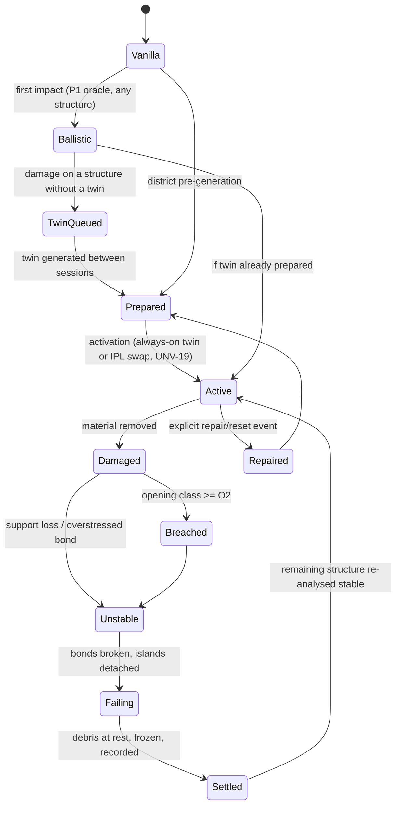
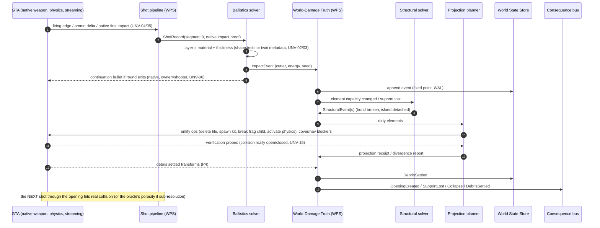

# ASTRA-001 · 03 — Ballistics ↔ geometry ↔ structure ↔ persistence contract

> **Status:** proposed contract for the recommended architecture (doc 02 C6). Nothing here is implemented. Every engine capability the contract relies on is tagged **UNV-nn** (unverified) and mapped to an experiment in §9 and doc 04. Evidence labels/sources: doc 01.

## 1. Authority and scope (proposed decisions)

The destruction stack is a new subsystem, called **WPS (World Physical State)** below. It is independent of Essential and of the promoted-character stack, so it fits the standalone direction as well as today's Essential deployment.

| Proposed ID | Decision | Relation to existing decisions |
|---|---|---|
| **P-D1** | WPS is the sole owner of *destruction-related world mutation*: creating/deleting/breaking projection entities it spawned, switching twin IPL/entity-set states, and nav/cover blockers it created. It never tasks, warps or damages peds directly. | **Requires an explicit architecture review of D-001 (LOCKED)**, because `CURRENT.md:7,13` assigns all "GTA physical execution" to Essential and Essential has no destruction seams. Proposed resolution: read D-001 as governing NPC task/session/playback lifecycles (WPS creates none of those), or host WPS in the standalone native core. Until the owner decides, WPS exists only as the isolated lab plugin of doc 04. |
| **P-D2** | WPS persists world damage in its own timeline-scoped **World State Store**. | D-003 unchanged (P2 stays the only *character/profile* store); this is a new non-character store and needs an explicit decision entry, not a silent parallel store. |
| **P-D3** | Every injury caused by a penetrating round is produced by a **native bullet** (the original shot or a re-emitted continuation owned by the shooter). WPS never writes ped health. | Keeps DamageTracker/native damage as the injury truth that PR #35 already relies on. |
| **P-D4** | WPS publishes **world facts** only. Whether any NPC knows about a hole or collapse is decided by PS2/PS4 later. | D-004 (LOCKED). Reuse PR #35's `world_impact` evidence seam instead of a new perception path. |
| **P-D5** | Twins and extracted collision are generated **locally** from the owner's installation and never redistributed. | Rockstar Mod Guidelines / copyright (doc 01 §3.10). |
| **P-D6** | Projection is derived from state, never the reverse — except *settled debris transforms*, which are recorded as state events. | Makes projection idempotent and crash-safe. |

## 2. Identity, scope and versioning

```text
WorldScope  { worldProfileId: uuid, timelineId: uuid,            // TimelineGuard (lsa-shared-brain/.../timelineGuard.mjs:1-27)
              gameBuild: "1.0.1158.16", rulesetVersion: semver,
              twinSetVersion: semver }
RunScope    { hostRunId: uuid, worldEpoch: uint }                // C-13 (system-contract-register.md:283-290)
StructureId = H(sourceFingerprint, ymapNameHash, entityGuid, placementHash)    // entity-based structures
            | H(ybnNameHash, polygonSetHash)                                   // static-only geometry (no entity)
ElementId   = (StructureId, elementIndex)    // wall panel / slab / column / beam / bond-graph chunk
sourceFingerprint = SHA-256 over every source file used to build the twin (ybn/ymap/ydr/ytyp + overlay order)
```

- Run-local handles (ped/vehicle/object handles, RPH wrappers) are **never persisted**; persisted records refer to `StructureId/ElementId` only (same principle as D-002 for characters).
- A structure whose `sourceFingerprint` no longer matches the installed files is **quarantined**: its damage stays stored but is not projected (UNV-31).

## 3. Physical-truth lifecycle



## 4. End-to-end data flow and ownership



**Ownership per step:** GTA owns native truth of *where the first round hit* and *who got hurt*; WPS owns *what material was removed, what stands, what fell and what persists*; the projection planner owns *how that truth is shown*; PS2/PS4 own *who knows*.

## 5. Subsystem contracts

### 5A. Projectile semantics

```text
ShotRecord {
  shotId, run: RunScope, scope: WorldScope, gameTimeMs (scaled), frame,
  shooter: { captureRef?: uuid /* C-02 anchor */, kind: player | ped | unknown },
  weapon:  { hash, fireType /* INSTANT_HIT | DELAYED_HIT | PROJECTILE … (S-09) */, damageType, ammoClass, bulletsInBatch },
  evidence: [ { kind: 'firing_edge', source: 'IS_PED_SHOOTING' },                 // existing sensor, SensorAdapters.cs:141-150
              { kind: 'ammo_delta', rounds },                                      // UNV-05
              { kind: 'native_first_impact', coord, source, frame } ],             // UNV-04
  muzzleEstimate: { coord, method },                                               // UNV-07 (bone/weapon offset)
  segments: Segment[], outcome: stopped | exited | ricochet | unresolved }

Segment {
  index, start, dir, vIn_mps, massKg, diameterM, yawState?,
  hit: { coord, normal, materialHash /* UNV-02 */, materialId?, elementId?, provenance: native | oracle },
  layer: { thicknessM, method: reverse_probe | twin_metadata | shadow_mesh, confidence },
  model: { id: 'poncelet_v1' | 'plugging_v1', paramsRef }, vOut_mps, energyDepositedJ,
  continuation?: { startOffsetM, damage, speed, ignoreEntity?, provenance: 'reemitted' } }
```

Rules:

1. **No impact from aim alone.** Segment 0's hit must carry native proof (first-impact coordinate within the shot's frame window, or a native damage event). A camera/aim raycast is at most a *hint* for where to search (PR #35 doctrine, `contextual-ballistics-perception-r0.md:47`). Bullet bending (S-09) makes aim rays wrong by design.
2. **Exit and continuation.** Thickness comes from (a) twin metadata for prepared structures, else (b) reverse shape tests from beyond the expected exit back toward the entry (UNV-03: back-face behaviour), else (c) material default thickness with `confidence: low`. If the model yields `vOut > 0`, WPS re-emits **one native bullet** starting `startOffsetM` (≥ 2 cm, tuned in E1) beyond the exit surface, along the entry direction perturbed by a seeded deflection, with damage scaled by residual energy and `ownerPed = shooter` (UNV-06).
3. **Energy model** (doc 01 X-1): Poncelet `F = A(σ + βρv²)` for brittle/granular layers, plugging energy `E = k·σu·A·t` for ductile plates, angle via path length `t/cos θ` plus a ricochet test above a material-specific critical angle (UNV-30 calibration). Calibrate per *condition* (range/yaw), not globally (X-1 showed same-range calibration is required).
4. **Prior damage** reduces effective thickness: `t_eff = remaining thickness along the ray` from WDT (5B). Sub-resolution holes (smaller than projected collision) are handled *only* here (porosity), never by native collision.
5. **Shotguns/automatic fire:** per-pellet truth needs per-pellet impacts; if natives expose only the last impact per frame (UNV-04), pellets beyond the first are modelled as a seeded spread around the proven impact and marked `provenance: oracle` (allowed for *geometry damage*, never for *injury* claims).
6. **NPC shooters** use the same pipeline when their impacts are observable (UNV-08); otherwise their rounds are not penetrated (fail closed, never invented).
7. **Explosions** are a separate source: `BlastRecord {center, explosionType, tntEquivalentG (designer table), owner?, proof: native_explosion | mod_charge}` (UNV-10: native explosion detection by `IS_EXPLOSION_IN_SPHERE`/owner natives).
8. **Interaction with PR #35:** WPS emits `world_impact` receipts `{shotId, elementId, surfaceClass, proof:'native_impact'|'oracle'}`; PS2 may join them to *visible* witnesses later. Through-wall injuries keep `proof: native_damage_callback` (from the continuation bullet) **plus** a provenance link to the ShotRecord, so "shot through the wall" is a world fact, not an inference.

### 5B. Geometry semantics

**Representations (state, not render):**

| Element kind | Truth representation | Resolution | Encoding |
|---|---|---|---|
| Planar (walls, slabs, panels) | 2.5D remaining-thickness field over element-local (u,v) | 1–2 cm fine | sparse 32×32 tiles, `int16` in 0.1 mm (fixed point) |
| Volumetric (columns, beams, blocks) | sparse occupancy/health voxels | 2–5 cm | `uint8` material + `uint8` health per voxel |
| Bond-graph chunks | per-bond remaining interface area & health | per bond | `int32` fixed point |

**Cutters** (all seeded from quantised inputs → deterministic, X-5): `crater` (wide, shallow cone bite: volume = η·E·ε_ammo with an aspect ratio per material; X-1b falsified hemispherical craters and shows energy-only scaling needs a per-ammunition erosivity factor ε_ammo), `spall` (exit-side cone for brittle materials), `throughHole` (column reaches zero), `blastDisk` (radius from scaled distance and charge, rim damage field), `pattern` (Voronoi/texture cutters à la R6S, S-21). Calibration anchors: FM 3-06.11 rounds-to-loophole and breach charges (doc 01 §7).

**Opening classes** (computed on the coarse grid, per element):

| Class | Meaning | Default threshold (to be measured in E2) |
|---|---|---|
| O1 shot hole | a round can pass without touching material | clear aperture ≥ 1 projected cell (5–25 cm); smaller = oracle porosity |
| O2 loophole | aim and fire through | ≥ 20 cm (FM "at least 8 inches") |
| O3 squeeze | player can pass crouched/stealth | ≥ 0.76 m × 1.27 m (FM troop breach 30 × 50 in) — *GTA capsule may need more* |
| O4 walk | upright traversal | ≥ player capsule + margin (UNV-16) |
| O5 vehicle | car passage | ≥ 2.5 m × 2.2 m |

**Projection invariants** (checked by verification probes, doc 04):

- **INV-G1 no phantom solid:** any coarse cell open in WDT has no collidable geometry in GTA after ≤ 1 projection cycle (target ≤ 100 ms game time).
- **INV-G2 no phantom hole:** GTA collision is never open where WDT is solid (projection errs toward solid).
- **INV-G3 first-hit agreement:** for a ray, the oracle's first element must equal the native first impact; disagreements are logged and native wins for segment 0.
- **INV-G4 monotonic material:** material only decreases, except by explicit `Repair/Reset` events.
- **INV-G5 budgeted projection:** if budgets are exceeded, degrade P2→P1 for the *least relevant* structures, never drop truth.

**Meshing:** no runtime mesh generation (H3). Openings are shown with pre-sliced vanilla panels (L1/L2), fragment children (L3) and tile-kit pieces (N-a), selected by the projection planner.

### 5C. Structural semantics

```text
Skeleton { nodes: [{elementId, massKg, centroid, synthetic: bool}],
           bonds: [{a, b | ground, areaM2, normal, lengthM, material,
                    capTension, capCompression, capShear, capBending, baselineDemand}],
           loads: { gravity, presetDeadKPa, presetLiveKPa }, provenance: inferred | authored }
```

- **Inference:** planar segmentation of the structure's collision into walls/slabs/columns; storey detection; materials from polygon material ids; thickness from paired faces; hollow shells get a labelled *synthetic* minimal structure (slab per storey, column grid). Synthetic parts are visible in debug views and in the dossier's claims — never presented as "real" structure (H8).
- **Weakening by damage:** bond capacity scales with remaining interface area from 5B: `cap = cap₀ · (A_remaining/A₀)^k`, `k ≥ 1` per mode.
- **Failure criterion:** `nominal` (engineering capacities, when known) or **baseline-relative** (default for inferred structures): a bond fails when `demand > baselineDemand · (1+α) + β·cap₀` (THE FINALS' "Impulse > Baseline + BreakOffset", S-20). Every converted structure is therefore stable at rest by construction (checked at activation).
- **Sudden support loss:** apply a dynamic increase factor (DIF, default 1.5–2.0) to loads in affected bays (UFC 4-023-03 alternate path, S-37). X-2 showed outcomes are sensitive to DIF — it is a tuning knob for "how brittle the world feels", logged per ruleset.
- **Solve:** sparse SPD system with low-rank up/downdates per event (X-2b: 3.8 ms–159 ms per support-loss event in the sandbox); iterate until no new failures or an iteration cap; run asynchronously, apply results in game-time order. CHOLMOD's update module is GPL (doc 01 §6) → re-implement or keep research-only.
- **Handoff to dynamics (P4):** detached islands become dynamic in RAGE (fragment child break or physics activation on props) with mass/inertia from the skeleton; large islands are kept as few big chunks; small debris becomes FX/rubble props (budget).
- **Settle:** a chunk with speed < ε for N frames (or after T_max) is frozen and recorded (`DebrisSettled`). Its resting contact is re-analysed as a new load on what it rests on (enables pancake/progressive collapse without scripting).
- **Causality guard:** every `StructuralEvent` cites the triggering impact/blast/support-loss event ids; spontaneous failures without a cause are a bug.

### 5D. Persistence semantics

```text
Event { seq: uint64 (per scope), eventId, scope: WorldScope, kind, elementId|structureId,
        payload (fixed-point ints only), cause: eventId[], rulesetVersion, crc32 }
Kinds: Impact | Blast | BondBroken | SupportLost | ElementFailed | DebrisSettled | Repair | Reset | Quarantine
Snapshot { structureId, scope, upToSeq, encodedState (zlib), stateHash }
```

- **Store:** new World State Store (P-D2); append-only event log with write-ahead durability + periodic per-structure snapshots, written with the proven exclusive-create/flush/backup/replace pattern (`docs/P1-session-identity-status.md:52`) or SQLite WAL (D-019 familiarity). X-5: 10k events replay in 0.5 s; snapshots load in ms.
- **Exactness:** state math in fixed point (X-5: float replay order changes results; fixed point does not).
- **Timeline isolation:** writes only when `TimelineGuard.writable`; on `clock_regression`/`timeline_change` (C-13) writes are suspended and the player confirms the timeline (the approved memory decision #5, `docs/plans/promoted-npc-memory/approved-decisions.md:13`, reused for world damage). Each timeline has its own event stream; branching copies the last snapshot, never merges futures.
- **Restore:** when a structure activates or streams in, load snapshot → replay tail → reproject. Debris is restored from `DebrisSettled` records (state, not re-simulation).
- **Crash recovery:** on start, verify the log tail CRCs; truncate a torn final record; projection is rebuilt from state (P-D6).
- **Reset/repair:** explicit player commands produce `Repair/Reset` events (history kept, tombstoned). A full purge is a separate, explicit administrative action.
- **Migrations:** events store raw cutter parameters in element-local coordinates, not meshes, so a regenerated twin can replay them. If an element no longer exists in the new twin, its events are quarantined, not silently dropped.

### 5E. Combat-experience coupling (Max Payne layer)

- **Time:** all WPS timers and solver application use *scaled game time* (`SET_TIME_SCALE`, RPH `Game.TimeScale`/`Game.GameTime`); verify that RAGE debris and re-emitted bullets follow the time scale (UNV-25).
- **Shoot-dodge / dives** are player-movement features that never block destruction; bullets fired mid-dive enter the same ShotLedger.
- **Hit reactions/ragdolls** stay native (Euphoria via NM messages, optional ERO-style tuning); through-wall hits arrive as native hits from continuation bullets, so reactions need no special casing.
- **Cover truth:** WPS answers `coverIntegrity(fromPos, toPos)` (remaining material along the line) for UI and future AI; NPC use is out of scope (vision Q7).

## 6. Projection contract (state → GTA)

| Tier | What GTA shows | Operations (natives named in the gen9 DB; parameters beyond the DB are UNKNOWN) | Budget unit |
|---|---|---|---|
| P0 cosmetic | decals, particle FX | `ADD_DECAL`, `REMOVE_DECALS_IN_RANGE` | decals/area |
| P1 ballistic | nothing new; continuation bullets | `START_EXPENSIVE_SYNCHRONOUS_SHAPE_TEST_LOS_PROBE`, `GET_SHAPE_TEST_RESULT_INCLUDING_MATERIAL`, `SHOOT_SINGLE_BULLET_BETWEEN_COORDS_IGNORE_ENTITY_NEW` | probes/shot |
| P2 collision | twin slices/panels/kit pieces/fragments | `REQUEST_MODEL`, `CREATE_OBJECT_NO_OFFSET`, `DELETE_OBJECT`, `FREEZE_ENTITY_POSITION`, `BREAK_OBJECT_FRAGMENT_CHILD`, `REQUEST_IPL`/`REMOVE_IPL`/`IPL_GROUP_SWAP_START`…`IPL_GROUP_SWAP_FINISH`, `ADD_COVER_BLOCKING_AREA`, `ADD_NAVMESH_BLOCKING_OBJECT` | entities, model memory |
| P3 structural | (no direct visuals) | solver only | ms/event |
| P4 dynamic debris | moving chunks | `ACTIVATE_PHYSICS`, `SET_ENTITY_DYNAMIC`, `APPLY_FORCE_TO_ENTITY`, freeze on settle | active bodies |

- **Budget manager:** per-frame caps on creations/deletions/model requests; priority = gameplay relevance (line of fire, player proximity, visibility) → distance; degrade P2→P1 with a logged reason when over budget (INV-G5).
- **Verification:** after each projection batch, a small probe set (rays through new openings, rays into retained solid) checks INV-G1/G2; failures raise `ProjectionDivergence` and retry once before degrading.

## 7. Consequence bus (world facts, versioned)

| Event | Payload (summary) | Consumers |
|---|---|---|
| `ImpactResolved` | shotId, elementId, entry/exit, material, outcome | VFX/audio, PS2 `world_impact` adapter (later) |
| `MaterialRemoved` | elementId, cells, volume | projection planner, structural solver |
| `OpeningCreated` | elementId, class O1–O5, aperture | projection, cover/nav repair, PS2 (later) |
| `SupportLost` / `ElementFailed` | ids, cause | structural solver, VFX/audio |
| `Collapse` | structureId, island ids, mass | debris handoff, audio, camera shake |
| `DebrisSettled` | chunkId, transform | store, cover/nav repair |
| `ProjectionDivergence` | invariant, probe data | diagnostics, degrade logic |

None of these grants NPC knowledge (D-004); ACT/Director can query WPS before using an object that might be destroyed.

## 8. Failure and rollback handling

| Stage | Failure | Detection | Response | Persistent effect |
|---|---|---|---|---|
| Shot capture | no native impact for a firing edge | missing evidence within window | no penetration for that round (fail closed) | none |
| Ballistics | thickness unknown | probes fail / no exit | default thickness, `confidence: low`, no continuation if unsure | Impact still recorded |
| Continuation | double hit / wrong owner | DamageTracker callback mismatch | disable continuation for that weapon class until fixed | flagged in log |
| WDT append | disk error / timeline not writable | store result | keep in RAM, show "damage not saved", retry; never project unsaved damage as persistent | none until committed |
| Structural solve | non-convergence / singular | solver status | cap iterations; mark structure `Unstable(pending)`; no collapse without a converged cause | event-free |
| Projection | entity creation fails / pool full | native returns / counts | degrade tier, retry later | none |
| Verification | phantom solid/hole | probes | retry; then degrade and report | divergence logged |
| Debris | chunk lost/fell through world | position checks | despawn, record as rubble at last good position | `DebrisSettled(lost)` |
| Restore | fingerprint mismatch | manifest check | quarantine structure | `Quarantine` event |
| Crash | torn log tail | CRC | truncate last record, rebuild projection | consistent prefix |

## 9. Unverified-capability register

| ID | Capability the contract assumes | Experiment |
|---|---|---|
| UNV-01 | RPH plugin built against the *official* SDK can call every native listed in §6 on 1.0.1158.16 | E0.0 |
| UNV-02 | `GET_SHAPE_TEST_RESULT_INCLUDING_MATERIAL` returns a stable material hash per polygon material | E0.2 |
| UNV-03 | Reverse probes find exit faces (back-face/inside-solid behaviour) | E0.3 |
| UNV-04 | `GET_PED_LAST_WEAPON_IMPACT_COORD` updates for every round at automatic rates | E0.4 |
| UNV-05 | Ammo-in-clip deltas count rounds per frame reliably | E0.4 |
| UNV-06 | Continuation bullets do native damage with shooter attribution and no self-hit/double-hit | E0.6, E1 |
| UNV-07 | Muzzle position can be estimated well enough for ray reconstruction | E0.4 |
| UNV-08 | NPC impacts are observable (same natives on NPC peds) | E0.4 |
| UNV-09 | `materials.dat` `ShootThru`/`PenetrationResistance` edits load via OpenRPF in Enhanced | E1 baseline |
| UNV-10 | Native explosions can be detected with position/type/owner | E0.10 |
| UNV-11 | Script-spawned collidable props block bullets/LOS/movement and stop doing so instantly when deleted | E0.5, E2a |
| UNV-12 | Custom gen9 props/fragments load from an OpenRPF overlay without crash; geometry-per-file limit | E2a |
| UNV-13 | `BREAK_OBJECT_FRAGMENT_CHILD` parameter semantics (child vs group index, flag) | E0.8 |
| UNV-14 | Fragment child break removes its collision immediately | E0.8 |
| UNV-15 | Verification probes see the same collision as bullets/peds | E0.5 |
| UNV-16 | Player capsule clearance for O4 | E2a |
| UNV-17 | Offline-edited static ybn (polygons excised) loads in Enhanced via OpenRPF; no invisible walls remain | E2b |
| UNV-18 | Vanilla building drawable can be replaced by an overlay ymap entity set (visual parity) | E2b |
| UNV-19 | IPL swap of a mod-authored state pair swaps collision, within bounded time, without leaks | E7a |
| UNV-20 | Entity-hosted collision streams at long range (sniping distant twins) | E7a |
| UNV-21 | Usable object/physics-instance budget for mod entities (vanilla Enhanced pools) | E0.9 |
| UNV-22 | RAGE handles N active debris bodies at acceptable frame time | E4 |
| UNV-23 | `ADD_COVER_BLOCKING_AREA(blockMap)` removes stale map cover | E6 |
| UNV-24 | Navmesh blockers/latent navmesh can make NPCs avoid/use openings | E7 (optional) |
| UNV-25 | Time scale applies to RAGE debris and re-emitted bullets consistently | E6 |
| UNV-26 | Interior portals can be pre-placed so breaches show interiors | E7a |
| UNV-27 | Frame-time cost of synchronous probes per shot | E1 |
| UNV-28 | Structural solve latency on the owner's PC within the "feel" budget (≤ 250 ms to first failure) | E4 |
| UNV-29 | Debris settle/freeze/restore produces identical piles after restart | E5 |
| UNV-30 | Ricochet/angle model calibration on GTA geometry | E1 |
| UNV-31 | Fingerprint/quarantine detects game or map-mod changes | E5 |
| UNV-32 | Twin generation throughput and storage per building | E7d |
