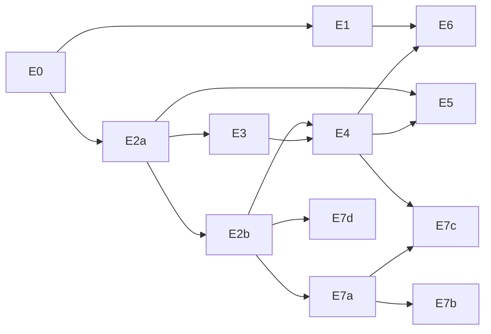

# ASTRA-001 · 04 — Falsifiable experiment ladder

> **None of these experiments has been run in GTA.** They are designed to be small, isolated, offline story-mode probes on the owner's GTA V Enhanced 1.0.1158.16 + RPH 1.132 setup. Thresholds are proposals to argue with, not targets already met. Contract IDs (UNV-nn, INV-Gn, O1–O5) come from doc 03.

## 0. Protocol rules (apply to every experiment)

1. **Offline story mode only.** Never GTA Online, never FiveM. Launch exactly as today's LSA test setup (RPH 1.132). No anti-cheat interaction of any kind.
2. **Separate lab plugin** (`LSA.WPS.Lab`, RPH, .NET 4.8.1): no Essential, no promoted-character code, no LSA config changes. It only acts on entities it spawns itself. Where an experiment needs moving NPC shooters, use lab-spawned peds in a session where LSA/Essential is not managing them — or ask the owner to waive D-001 for that lab session explicitly.
3. **Build hygiene:** compile against the *official* RPH SDK and run the existing member-import audit from the RPH 1.132 investigation; a "native missing" result from a fake-SDK build is void (doc 01 §2.6).
4. **Asset hygiene:** all asset changes live in an OpenRPF `mods` overlay (doc 01 §3.1), never in base RPFs; keep a hash manifest of every overlay file; one switch removes the overlay. Gen9 conversion via CodeWalker; record the CodeWalker version.
5. **Minimal instrumentation (no big harness):** one log prefix `[WPS-LAB]` with one JSON object per line: `{exp, run, build, rph, t_game_ms, t_real_ms, frame, kind, …}`; a per-run manifest (plugin DLL SHA-256, overlay hashes, game build, time scale); a frame-time sampler (p50/p95/p99/max over 60 s windows); and the **probe grid**: a regular grid of synchronous LOS probes across a test region used to measure *where collision really is*.
6. **Ground truth:** wall thickness/material/polygon sets are measured offline in CodeWalker from the same installed files and stored with the run.
7. **Every experiment ends with cleanup:** delete lab entities, remove blockers/cover areas, restore IPL states, unload the overlay if it was experiment-specific, verify with a probe grid that the world is vanilla again.
8. **Report** results as `works / partial / no / crash` per hypothesis, with logs — including the negative ones.

## E0 — Capability census (the first experiment to run; no custom assets)

**Purpose:** resolve the cheapest unknowns that decide between architectures before any asset work. One evening of testing.

| Probe | Question (UNV) | Method | Records | Decision it informs |
|---|---|---|---|---|
| E0.0 | Toolchain & build (UNV-01) | Log RPH version, game build, presence/versions of Script Hook V, SHVDNE, OpenRPF, CodeWalker; build lab plugin vs official SDK; run a no-op command. | versions, import audit | Whether a C++ ASI route is even available on 1158.16 (SHV lists 1158.13). |
| E0.1 | Natives callable | Call each native named in doc 03 §6 once in a safe context. | success/exception per native | Prune the contract. |
| E0.2 | Material hashes (UNV-02) | Probe ≥ 30 surfaces of known material (from CodeWalker) with `START_EXPENSIVE_SYNCHRONOUS_SHAPE_TEST_LOS_PROBE` + `GET_SHAPE_TEST_RESULT_INCLUDING_MATERIAL`; compare with `joaat(name)` and `joaat(name_index)` computed from the local `materials.dat`. | hash ↔ material table | Material-aware penetration feasibility. |
| E0.3 | Exit faces (UNV-03) | For 10 walls of known thickness: forward probe; reverse probe from beyond; probe starting inside solid; record hits/normals. | thickness error | Runtime thickness vs needing twin metadata. |
| E0.4 | Shot evidence (UNV-04/05/07/08) | Single, burst, full-auto, shotgun at a wall: each frame log `IS_PED_SHOOTING`, `GET_AMMO_IN_CLIP`, `GET_PED_LAST_WEAPON_IMPACT_COORD`; cross-check `HAS_BULLET_IMPACTED_IN_AREA`; repeat with a lab NPC shooter. | rounds vs impacts | Native-first-impact pipeline vs needing a bullet hook. |
| E0.5 | Prop collision authority (UNV-11/15) | Spawn a wall of vanilla collidable props; test native impacts, `HAS_ENTITY_CLEAR_LOS_TO_ENTITY(…,17)`, player movement; delete one prop; re-test at +1, +5, +30 frames. | collision removal latency | Whether entity projection is a sound P2 substrate. |
| E0.6 | Continuation bullets (UNV-06) | From behind a wall, `SHOOT_SINGLE_BULLET_BETWEEN_COORDS_IGNORE_ENTITY_NEW` at a lab ped with owner = player; vary start offset 0.5–10 cm; record damage, DamageTracker attacker, `World.PedShot`, self-hits, wanted level. | attribution, min. safe offset | P-D3 feasibility. |
| E0.7 | Model hide on map entities | `CREATE_MODEL_HIDE` on a map object and on a building archetype; probe visuals + collision. | hidden? collision gone? | Whether any vanilla structure can be hidden at runtime. |
| E0.8 | Fragment natives (UNV-13/14) | Spawn vanilla breakable fragment props; `BREAK_OBJECT_FRAGMENT_CHILD` over child indices; `GET_OBJECT_FRAGMENT_DAMAGE_HEALTH`; probe collision after each break. Low counts only (mass frag breaking is a known crash vector). | index semantics, collision change | Fragments as P2/L3 projection. |
| E0.9 | Budget census (UNV-21) | Spawn collidable props in batches 100/250/500/1000/2000 in an empty area; record failures, frame time, hitches; repeat with fragment props. | usable entity budget | Size of the projection window. |
| E0.10 | Explosion intake (UNV-10) | `ADD_EXPLOSION` of several types; poll `IS_EXPLOSION_IN_SPHERE`/`GET_OWNER_OF_EXPLOSION_IN_SPHERE`; player-thrown grenade. | detection latency/reliability | Blast source pipeline. |
| E0.11 | IPL collision swap (vanilla) | `REMOVE_IPL`/`REQUEST_IPL` of a vanilla state IPL known to change geometry; probe collision before/after; 20 cycles. | collision follows IPL? latency | Early read on UNV-19 before authoring twins. |
| E0.12 | Time scale (UNV-25) | `SET_TIME_SCALE(0.2…1.0)`; compare game vs real time; watch prop debris and re-emitted bullets. | scaling consistency | Bullet-time coupling. |

**Pass condition for E0:** every probe has a recorded verdict. E0 cannot "fail"; it routes the plan:
- E0.4 shows < 90 % round coverage at full auto → per-bullet capture becomes a research item (C5 narrow hook) and penetration ships first for semi-auto weapons.
- E0.5 shows deleted props keep collision > 100 ms → P2 must use fragment breaks instead of deletion, or C6 is in trouble.
- E0.9 usable budget < 300 entities → tile kits limited to set-pieces; fragments/merged slices become mandatory.
- E0.11 vanilla IPL swaps do change collision → strong prior for E7a.

## E1 — Material-aware penetration (Core 1)

| Item | Content |
|---|---|
| **Hypothesis** | With native first-impact proof + material + thickness + the Poncelet/plugging model, a target behind a wall is hit **iff** the model predicts an exit, across ≥ 5 materials, reproducibly; injuries arrive as native hits from continuation bullets. |
| **Strongest way it is false** | Native impact evidence is incomplete or late (cannot prove which round hit where), or continuation bullets misbehave (self-hit, double-hit, wrong attacker), making "only when physically possible" unenforceable. |
| **Dependencies / preparation** | E0.2–E0.6 positive. Test range with vanilla surfaces measured in CodeWalker: interior drywall, wooden fence, brick wall, concrete wall, steel container; optional mod props from E0.5. Lab target peds with health read-out. |
| **Entry points** | Shot pipeline per doc 03 §5A; natives `IS_PED_SHOOTING`, `GET_AMMO_IN_CLIP`, `GET_PED_LAST_WEAPON_IMPACT_COORD`, synchronous LOS probes with material, `SHOOT_SINGLE_BULLET_BETWEEN_COORDS_IGNORE_ENTITY_NEW` (parameters exactly as in the gen9 NativeDB; unknown `p`-parameters left default and logged). |
| **Arms** | A0 vanilla; A1 `materials.dat` ShootThru tuning (RBP-like baseline, S-15); A2 oracle + continuation. |
| **Measurements** | Per round: evidence completeness; thickness estimate vs CodeWalker truth; predicted outcome vs observed target hit; native damage; DamageTracker attacker; impact→continuation latency; probes per round; frame-time delta. |
| **Acceptance** | Evidence ≥ 98 % (single shots) and ≥ 90 % (full auto); thickness within ±2 cm or ±20 % on ≥ 90 % of closed-collision walls; prediction-observation agreement ≥ 95 %; **0 injuries** behind walls predicted to stop the round over 200 rounds; attribution correct on 100 % of continuation hits; physical anchors (doc 01 §7): rifle round passes ≥ 4 gypsum boards, stopped by ≥ 5 cm concrete at the calibrated setting; pistol stopped by brick veneer. Frame-time: report p95 delta at 10 rounds/s (no FPS floor; the owner decides). |
| **Negative controls** | Targets behind thick concrete; shots with no geometric path to the target; NPC shooters if E0.4 shows NPC impacts are not observable (must not penetrate: fail closed); glass (vanilla behaviour must be unchanged). |
| **Cleanup/fallback** | Kill switch disables continuation instantly; lab peds deleted; decals cleared. |
| **Rules out / points to** | Unattributable continuation → P-D3 impossible → only a bullet-processing hook (C5) can deliver Core 1 honestly. Missing evidence at auto rates → semi-auto first, hook research next. A1 ≈ A2 quality → data tuning suffices for a first fun slice (cheap win). |
| **Learned without full subsystem** | Entire Core 1 feasibility on unmodified Los Santos; no geometry, no persistence needed. |

## E2a — A real opening in a mod-built wall (Core 2, ordinary-modding edge)

| Item | Content |
|---|---|
| **Hypothesis** | A wall built from mod-owned collidable entities can be eroded by repeated fire so that, after a number of rounds consistent with the calibrated erosion law, a **real** opening exists: native bullets, LOS natives, probe grid and player movement pass through it, and nowhere else. |
| **Strongest way it is false** | Removed entities leave collision (phantom solid) or the removal latency is long; budgets too small; gen9 custom assets crash (≤128 geometries per file reported, S-06). |
| **Preparation** | Phase 1: vanilla collidable block props only (zero custom assets). Phase 2: one tile kit (concrete 20 cm; 25 cm and 10 cm resolution; panels + 6 marching-squares shapes, doc 02 N-a) as gen9 assets with embedded collision in the overlay. Phase 3: one fragment wall panel (≤ 100 children) for comparison. |
| **Entry points** | WDT thickness field + crater cutter (X-1b law), projection planner ops (delete/spawn/break), probe grid. |
| **Measurements** | Rounds to first perforation and to O2 loophole; aperture; probe-grid open/solid vs WDT mask (phantom-solid/phantom-hole rates); WDT-open → collision-open latency; LOS natives through the hole; player traversal by opening class; entity counts; frame time. |
| **Acceptance** | Physics-calibrated mode, 20 cm reinforced concrete, 5.56-class weapon: first perforation after **21–49 rounds** (FM 35 ± 40 %), never < 10 (no "two-shot holes"); a ≈7-in O2 loophole after **150–350 rounds** with FM's U-shaped burst pattern (FM ≈250 ± 40 %, reconstructed pairing, doc 01 §7); **0 phantom-hole cells**; ≤ 1 % phantom-solid cells 100 ms after projection; LOS natives agree with the probe grid in ≥ 99 % of 100 pairs; player passes an O4 opening 10/10 and fails at the next-smaller opening 10/10. |
| **Negative controls** | Intact wall blocks 200/200 rounds and all LOS pairs; a deleted entity outside the opening region must not open anything else. |
| **Cleanup/fallback** | Delete all kit entities; probe grid confirms vanilla state. |
| **Rules out / points to** | Phantom solids after deletion → entity projection unsound → use fragment children or C5. Budget per wall > 300 at 10 cm → 25 cm resolution + oracle porosity for finer holes. |
| **Learned without full subsystem** | That *mod-owned collision* can be mutated coherently in Enhanced — the foundation of C2/C6 — without touching vanilla assets. |

## E2b — The decisive one: excise and re-host one vanilla wall ("Excision Twin")

| Item | Content |
|---|---|
| **Hypothesis** | A wall section of an existing Los Santos building becomes genuinely destructible when (1) its polygons are excised from locally edited static collision files (all relevant layers), (2) its visual is replaced by a twin panel set cut from the vanilla drawable, and (3) the E2a kit projects damage — with **no vanilla collision remaining** where the twin is open and identical blocking where it is intact. |
| **Strongest way it is false** | Enhanced crashes on or ignores edited `ybn` (cache/overlay issues); collision exists in more places than the excised polygons (other layers, embedded drawable bounds, entity bounds) and survives as invisible walls; the vanilla drawable cannot be replaced/sliced without LOD/visual breakage. |
| **Preparation** | Choose a building with a simple single-material exterior wall that is **not** an MLO wall; record coordinates and file names; extract with CodeWalker; identify polygons per layer; generate edited `ybn` copies + replacement `ymap` entities + twin panels; keep an untouched control building nearby. |
| **Entry points** | OpenRPF overlay; lab plugin projection; probe grid with map + object flags and weapon-type flags. |
| **Measurements** | Probe grid (≥ 300 cells) with twin present/absent; bullets 200 rounds into intact twin; player and vehicle collision; NPC LOS pairs; LOD behaviour at 50/150/300/600 m (UNV-20); visual parity screenshots; stability over three 30-min sessions; load time. |
| **Acceptance** | **0 phantom-solid cells** with the twin removed; intact twin stops 200/200 rounds and blocks movement like the control; no crash in 3 sessions; load time within ±10 %; visual seams documented (no numeric pass/fail — the owner judges). |
| **Negative controls** | Control building unchanged; overlay disabled → vanilla behaviour restored exactly (probe grid hash equal to pre-test). |
| **Cleanup/fallback** | Remove overlay; verify control and test building with probe grid. |
| **Rules out / points to** | **If vanilla collision cannot be excised and re-hosted in Enhanced, C6 cannot make the existing map destructible**: vanilla stays at P1 (penetration only), destruction becomes mod-added structures (C2), and the only remaining route to vanilla holes is the C5 lab track. If it works, the central assumption of the recommended architecture is proven for one structure; everything after is scaling. |
| **Learned without full subsystem** | Whether "everything destructible" is an asset-conversion problem (tractable) or an engine-modification problem (much harder). |

## E3 — Explosive breach

| Item | Content |
|---|---|
| **Hypothesis** | A blast model (charge → scaled distance → cutter disk + damaged rim) yields openings whose size scales with charge, material and thickness, reproducing the FM anchors in physics-calibrated mode, with real collision change (E2 invariants). |
| **Strongest way it is false** | Explosion intake unreliable (E0.10); native explosion impulses fling projected pieces chaotically (two physics systems fighting); hole size insensitive to charge. |
| **Preparation** | E2a/E2b walls; mod-placed charges with designer TNT-equivalents; native explosion types mapped to TNT-equivalent. |
| **Measurements** | Hole area vs charge (5 charges × 2 materials × 2 thicknesses); debris count and maximum flight distance; frame spikes; detection latency. |
| **Acceptance** | Monotonic hole size vs charge (Spearman ρ ≥ 0.9); anchors within ×1.5 (≈5 lb TNT breaches 12 in unreinforced concrete; ≈10 lb C4 → O4 hole in masonry); fragmentation-grenade-class charge does **not** breach brick or cinder block (FM: its fragments "cannot penetrate … a cinder block, or a brick building"); no projected piece travels > 50 m; E2 collision invariants hold. |
| **Negative controls** | Charge below threshold leaves only cratering; explosion far from wall changes nothing. |
| **Rules out / points to** | Chaotic double physics → projected pieces must be frozen until WPS releases them (P4 handoff only). |

## E4 — Structural partial collapse

| Item | Content |
|---|---|
| **Hypothesis** | For (a) a mod-built two-storey frame and (b) a twin of a simple vanilla building with an inferred skeleton, destroying load-bearing elements makes *some* configurations bridge and *others* partially collapse, as predicted by the solver's load redistribution — never by a canned animation. |
| **Strongest way it is false** | Outcomes ignore which support was destroyed; solver latency breaks the feel; RAGE debris explodes/jitters; inferred structures fail at rest or never fail. |
| **Preparation** | 4–9-column test frames; six scenarios (corner, edge, two adjacent, interior column, slab section, interior with DIF 1.3 vs 2.0) predicted offline first with the X-2 solver. |
| **Measurements** | Outcome class per scenario; agreement with offline prediction; event→first-failure latency; collapse duration; active dynamic bodies; frame time; settle time; post-settle probe grid; repeatability (5 runs). |
| **Acceptance** | ≥ 3 distinct outcome classes across 6 scenarios; ≥ 5/6 match the offline prediction; 0 spontaneous failures at rest over 10 min; event→first failure ≤ 250 ms on the owner's PC (UNV-28, tunable); ≥ 99 % of debris settles within 10 s; identical failure sets across 5 repeats (debris poses may vary). |
| **Negative controls** | Non-structural damage (holes in an infill wall) never triggers collapse; removing then restoring (repair event) returns to stable. |
| **Rules out / points to** | RAGE debris unusable at the needed body counts → external debris solver (C4) for P4 with kinematic proxies; solver too slow → coarse-to-fine skeletons or offline precomputed influence matrices. |

## E5 — Persistence (unload/reload, restart, crash, timeline)

| Item | Content |
|---|---|
| **Hypothesis** | Holes, broken elements and settled debris are restored exactly after streaming away/back, plugin reload, full GTA restart and a killed process, and only within the confirmed timeline. |
| **Strongest way it is false** | Projection after restore differs from before; restore too slow; damage leaks into another save lineage; torn writes corrupt the store. |
| **Measurements** | WDT state hash before/after; probe-grid mask hash; debris pose error; restore time; replay time; storage size; behaviour on clock regression and timeline switch. |
| **Acceptance** | State hash equal 100 %; probe-grid mismatch 0 cells; debris pose error ≤ 1 cm; restore ≤ 2 s for 10 structures; kill-during-write leaves a consistent prefix; damage from timeline A is never projected in timeline B; fingerprint change → quarantine, not silent drop (UNV-31). |
| **Negative controls** | Fresh timeline shows vanilla world; repair event restores intact twin. |
| **Learned without full subsystem** | X-5 already shows the format is sound offline; E5 proves the *projection* is a pure function of state in GTA. |

## E6 — Max Payne-style gunfight inside damaged cover

| Item | Content |
|---|---|
| **Hypothesis** | A 5-minute firefight with bullet-time dives inside an E2/E4 structure stays coherent: no time-scale desync, through-wall hits arrive as native hit reactions, cover erodes, stale cover is suppressed. |
| **Strongest way it is false** | Time scale desynchronises WPS timers from RAGE (debris/continuations mistimed); AI uses destroyed cover or shoots through intact walls; ragdolls interpenetrate projected pieces. |
| **Preparation** | Existing shoot-dodge approach (time scale + dive) prototyped in the lab plugin (no Max Payne 3 assets: Rockstar guidelines forbid cross-title assets, S-12); hostiles per protocol rule 2. |
| **Measurements** | Desync counters; invalid injuries (through solid); through-wall hits matching predictions; stale-cover incidents with and without `ADD_COVER_BLOCKING_AREA`; frame time; owner's fun rating. |
| **Acceptance** | 0 desyncs; 0 invalid injuries; ≤ 1 stale-cover incident per 5 min with blocking enabled; owner rates it ≥ 4/5 for fun (the product goal is fun). |
| **Rules out / points to** | Desync → solver must run inside the game fiber on scaled time; AI incoherence → cover/nav repair becomes a prerequisite before NPC-heavy content. |

## E7 — Scaling ladder (each rung is separate evidence; none proves city scale alone)

| Rung | Hypothesis | Acceptance | Infeasibility signal (→ doc 05 thresholds) |
|---|---|---|---|
| **E7a** activation of a vanilla building twin via dual-state IPL swap (UNV-19/20/26) | Swapping intact-twin ↔ destructible-twin layers swaps collision within ≤ 1 s, 100 cycles without leaks/crashes; entity-hosted collision exists for long shots (≥ 300 m); latent portals show the interior through a breach. | 100/100 cycles clean; probe grid correct after each swap; a 300 m+ shot impacts the twin; interior visible through an O2+ opening. | Collision does not follow the IPL → always-on twins only (budget cost); no long-range collision → keep a coarse static proxy for distance. |
| **E7b** many structures | 10 → 50 activated buildings in one block with hierarchical demotion. | Entities scale with *damage* not building count (≤ 1.5× the X-3 per-wall budget per damaged wall); no hitch > 100 ms during demotion. | Entity/memory limit hit below 10 heavily damaged buildings in view. |
| **E7c** bridge | A twin of an existing bridge with an inferred skeleton (deck segments, piers, cables as tension bonds): losing a pier drops the right spans only; vehicles on a falling deck fall with it; state persists. | Outcome matches offline prediction; persistence passes E5 criteria. | Deck dynamics unstable in RAGE at the needed chunk sizes. |
| **E7d** conversion throughput | Twin generation for 20 buildings of different classes measures time, storage, manual-fix rate. | Median ≤ 10 min and ≤ 200 MB per building, ≤ 20 % needing manual fixes (proposed; owner may relax). | > 1 h or > 2 GB per typical building, or > 50 % manual fixes → district-scale only. |

## Dependency order

E1 and E2a can run in parallel after E0. **E2b is the decisive gate for the "existing Los Santos" part of the dream.**
