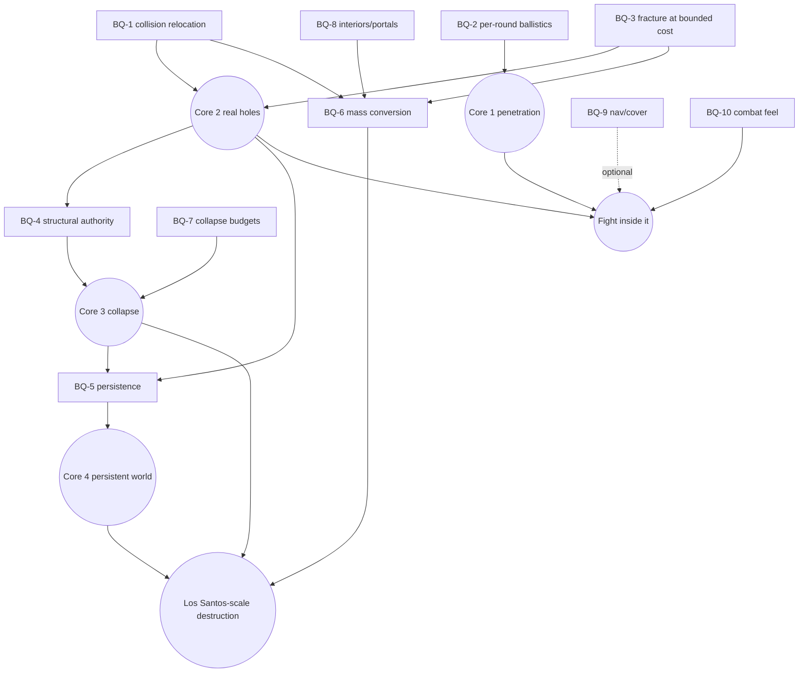

# ASTRA-001 · 05 — Breakthrough questions and roadmap

> Priority-ordered moonshots for the recommended architecture (doc 02 C6), each with a precise formulation, best evidence, the constraint that makes it look impossible, the proposed breakthrough, the test, and what failure would mean. Evidence labels/sources: doc 01. Experiments: doc 04.

## 1. Breakthrough questions (highest leverage first)

### BQ-1 — Mutable world collision without runtime mutation

- **Formulation:** Can the collision of an *existing* Los Santos structure be made fully mod-controlled in GTA V Enhanced — intact parts block exactly as before, removed parts block nothing — using only offline-prepared assets and public runtime levers?
- **Best evidence:** static collision is a separate, spatially streamed bounds store (CodeWalker, S-04); runtime (un)registration of collision is crash-prone even with FiveM hooks (S-13); the `ybn` format appears unchanged between Legacy and Enhanced (CodeWalker converter has no YBN path, S-04) and Enhanced has a mods overlay (OpenRPF, S-03); RAGE already removes collision when fragment children break (S-04 Frag.cs, S-09 `FragImpulse`).
- **Seemingly impossible constraint:** H1 + H2 — the original collision is immutable at runtime and buildings are not script entities.
- **Proposed breakthrough:** *collision-authority relocation* — excise the structure's polygons from local copies of the static collision and re-host them on twin entities the mod owns (doc 02 C6, N-b); optionally activate twins at runtime through IPL state swaps.
- **Test:** E2b (decisive), then E7a (activation, long-range collision, portals).
- **If it fails:** vanilla structures stay at P1 (penetration only); destruction is limited to mod-added structures (C2); the only remaining route to holes in vanilla walls is the high-risk C5 lab track (in-memory bound surgery), to be opened explicitly by the owner.

### BQ-2 — Honest per-round ballistics through evolving geometry

- **Formulation:** Can every player round's real path be proven, penetrated with material/thickness/energy physics, and continued so that only physically possible hits occur — without engine hooks?
- **Best evidence:** natives for last impact, shape tests with material hash, and native bullet re-emission with owner attribution exist in the gen9 DB (S-08); most guns are `INSTANT_HIT` and aim bending exists (S-09), so only native impacts prove paths (PR #35 doctrine); offline penetration model reproduces 4/5 FM statements and the 5th with same-range calibration (X-1).
- **Constraint:** H6 — natives expose coarse shot data (firing edges, last impact).
- **Proposed breakthrough:** ShotLedger = native first impact + oracle + native continuation bullet (P-D3), plus *two-tier collision* (fine ballistic truth in WDT for sub-resolution porosity, coarse real collision for everything else).
- **Test:** E0.4, E0.6, E1.
- **If it fails:** penetration first ships for semi-automatic weapons; a narrowly scoped bullet-processing hook (C5) becomes a separate research item; never "invent" impacts from aim.

### BQ-3 — Physical fracture of vanilla structures with vanilla visuals at bounded cost

- **Formulation:** Can damaged areas of vanilla buildings show real, collidable holes that look like the original building, while entity and storage costs scale with *damage* rather than with city size?
- **Best evidence:** naive cell projection needs 480–12,000 entities per 10 m wall; a tile kit needs 6–16 (pristine) to 36–119 (heavily damaged) (X-3); pre-fracturing the city at 0.5 m is 0.9–24 TB (X-4); Enhanced reportedly crashes beyond 128 geometries per file (S-06); fragments hold ≤ 255 children per LOD (S-04).
- **Constraint:** H3 + H5 + H11.
- **Proposed breakthrough:** *pre-slice, demote, fracture only where damaged* — slicing the vanilla drawable into L1 groups and L2 panels preserves textures and costs roughly geometry-proportional storage (INFER, to measure); L3 fracture variants (fragments/kit pieces) are generated between sessions only for damaged panels; in-session first damage uses generic kit pieces until the next boot (N-a, N-b, N-d).
- **Test:** E2a, E2b, E7b, E7d.
- **If it fails:** damaged areas use generic-material kits (visible mismatch) or destruction is limited to curated districts with hand-authored fracture.

### BQ-4 — Structural solver ↔ GTA simulation authority, with structure that the data does not contain

- **Formulation:** Can collapse be causally driven by load redistribution in an inferred structure, with RAGE simulating what falls, without two physics engines fighting and without canned animations?
- **Best evidence:** THE FINALS ships structural analysis with a sparse direct Cholesky solver, force decomposition and a baseline+offset break rule (S-20); Blast offers a BSD stress solver over support graphs (S-28); UFC alternate-path analysis gives the sudden-loss model (S-37); offline, the same building bridges or collapses depending on which supports were removed and on stiffness/DIF (X-2), and support-loss events cost 3.8–159 ms via low-rank downdates (X-2b). Most GTA buildings are hollow shells (S-07).
- **Constraint:** H8 (no structure in data) + co-simulation instability.
- **Proposed breakthrough:** *baseline-relative inferred skeletons* (stable at rest by construction, labelled synthetic where invented) + *event-driven* static re-analysis + *handoff* of detached islands to RAGE dynamics + *settle-and-record* (outcomes persisted, not simulations) (N-c).
- **Test:** E4, E7c.
- **If it fails:** authored skeletons for chosen landmark structures; external debris dynamics (C4) if RAGE cannot handle the bodies; coarse-to-fine solving for towers/bridges.

### BQ-5 — Persisting arbitrary structural state across sessions, versions and save lineages

- **Formulation:** Can the exact damaged world (holes, failed elements, debris piles) be restored after streaming, restart and crash, scoped to the right save lineage, and survive game/mod updates honestly?
- **Best evidence:** no save hook exists (PROVEN, C-07); TimelineGuard is fail-closed (CODE); fixed-point event replay is order-independent and bit-exact, float is not; 10k events replay in 0.5 s (X-5); R6S's determinism contract (S-21).
- **Constraint:** H9 + H11.
- **Proposed breakthrough:** *outcome persistence*: fixed-point event sourcing + snapshots + settled-debris records + source-asset fingerprints with quarantine + per-timeline branches (doc 03 §5D).
- **Test:** E5.
- **If it fails:** snapshot-only persistence with coarser state; no cross-version migration.

### BQ-6 — Mass-scale world conversion

- **Formulation:** Can a local, bring-your-own-install pipeline convert districts — eventually most of Los Santos — into activatable twins with acceptable time, storage, failure rate and update resilience?
- **Best evidence:** CodeWalker can read/write the formats and even generates navmesh offline (S-04); FiveM's raised config hints at ~10⁴ static-bounds entries (S-13, not vanilla); storage envelopes depend strongly on representation (X-4); automatic structural segmentation quality is unknown.
- **Constraint:** H10 + H11 + H12 + segmentation quality.
- **Proposed breakthrough:** *just-in-time conversion between sessions* driven by where the player actually fights, plus district pre-generation; fingerprints make game updates trigger incremental reconversion instead of global breakage (N-d).
- **Test:** E7d, E7b.
- **If it fails:** curated district packs only (thresholds §3).

### BQ-7 — Projection budgets during large collapses

- **Formulation:** When a structure collapses into 10³–10⁴ pieces, can GTA show a convincing, physically consistent result within object/physics budgets?
- **Best evidence:** budgets unknown for vanilla Enhanced (E0.9); R6S used recycled instanced replacements with box collision and non-colliding fragments (S-21); THE FINALS needed a GPU transform pool (S-20).
- **Proposed breakthrough:** *aggregate-to-budget* (merge detached islands into few large rigid chunks, VFX for the small rest), progressive release across frames, freeze-on-settle into rubble prefabs.
- **Test:** E4, E7b. **If it fails:** external debris world with kinematic proxies (C4) for large events only.

### BQ-8 — Seeing into what you opened

- **Formulation:** Can a breach show a coherent interior (MLO portals) and can hollow shells present plausible insides?
- **Best evidence:** MLO visibility goes through portals; portal-less openings show "the void" (S-38).
- **Proposed breakthrough:** latent portals at breachable walls and labelled synthetic interior slabs/columns in twins (N-g).
- **Test:** E7a. **If it fails:** breaches into MLOs restricted to existing portal walls; hollow shells get opaque interior liners.

### BQ-9 — AI navigation and cover coherence

- **Formulation:** Can NPCs avoid destroyed cover and (optionally) use new openings?
- **Best evidence:** only blockers/disable areas exist at runtime; cover blocking areas and scripted cover points exist (S-08); CodeWalker can generate navmesh offline (S-04).
- **Proposed breakthrough:** latent navmesh links baked into twins and blocked while intact; cover blocking/adding driven by `OpeningCreated`/`DebrisSettled`.
- **Test:** E6, E7 (optional; NPC physics reasoning is out of scope per the vision).

### BQ-10 — Combat feel under time scaling

- **Formulation:** Do bullet time, dives and Euphoria reactions stay consistent with destruction?
- **Evidence:** `SET_TIME_SCALE`, NM messages, RPH Euphoria classes (S-08, S-10); ShootDodge existed on Legacy (S-17).
- **Proposed approach:** scaled game time everywhere; WPS on the game fiber; no special casing because injuries remain native.
- **Test:** E6. Mostly engineering, not a moonshot.

## 2. Dependency graph

## 3. Explicit infeasibility thresholds (decide early, decide honestly)

| ID | Measured in | Threshold | Consequence |
|---|---|---|---|
| T-1 | E2b | Vanilla collision cannot be excised and re-hosted on 3 different buildings (crash, or ≥ 1 % phantom-solid cells after complete excision) | "Existing map destructible via assets" is infeasible → vanilla = P1 only; C5 lab track or stop. |
| T-2 | E0.9/E2a | Usable mod-entity budget < 300 | P2 limited to a few damaged walls in view → city-scale holes need runtime asset registration (C5). |
| T-3 | E0.4/E1 | < 70 % round coverage at full auto even with ammo-delta inference | Honest per-round penetration for automatic weapons needs a bullet hook. |
| T-4 | E7d | > 1 h or > 2 GB per typical building, or > 50 % needing manual fixes | City conversion infeasible; district packs only. |
| T-5 | E4 | Event→first failure > 1 s for a mid-rise skeleton on the owner's PC after low-rank optimisation | Realistic collapse feel infeasible at that scale; coarse skeletons. |
| T-6 | E4/E7b | RAGE sustains < 100 simultaneously active debris bodies at the owner's acceptable frame rate | Aggregate debris or external debris world (C4) for big collapses. |
| T-7 | E7a | IPL swaps do not carry collision reliably | Always-on twins only → density limited by budgets. |
| T-8 | E5 | Any persistent restore mismatch after fixes | Persistence model unsound → stop scaling until fixed. |
| T-9 | policy | Rockstar policy forbids local asset conversion or SP memory modding | Stop the affected track. |

## 4. Roadmap (gated, each phase delivers something fun)

| Phase | Content | Gate to pass | Fun slice the player gets |
|---|---|---|---|
| **R0** (done) | This dossier: audit, architectures, contract, ladder. | — | — |
| **R1** | E0 census; E1 penetration on vanilla Los Santos (C1/P1); debug overlay for shot paths. | E1 acceptance | Shooting through drywall, wood, thin metal and car-like sheet *only* when physically plausible, everywhere in the city. |
| **R2** | E2a mod-built walls with tile kit; minimal WDT + persistence (E5 subset). | E2a acceptance | Carving firing ports and passages through test walls that stay carved. |
| **R3** | **E2b decisive excision twin**; E3 explosive breach. | E2b (T-1) | Breaching a real Los Santos wall with fire or explosives. |
| **R4** | E4 structural partial collapse; full E5; E6 gunfight. | E4, E5, E6 | A small vanilla building whose floor or corner genuinely fails after you destroy its supports — and is still broken tomorrow. |
| **R5** | E7a activation, E7b block-scale, E7c bridge, E7d generator v1. | T-2, T-4, T-6, T-7 | A destructible city block and one bridge. |
| **R6** | JIT/district conversion program, update resilience, budget tuning. | T-4 measured on ≥ 100 buildings | Progressive "everything destructible" for the places you actually fight in. |

**Scaling gap stated plainly:** passing R3 proves one structure; R5 proves a block; only R6 data (conversion throughput, budgets, update churn) can justify any claim about most of Los Santos. Bridges and towers additionally depend on coarse-to-fine structural solving (BQ-4).

## 5. What is impossible or blocked today (no dressing-up)

- Creating arbitrary new engine meshes/collision at runtime in single-player without engine hooks (H3). The plan routes around it; it does not solve it.
- Physically *true* collapse for buildings whose structure does not exist in the data (H8); only plausible, labelled synthesis is possible.
- Everything destructible *simultaneously* with vanilla visuals: storage (X-4) and projection budgets (X-3, E0.9) make this a progressive, activation-based program, not a switch.
- NPCs walking through new openings: no runtime navmesh creation; latent navmesh is research.
- Per-bullet engine events for every weapon: unknown without hooks (E0.4 decides).

## 6. Immediate next actions

1. Run **E0** (one session, lab plugin only, official SDK build).
2. In parallel, offline: pick the E2b building, extract its collision layers in CodeWalker, measure wall thicknesses, compute expected probe grids.
3. Run **E1** on vanilla surfaces; decide whether data tuning (A1) is already a fun first slice.
4. Run **E2a** phase 1 (vanilla props) → phase 2 (tile kit).
5. Run **E2b** — the go/no-go for the existing-map dream.
