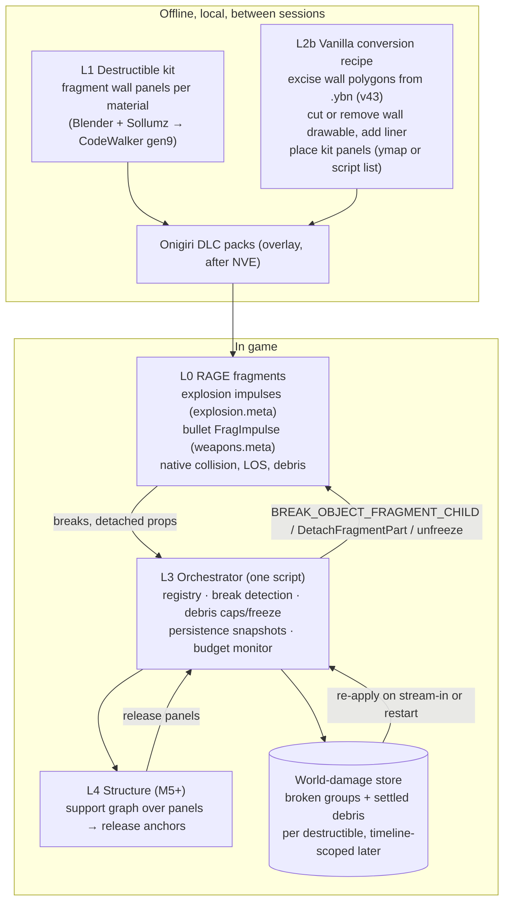
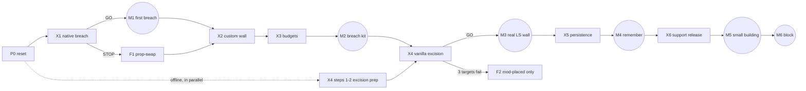

# ASTRA-001 · 06 — Explosion & Destruction Master Plan

**Date:** 2026-10-20 · **Status:** plan only. Nothing here is implemented or tested in GTA. · **Supersedes:** the experiment order in [04](04-falsifiable-experiment-ladder.md), the roadmap in [05 §4](05-breakthrough-questions-and-roadmap.md), and the GT0–GT5 ground-truth roadmap (`research/e0-material-geometry-ground-truth-20261019`). Docs [01](01-current-capability-and-engine-evidence.md)–[05](05-breakthrough-questions-and-roadmap.md) remain the evidence archive.

> **How this plan was produced.** Read-only work on 2026-10-20: the full ASTRA-001 dossier (EXECUTIVE-VERDICT, 01–05, offline probes), every E0 evidence branch and PRs #285/#286/#287, the private CityOfEchoes GT1–GT4 handoffs and findings (summarised here without private coordinates or asset data), a read-only inspection of the owner's installed GTA V Enhanced folder (logs, Onigiri overrides, DLC-pack tables of contents, SHVDN scripts, RPH plugin list), the gen9 NativeDB, the ScriptHookVDotNet Enhanced source, and web research into existing mods, FiveM resources and tool documentation. **GTA was not launched, no gameplay code changed, nothing was installed.**
>
> Evidence tags: **[LOCAL]** seen read-only on the owner's install today · **[REPO]** repository evidence · **[PRIMARY]** native DB, tool source or official tool docs · **[MOD]** community or mod-page claim · **[INFER]** inference · **[UNTESTED]** needs an experiment. "Enhanced-demonstrated" means it runs on GTA V Enhanced, preferably on this install; Legacy/FiveM claims are marked separately.

---

## 0. The answer on one page

**The shortest credible path to a genuine hole is GTA's own fragment system, not a new framework.** RAGE already has collision-correct runtime destruction: fragment objects (`.yft`) are built from breakable groups, each with its own collision, and explosion impulses and bullets break those groups off natively. Fences, phone boxes and glass break this way in vanilla gameplay. The ASTRA-001 dossier knew this (doc 01 §3.4), but treated fragments as one projection option next to custom tile kits and a script-side damage model: their first planned test (E0.8) script-breaks a single child, and a fragment panel appears only as a phase-3 comparison inside E2a. On top it designed a custom stack: tile kits, a fixed-point World-Damage Truth, latent twins, IPL dual-state swaps, a Cholesky structural solver. Since the dossier, ~208 commits over two days (84 on LSA E0 branches, 124 in CityOfEchoes) went into read-only census work: lab infrastructure, transport gating, material and thickness raycasts. **No world-mutation experiment has run yet** (CityOfEchoes `docs/GT4_FINDINGS_20261020.md`: "E2 (destructible geometry): not ready — no world-mutation experiment approved or run").

**Three facts about the owner's install change the plan** (all [LOCAL], read-only, 2026-10-20):

1. **ScriptHookV and ScriptHookVDotNet Enhanced already run in every session.** `ScriptHookV.log`: v3889.0, "INIT: Success". `ScriptHookVDotNet.log`: SHVDN Enhanced 3.9.0.6 loads 10 script mods, compiles single `.cs` files in-game and reloads with **Insert**. Its source exposes fragment helpers (`Entity.IsFragmentObject`, `FragmentGroupCount`, `DetachFragmentPart`, `Prop.HasBeenDetachedFromParentEntity`) and pool counters (`World.PropCount/PropCapacity`) [PRIMARY]. The dossier assumed the only route was RPH and that SHV support was unknown.
2. **The asset loader is Onigiri (NVE's), not OpenRPF**, and active packs on it already replace and add static collision. `NVE_3` overlays `sm_22_0/1/2.ybn` through standard `RPF_FILE` + `overlay` entries in `content.xml`; `NVE_roads` overrides `sc1_rd_17.ybn`; the `forest_n`/`forest_s` packs add 425 collision files. All of them are resource version 43, the Legacy YBN version. `NVE_props_replace` loads 101 custom gen9 `.yft` fragment props. So a DLC pack can replace vanilla collision and ship custom fragments on this exact install. OpenRPF is not installed and is not needed.
3. **The pool limits are known, not "~10³ unknown".** The installed `onigiri/common/data/gameconfig.xml` sets Object 2300, phInstGta 15030, FragmentStore 77700, StaticBounds 24500, PhysicsBounds 1450. `fragInstGta` is not overridden; a FiveM report shows "fragInstGta Pool Full, Size == 1600" as a crash point [MOD], so debris must be capped. How much headroom is left during real play is what X3 measures.

**Architecture in one line:** RAGE fragments do the breaking. A small orchestrator script registers destructibles, caps and freezes debris, records which groups broke, and re-applies them. Offline Onigiri overlay packs remove a vanilla wall's static collision and drawable and put fragment panels in its place. Structural collapse comes later, as a support graph that releases anchored panels so RAGE simulates the fall.

**First playable milestone (M1):** in free roam, a grenade or sticky bomb blows a hole in a wall. Probe rays and a player-sized capsule pass where they were blocked, `HAS_ENTITY_CLEAR_LOS_TO_ENTITY` flips to clear, a ped walks through, and nothing else opened. Decided by experiment **X1** (§6, Task 1), time-boxed to one day plus one session.

**Stop now:** GT0–GT5 material catalog, further shape-test option/thickness/inside-solid research, new per-question RPH plugins, OpenRPF overlays, and WDT/tile-kit/IPL-twin engineering before M3. Details in §2.5 and §7.

---

## 1. Existing-solution and reuse matrix

| # | Capability | Existing solution | Enhanced status (evidence) | Decision | Sources |
|---|---|---|---|---|---|
| R1 | Runtime destruction that removes collision | RAGE **fragments** (`.yft`): physics groups per bone, each with collision; per-group Strength, MinDamageForce, DamageHealth, weapon/vehicle scaling; broken groups separate as new physical objects | Fragments load and work in Enhanced: vanilla props, plus NVE's 101 gen9 `.yft` (resource v171) via Onigiri [LOCAL]. **An explosion opening a passable hole in a fragment wall is [UNTESTED]**; vanilla fence and phone-box breakage is everyday gameplay [INFER] | **REUSE + TEST (X1)** | Sollumz fragments and prop setup [N3]; dossier 01 §3.4 (CodeWalker `Frag.cs`) |
| R2 | Vanilla wall-like fragment to test with | `prop_ld_fragwall_01a` (base game, concrete, "Has Physic", "Embedded Collision", "Scriptable") | Listed in the base-game object DB [MOD]; whether it is a multi-group `.yft` is [UNTESTED]; not replaced by NVE [LOCAL] | **TEST (X1 census)** | [N11]; NVE `props_replace` table of contents [LOCAL] |
| R3 | Authoring breakable walls | Blender + Sollumz fragment setup (one bone per chunk, collision per bone, bone Strength; YTYP **Dynamic** flag required); Blender Cell Fracture or Blast authoring for chunking | Enhanced conversion via CodeWalker30_dev48+ Asset Converter (ydr/yft/ytd/ydd); "GTAV Enhanced has a limit of 128 materials/geometries" per file [PRIMARY tool docs]. CodeWalker dev48 is already on the owner's PC [REPO GT docs] | **REUSE** | [N3], [N4], [N15] |
| R4 | Explosion strength vs objects | `explosion.meta` `CExplosionTagData`: `forceFactor`, **`fragDamage`**, `endRadius`, `bDamageObjects`, `directedWidth` | Field set confirmed in public `explosion.meta` files [PRIMARY format; Legacy/FiveM]; an override path under Onigiri is [UNTESTED]; the owner currently overrides only `explosionfx.dat` (VFX) [LOCAL] | **REUSE (tuning lever)** | [N8] |
| R5 | Bullets chipping fragments | `weapons.meta` `FragImpulse` per weapon | Installed override `onigiri/common/data/ai/weapons.meta` has FragImpulse (pistol 250, melee 2250) [LOCAL]; provenance unknown | **REUSE (later tuning)** | [LOCAL]; dossier S-09 |
| R6 | Per-material shoot-through | `materials.dat` ShootThru edits (Realistic Bullet Penetration) | RBP claims Enhanced support [MOD]; an installed `materials.dat` override of unknown provenance exists [LOCAL] | **DEFER** (Core 1 track) | [N14]; dossier S-15 |
| R7 | Asset loading in Enhanced | **Onigiri** (`onigiri.asi` + `onigiri/` tree: `dlcpacks/`, `common/data/dlclist.xml`, `dlc_patch/`) | Active; `dlclist.xml` enables 12 NVE packs plus forest and vegetation packs; LA Roads and `vremastered` present but commented out [LOCAL] | **REUSE**; **do not add OpenRPF** | [N13]; [LOCAL] |
| R8 | Replacing vanilla static collision | DLC pack with an `RPF_FILE overlay` holding replacement `.ybn` files | **Enhanced-demonstrated on this install:** NVE_3 (`sm_22_0/1/2.ybn`) and NVE_roads (`sc1_rd_17.ybn`) override vanilla collision; forest_n/forest_s add 425 collision files; all v43 [LOCAL]. Removing part of a wall without leaving residual collision is [UNTESTED] | **REUSE + TEST (X4)** | [LOCAL]; FiveM collision docs [N5], [N6] |
| R9 | Removing or hiding buildings at runtime | `CREATE_MODEL_HIDE` / `CREATE_MODEL_SWAP` ("Only works with objects!") | Building collision is static; community consensus is "collisions for buildings are fixed in place as static bounds" | **INFEASIBLE at runtime** without deep hooks → offline overlay only | [N1] DB comments; [N7] |
| R10 | Lab runtime with fast iteration | **SHVDN Enhanced 3.9.0.6**: in-game `.cs` compile, Insert to reload, fragment helpers, `World.GetNearbyBuildings` (read-only), projectile enumeration, pool counters | Loads 10 script mods every session [LOCAL]; the specific fragment APIs are [UNTESTED] on this build | **REUSE for the lab** | [N2]; [LOCAL] |
| R11 | Existing RPH lab | WPS E0 lab (PR #285, shape-options branch): safe teleport and collision gate, JSONL evidence, E0.5 prop-deletion phantom-collision probe (implemented, never run) | E0.0–E0.3 GTA-verified; E0.4–E0.12 never run [REPO] | **REUSE selectively** (E0.5 for fallback F1; gating logic); **do not extend for M1** | [REPO] |
| R12 | Unattended in-game test control | CityOfEchoes GT4 file bridge (`requests/` → `responses/`, 2 s heartbeat with loaded-DLL SHA, `gt4_bridge.py`, scripted restart that verifies the loaded build) | Worked in GTA on 2026-10-20 [REPO private] | **REUSE protocol** (port to the SHVDN lab) | CityOfEchoes `docs/GT4_BRIDGE.md` |
| R13 | Native C++ route | ScriptHook V ASI | Initializes on the owner's game ("game version is VER_EN_1_0_1158_13") while RPH reports product version 1.0.1158.16 [LOCAL] | **HOLD** (only if explosion polling proves insufficient) | [LOCAL]; dossier S-01 |
| R14 | Explosion and break observation | `IS_EXPLOSION_IN_SPHERE` / `IS_EXPLOSION_IN_ANGLED_AREA` (−1 = any type, per DB comment on the angled form), `GET_OWNER_OF_EXPLOSION_IN_SPHERE`, `HAS_OBJECT_BEEN_BROKEN`, `GET_HAS_OBJECT_BEEN_COMPLETELY_DESTROYED`, `GET_IS_ENTITY_A_FRAG` | In the gen9 DB [PRIMARY]; latency and reliability [UNTESTED] (E0.10 only ever planned an inert, invisible explosion) | **TEST (X1)** | [N1] |
| R15 | Re-applying damage (persistence) | `BREAK_OBJECT_FRAGMENT_CHILD(Object, Any, BOOL)`, `FIX_OBJECT_FRAGMENT`, `SET_DISABLE_BREAKING`; SHVDN `DetachFragmentPart(groupIndex)` | Signatures are partly opaque (`Any` parameters) [PRIMARY]; semantics [UNTESTED] | **TEST (X5)** | [N1], [N2] |
| R16 | Prop-based "health then delete" destruction | FiveM base-building and raid resources: HP per material tier, server-checked explosion distance, cascade delete of attachments | FiveM/Legacy only, paid code [MOD] | **REUSE the pattern** for fallback F1; no code | [N9] |
| R17 | Pre-made "destroyed" scenes | Rockstar rayfire objects (`GET_RAYFIRE_MAP_OBJECT`, states 2/4/6/9); static destroyed-building ymaps on gta5-mods | Canned or static [MOD/PRIMARY] | **ABANDON** for the main path (reference for state swaps only) | [N12]; dossier S-16 |
| R18 | Fully destructible GTA buildings | — | None found (searched 2026-10-18 and 2026-10-20) | **BUILD** | searches in §10 |
| R19 | Structural and destruction design references | R6S RealBlast, THE FINALS (baseline+offset failure, incremental Cholesky), Teardown, NVIDIA Blast stress solver (BSD) | Reference only | **REUSE ideas at M5+** | dossier 01 §5–§6 |
| R20 | Navmesh and cover after damage | Navmesh blockers, `ADD_COVER_BLOCKING_AREA`; no runtime navmesh creation | [PRIMARY] | **ACCEPT the limitation** (NPC use of holes is out of scope per the vision) | [N1] |
| R21 | Shape-test knowledge | E0/GT results: option bit 2 hides see-through surfaces (option 0 recovers 30/30 materials in 3 sessions); forward rays never hit back faces; inside-solid rays return nothing; same-entity/material reverse pairs give thickness | [REPO] | **REUSE** as hole-verification probe settings (flags map+objects, options 0, reverse scans) | E0 correction FINDINGS; CityOfEchoes GT4 findings |

**Bottom line of the audit:** no one has built persistent, physically driven building destruction for GTA V, so BUILD is justified. But the destruction substrate (fragments), the asset path (Onigiri overlays), the authoring path (Sollumz + CodeWalker), the tuning levers (`explosion.meta`, `weapons.meta`) and a fast lab runtime (SHVDN) all exist and are mostly demonstrated on this install. What must be built is small: an orchestrator, persistence, a conversion recipe and, later, a structural layer.

---

## 2. ASTRA-001 research audit

### 2.1 What exists and what it settled

| Body of work | Settled | Not settled |
|---|---|---|
| Dossier (2026-10-18): 6 docs, 7 offline probes | Hard constraints H1–H12 are right: static map collision is immutable at runtime, buildings are not script entities, no runtime asset creation, hollow shells, portal-less voids, local-only conversion | Anything in GTA (no runs) |
| E0.0–E0.3 (LSA, 2026-10-19/20; several GTA runs) | Native calls work under RPH 1.132; material hash = `joaat(name + "_" + index)`; 28/30 → 30/30 with option 0; thickness 8/10 → 10/10 with pair search; inside-solid rays never hit; safe teleport and collision gate work | E0.4–E0.12: never run |
| CityOfEchoes GT1–GT4 (124 commits, 6 RPH plugins) | Same raycast questions from new angles: layer peeling, wall fans, option matrices, camera proxies, a file bridge, restart automation | Penetration, damage and destruction: explicitly "not ready" |

Net: two days answered "how precisely can raycasts describe existing collision?" Nobody asked "does a wall's collision change when it breaks?" — and the research workflow's own Phase-5 example is "destructible wall with updated collision" (`research-workflow.md` §5).

### 2.2 Corrected assumptions

| # | Assumption in the dossier or later plans | Evidence now | Correction |
|---|---|---|---|
| A1 | The only extension route is RPH; Script Hook V on 1.0.1158.16 is UNKNOWN; there is no C++ or ASI route (01 §2.1, §9 row 3) | `ScriptHookV.log` "INIT: Success"; SHVDN Enhanced 3.9.0.6 loads 10 script mods, including in-game-compiled `.cs`; ASI mods load [LOCAL] | SHV + SHVDN are available today. Use SHVDN for the lab. ASI hooks are possible if ever needed |
| A2 | Asset overlays go through the OpenRPF `mods` folder (04 rule 4; E2b) | No OpenRPF and no `mods` folder; Onigiri is the active loader [LOCAL] | Use Onigiri DLC packs on the NVE_3 pattern. Do not install a second loader |
| A3 | Whether Enhanced loads edited static collision is the decisive unknown (E2b, BQ-1) | Active packs on this install override 4 vanilla `.ybn` (NVE_3, NVE_roads) and add 425 more (forest_n/s), all v43 [LOCAL] | Loading mod-supplied collision is demonstrated at scale. The narrow remaining unknown: does **excising** a wall leave zero residual collision (other bound layers, embedded drawable bounds)? |
| A4 | Fragments are one projection option (E0.8 census, E2a phase-3 comparison); the P2 design centres on tile kits, cutters and the WDT (02 C6, N-a) | Fragments are the engine's own collision-correct destruction; SHVDN exposes group counts and detach | Fragments are the substrate. Tile kits and prop swaps become fallback F1 |
| A5 | Core 1 penetration comes first (R1 = E0 + E1); material ground truth gates destruction (GT roadmap end state) | The owner's first milestone is explosion → hole. Material identity has no role in whether a fragment breaks | Explosions and holes first. Penetration is a parallel, deferred track. The GT catalog is not a gate |
| A6 | Persistence needs a fixed-point, event-sourced WDT with cutters (03 §5D, X-5) | Fragment damage state is "which groups are broken" (≤255 bits per object) plus settled debris transforms | Outcome snapshots per object first. Adopt WDT/event-sourcing only if snapshots fail X5 |
| A7 | Object/physics budget ~10³, unknown (01 §3.8) | Installed gameconfig: Object 2300, phInstGta 15030, FragmentStore 77700; fragInstGta at engine default (a FiveM report crashes at 1600) [LOCAL/MOD] | Budgets are concrete. Debris caps and cleanup are mandatory design, measured in X3 |
| A8 | IPL dual-state twin activation is pivotal (E7a, T-7) | Not needed until district scale | Defer to after M5. Permanent overlay replacement first |
| A9 | Per-round capture (E0.4) and continuation bullets (E0.6) are early prerequisites | Bullets apply `FragImpulse` to fragments natively | Not needed for M1–M5. They belong to the penetration track |
| A10 | E0.8/E0.10 will settle fragments and explosions | E0.8 script-breaks one child and casts one ray; E0.10 emits an invisible, zero-damage explosion (`Probes.cs` `Fragments()`, `Explosions()`) [REPO] | Neither can show an explosion opening a hole. X1 replaces them |
| A11 | NVE might conflict through OpenRPF (02 §8.4) | NVE *is* the loader owner; NVE replaces 101 fragment props, 4 `.ybn` files, some downtown ymaps and hundreds of drawables; LA Roads is disabled and has no `.ybn` [LOCAL] | Pick targets outside NVE-touched files. Load our packs after NVE entries |
| A12 | Rigorous acceptance needs ≥300 probe cells, 200/200 rounds, three 30-minute sessions, screenshots, ≥2 sessions per sample | Over-specified for go/no-go decisions; it produced the GT0–GT5 catalog gates | Each experiment gets a small pre-registered decisive check (§5–§6); heavy criteria only at milestone acceptance |
| A13 | Each question deserves its own isolated RPH plugin with installer, CI, receipts and uploader | Six research plugins load in every GTA session (GT2, GT3, GT3.1 with damage capability, GT32, GT4, WPS lab) [LOCAL `RagePluginHook.log`] | One lab script. Retire or disable the GT plugins (owner approval). RPH SDK discipline stays for LSA production code only |

### 2.3 Overlooked capabilities

- SHVDN Enhanced fragment and pool APIs, including `Prop.ParentEntityDetachedFrom`, which identifies debris that came off our wall.
- `GET_IS_ENTITY_A_FRAG`, `HAS_OBJECT_BEEN_BROKEN`, `HAS_CLOSEST_OBJECT_OF_TYPE_BEEN_BROKEN`, `GET_HAS_OBJECT_BEEN_COMPLETELY_DESTROYED` [N1].
- `START_SHAPE_TEST_CAPSULE`, `START_SHAPE_TEST_BOX` and `START_SHAPE_TEST_SWEPT_SPHERE` give a direct "can a player-sized body pass" check, cheaper and more decisive than large probe grids [N1].
- `explosion.meta` `fragDamage`/`forceFactor` as data-driven explosive strength.
- NVE_3's overlay `content.xml`: a working template for our packs on this install.
- LSA perception already uses `HAS_ENTITY_CLEAR_LOS_TO_ENTITY(…, 17)` (map + objects). Real fragment holes therefore change NPC perception with no extra work (closes dossier gap G-7).

### 2.4 Duplicated work

- E0.2/E0.3 (public LSA) and GT2/GT3.x/GT4 (private) probe the same surfaces; GT4 re-ran the E0 option experiments.
- Six lab plugins, each with its own installer, backup scheme, CI workflow and receipt format, several with their own evidence uploaders.
- Two evidence stores (public LSA branches and private CityOfEchoes) for one research question.

### 2.5 Research that is no longer necessary (STOP)

- GT0–GT5 verified material catalog (CONFIRMED gates, screenshots, ≥2 sessions, source-identity chains).
- More shape-test option matrices, wall-thickness pair searches, inside-solid exit research. Answered well enough; CodeWalker gives exact geometry offline when needed.
- Transport and teleport-gate refinement. It works; reuse it as is.
- FM 3-06.11 erosion calibration, CHOLMOD scaling and city storage envelopes as gates. Keep them as tuning references for M5+.
- E0.7 (model hide on buildings; the DB already says objects only) and E0.12 (time scale) for now.

### 2.6 What the dossier got right (keep)

H1–H12; local-only conversion and no redistribution; mod-built walls before vanilla; vanilla excision as the decisive gate; hollow-shell and portal problems; outcome persistence ("persist outcomes, not simulations"); baseline-relative structural failure (THE FINALS) and R6S two-tier collision as later design references; honest scaling thresholds (T-4/T-5/T-6).

---

## 3. Critical technical blockers, ranked

| Rank | Blocker | Why it decides things | Evidence today | Decisive test (time box) | If it fails |
|---|---|---|---|---|---|
| **1** | Real explosions break fragment groups **and** the opening has no residual collision (rays, capsule, LOS, walking) | It chooses the destruction substrate for everything | Gameplay intuition (fences); none measured in Enhanced | **X1** (1 day + 1 session) | F1 prop-swap substrate (deletion; E0.5 measures latency) |
| **2** | Vanilla wall excision: overlay `.ybn` with polygons removed, plus drawable cut or removal, leaves **zero** residual collision and does not crash | It decides "ordinary Los Santos buildings" | Collision overlays demonstrated by NVE_3, NVE_roads and the forest packs [LOCAL]; partial removal untested | **X4** (3 days; up to 3 targets) | Vanilla stays non-destructible (T-1). Destruction on mod-placed structures only. C5 deep-engine track becomes an owner decision |
| **3** | A custom gen9 fragment wall (≤128 geometries, ≤255 groups) loads through Onigiri, with controllable chunk strength | Material fidelity and real-looking chunks | NVE loads 101 gen9 `.yft` [LOCAL]; tool docs [PRIMARY] | **X2** (2 days) | Build walls from vanilla fragment props (X1 winners) or F1 chunks |
| **4** | Debris budgets: fragInst/Object/collider pools and frame time under repeated blasts | Crash risk; scale per scene | Pool sizes known [LOCAL]; crash point reported [MOD] | **X3** (half a day, isolated session) | Coarser chunks, aggressive debris cleanup and freezing, raise pools in gameconfig as a last resort |
| **5** | Break state survives stream-out/in and restart (script-spawned and ymap-placed) | "Remember" (Core 4) | Re-break natives exist [PRIMARY]; semantics untested | **X5** (2 days) | Script-spawn all live destructibles inside a radius (script owns the lifecycle); keep vanilla static outside it |
| **6** | Hollow shells: a breach into a non-enterable building shows through-the-world voids | Building breaches look wrong | H8 (dossier) | Asset step in M5 (interior liner) | Restrict breaches to freestanding walls and buildings with liners |
| **7** | Structural release: support loss drops anchored panels plausibly, stays stable at rest, is fast enough | Core 3 | Offline solver probes only (X-2/X-2b) | **X6** (3–5 days) | Connectivity-only collapse (Teardown-style), or authored skeletons |
| 8 | Explosion observation for logging and structure | Needed only for bookkeeping, not for holes | Natives exist | Folded into X1 | SHV ASI hook (R13) |
| 9 | Mod conflicts (§4.4) | Avoidable | [LOCAL] | Preflight checklist | — |
| 10 | AI navigation and cover through holes | Out of scope per vision Q7 | — | — | Cover blocking areas later |

---

## 4. Recommended architecture and fallbacks

### 4.1 Principle

**RAGE is the only physics authority.** Breakage, debris dynamics, collision and LOS stay native. Our code orchestrates, persists, budgets and, later, decides structural support loss. There is no second physics world, no runtime collision surgery, and no canned animation.

### 4.2 Layers

### 4.3 Component decisions

| Concern | Design | Notes |
|---|---|---|
| **Explosion capture** | Not needed for holes: RAGE applies impulses itself. For bookkeeping: poll `IS_EXPLOSION_IN_SPHERE` near active destructibles (≤32 clusters), `GET_OWNER_OF_EXPLOSION_IN_SPHERE`, `HAS_OBJECT_BEEN_BROKEN`, SHVDN detach detection; SHVDN projectile enumeration to anticipate thrown and rocket hits | Persist **outcomes** (groups broken), not causes. SHV ASI hook only if polling misses explosions (X1 measures this) |
| **Material-dependent damage** | Data, not code: per-material kit presets (chunk size, mass density, group Strength, MinDamageForce, DamageHealth); per-explosive `forceFactor`/`fragDamage`; per-weapon `FragImpulse` | Tuning targets from dossier 01 §7 (FM 3-06.11), qualitatively: grenades breach wood or tin, not brick or block; demolition charges and RPGs breach masonry; rifle rounds chip but don't cut rebar |
| **Geometry removal** | Native group separation (L0). Vanilla walls: offline excision (L2b) | No runtime mesh or collision creation (H3 stands) |
| **Debris** | Broken groups are dynamic objects. Freeze after settle (speed < ε for N frames), cap live debris per scene, delete small or far debris first, record large settled pieces | Protects fragInst/Object pools (X3 sets the caps) |
| **Collision changes** | Native. The lab verifies with ray grid + capsule + `HAS_ENTITY_CLEAR_LOS_TO_ENTITY` + traversal | No phantom-solid or phantom-hole cells allowed |
| **Structural failure (M5)** | Panels anchored (frozen) by default. A support graph over panels with ground anchors; v0 connectivity (orphaned panels release), v1 load-based (Blast-style stress or baseline-relative capacities). Release = unfreeze and activate physics, or break anchor groups | Every release cites the break events that caused it (causality guard from doc 03 §5C) |
| **Persistence (M4)** | Per destructible: `{instanceId, modelHash, brokenGroups bitset, settled debris[]}` in a small JSON or SQLite store; re-apply before visible on spawn or stream-in; delete regenerated debris; respawn recorded debris frozen | Timeline scoping (TimelineGuard ideas) when integrated with LSA. A full WDT only if snapshots fail |
| **City scale (M6+)** | "Convert where you fight": district packs prepared offline; live fragment panels only within a radius; intact buildings stay vanilla; damaged far LOD stays vanilla at first; conversion pipeline measured against the E7d targets (median ≤10 min, ≤200 MB, ≤20 % manual fixes per building) and the T-4 infeasibility line (>1 h, >2 GB or >50 % manual fixes) | Honest ceiling: progressive conversion, never "everything at once" (X-3/X-4 still apply) |

### 4.4 Mod-stack integration and conflict rules (installed stack, [LOCAL])

| Component | Installed state | Risk to destruction work | Rule |
|---|---|---|---|
| NVE (via Onigiri) | 12 packs present and enabled; NVE.asi itself renamed `.disabled` | Replaces 101 fragment props (bins, phone boxes, electrical boxes, bus stops…), 4 `.ybn` (`sm_22_0/1/2`, `sc1_rd_17`), some ymaps (e.g. `dt1_tc`, `dt1_occl_04`, `cs1_01_strm_1`, `hw1_blimp`) and many drawables | Never calibrate on NVE-replaced props. Pick excision targets whose `.ybn`/ymap/ydr are not in NVE packs (check with the table-of-contents listing). Add our `dlclist` lines **after** all NVE lines |
| LA Roads Enhanced | Present, commented out in `dlclist.xml`; ydr/ytd only, no `.ybn` | None for collision | Re-enabling it is visual only |
| Forest and vegetation packs | `forest_n`/`forest_s` enabled (425 added `.ybn`, ymaps, ytyps); `vremastered` disabled | Only in forest areas | Keep conversion targets in the city, away from these packs' areas |
| OpenRPF | Not installed | — | Don't install it; Onigiri covers our needs |
| Onigiri data overrides | `gameconfig.xml` (pools), `weapons.meta`, `materials.dat`, `handling.meta`, `explosionfx.dat`, timecycles | Our tuning edits collide with whoever owns these files | Identify provenance before editing; prefer a separate `explosion.meta` override; keep diffs minimal and documented |
| RPH 1.132 | LSA + PromotedCharacters + SmartVehicleEntry + six research plugins load every session | Noise, wasted frame time, the GT3.1 damage-capable mode | Move retired lab plugins out of `Plugins/` (owner approval). The destruction lab does not use RPH |
| SHV + SHVDN | 10 scripts: EnableAllInteriors, CustomWeaponDamage, LocationalDamage, PlayerDamageBalance, CopDamageAudit, BetterChasesPlus, PoliceRide, VehicleRollover, Fumes, iFruitAddon2 | EnableAllInteriors touches interiors and IPLs; damage scripts alter injury tests; police and chase scripts react to explosions | Run lab trials at a quiet site with wanted level suppressed and restored. Exclude IPL work while EnableAllInteriors is active |
| Console keys | RPH console and SHVDN console are **both F4** (`RagePluginHook.ini`, `ScriptHookVDotNet.ini`) | One keypress opens two consoles; breaks scripted input | Rebind SHVDN's console (e.g., F8) or drive the lab via hotkey or file bridge |
| ASI mods | ImmersiveSantos (ambient population), AdaptiveHeadlights, DirectStorageFix, ReShade + renodx | Ambient spawns compete for pools | Count pools before and after each trial (`World.PropCount`, `EntityColliderCount`) |
| LSA / Essential | D-001: Essential is the sole NPC task executor | Lab peds used for LOS and traversal tests | Lab-owned peds only, far from promoted characters; owner confirms this is acceptable (§9) |

### 4.5 Fallback architectures

| ID | Trigger | Fallback |
|---|---|---|
| **F1 Prop-swap chunks** | X1/X2 show fragments don't free collision, crash, or can't be controlled | Walls made of N static chunk props; on a nearby explosion, apply a material HP model (FiveM raid pattern R16) to chunks within an effective radius, delete them, spawn dynamic debris props. Collision change by deletion; E0.5 measures latency |
| **F2 Mod-placed structures only** | X4 fails on 3 targets (T-1) | Destruction limited to converted set-pieces and prefab structures placed by our packs; vanilla walls keep penetration-only treatment (Core 1) |
| **F3 Coarse budget mode** | X3 crash threshold below ~50 live debris pieces | Fewer, larger chunks; aggregate debris; freeze-on-settle; despawn small pieces at once; raise pools only after testing |
| **F4 Vanilla fragment kits** | X2 asset pipeline blocked for more than 2 days | Build walls from vanilla fragment props found in the X1 census |
| **F5 Deep engine (C5)** | F2 unacceptable to the owner | Separate owner decision; not part of this plan |

---

## 5. Phased roadmap

Each phase ends in something playable. One experiment is active at a time. Time boxes are budgets, not estimates.

| Phase | Goal → milestone | Prerequisites | Work | Acceptance (all must pass) | Time box | Stop / go |
|---|---|---|---|---|---|---|
| **P0** Reset | Clean lab baseline | Owner OK to retire lab plugins | Move GT2/GT3/GT31(+v3test)/GT32/GT4 out of `Plugins/`; rebind SHVDN console; freeze the GT0–GT5 roadmap; one evidence folder | Clean RPH log; SHVDN loads | ½ day | — |
| **P1** First breach → **M1** | Explosion makes a genuine hole | P0 | **X1** (Task 1): vanilla fragment census + breach trials | §6 Task 1 GO criteria, plus an attended run: the player throws a sticky bomb at the wall in free roam and walks through the hole | 1 day + 1 session | GO → P2. STOP (no candidate breaks into a real opening) → F1 inside P2 |
| **P2** Breach kit → **M2** | Material-specific walls; safe budgets | M1 or F1 | **X2** custom fragment walls (concrete, brick, drywall/wood) in the `lsa_destruct` pack; **X3** budget and crash caps; tune `explosion.meta` and kit presets | Hole centroid within 0.5 m of the blast projection in ≥80 % of trials; hole area increases grenade < sticky < RPG on ≥2 of 3 materials; pistol chips drywall but not concrete; debris caps hold over 20 blasts with no crash | 3 days | STOP if pack load crashes persist for more than 2 days → F4 |
| **P3** Real Los Santos wall → **M3** | One vanilla freestanding perimeter wall becomes breachable | M2 kit (or X1 vanilla fragments) | **X4** (Task 3): excise collision, remove or cut the drawable, place panels; overlay pack disabled by default | 0 residual-collision cells over ≥300 probes with panels removed; panels block 100 % of probes and the player when intact; no crash in 3 launches; owner accepts the seams | 3 days, ≤3 targets | STOP after 3 failed targets → F2 (T-1) |
| **P4** Remember → **M4** | Damage persists | M3 | **X5**: break-state snapshots; re-apply on stream-in and restart; debris records | After leaving 500 m and returning, and after a game restart: identical broken groups (bitset equal), probe-mask identical, debris within 5 cm or deliberately cleaned; 20 cycles with no leaks or crashes | 2 days | STOP → script-owned radius model (blocker 5 fallback) |
| **P5** Small building → **M5** | Causal partial collapse of a small converted building | M4 | Convert one small single-storey building: walls and roof as panels, interior liner, support graph v0 (connectivity), then v1 (load); **X6** | ≥3 distinct outcomes across 6 support-removal scenarios, matching offline prediction ≥5/6; 0 spontaneous failures at rest over 10 min; release ≤250 ms after the triggering break; debris settles ≤10 s | 2–3 weeks | STOP → connectivity-only or authored skeletons |
| **P6** Block → **M6** | Several buildings; pipeline throughput | M5 | Semi-automated conversion (CodeWalker XML + Blender/Sollumz scripts); budget manager; LOD policy | T-4 measured on ≥10 buildings; no hitch above 100 ms when panels activate | open | Pipeline thresholds T-4/T-6 decide district scale |
| **P7** Research | Bridges, towers, IPL activation, penetration track | M6 | Dossier BQ-4/6/7, E1 penetration (Core 1), Max Payne layer | Separate briefs | — | — |

**Parallel, deferred:** Core 1 penetration (E1) restarts after M2, reusing E0/GT results; a quick fun baseline is `materials.dat` ShootThru tuning once the installed override's provenance is known.

---

## 6. First three implementation tasks (handoff-ready for Codex or Claude)

Shared rules: offline Story Mode only; never GTA Online; no LSA, Essential or gameplay code changes; lab-owned entities only, all deleted on exit; wanted level suppressed during trials and restored; evidence written to `<GTA root>/WpsBreachLab/<run-id>/` as `trials.jsonl` + `summary.json` with the script's SHA-256 in the header; a sanitized summary (no coordinates, no Rockstar data) committed to this research branch. Follow the owner's standard launch and shutdown checklist for every session.

### Task 1 — X1 "Native fragment breach" (decides blockers 1 and 8)

**Goal:** prove or refute that a real explosion breaks a fragment wall into a genuine, passable opening on this install.

**Build:** one SHVDN Enhanced script, `scripts/WpsBreachLab.3.cs` (≈300–400 lines, in-game compiled, idle until triggered). Trigger by hotkey or by a request file using the GT4 bridge protocol (`requests/*.json` → `responses/*.json`, heartbeat with the script hash). Teleport to a configured quiet test site using the proven gate (navmesh request, ≥800 ms continuous collision-loaded polls, return to origin).

**Census mode (≤30 min):** for each candidate model (`prop_ld_fragwall_01a` first, then wall, fence and barrier names gathered from object lists), spawn 40 m away, record `GET_IS_ENTITY_A_FRAG`, `IsFragmentObject`, `FragmentGroupCount` and model dimensions, then delete. Rank wall-like candidates with ≥4 groups. Skip NVE-replaced models.

**Trial mode:** top 3 candidates × 3 anchoring variants (default, `FREEZE_ENTITY_POSITION` true, `SET_ENTITY_DYNAMIC` false) × 2 explosives (grenade and sticky-bomb explosion types through `ADD_OWNED_EXPLOSION` with the player as owner, damage scale 1.0, 0.75 m in front of centre) = 18 trials, plus 2 controls (no blast; blast 6 m away). Per trial:

1. Baseline: probe grid at 0.25 m pitch across the wall face (flags map+objects, options 0, forward and reverse); short capsule sweeps (r = 0.30 m) through the wall at grid points; two lab peds placed so their head-to-head line crosses the expected hole, checked with `HAS_ENTITY_CLEAR_LOS_TO_ENTITY(…, 17)`; `World.PropCount` and `EntityColliderCount`.
2. Detonate. Poll `IS_EXPLOSION_IN_SPHERE` (any type, 5 m) and record detection frame and owner.
3. Re-measure at +1, +5, +30 and +120 frames: grid, capsules, LOS, `HAS_OBJECT_BEEN_BROKEN`, `FragmentGroupCount`, detached props whose parent is the wall, pool counts, frame times.
4. Traversal: `TASK_GO_STRAIGHT_TO_COORD` for ped A through the hole centre; record arrival within 10 s.
5. Optional bullet check: `SHOOT_SINGLE_BULLET_BETWEEN_COORDS_IGNORE_ENTITY` through the hole at ped B (lab-owned).
6. Cleanup and verify the site is empty.

**Verdict per trial:** `HOLE_CONFIRMED` (≥4 adjacent cells closed → open, capsule passes, LOS flips, traversal succeeds, no unexpected openings outside the blast zone) · `BROKEN_NO_OPENING` · `NO_BREAK` · `PHANTOM` (rays open but capsule or traversal blocked, or the reverse) · `CRASH`.

**GO:** ≥1 candidate with `HOLE_CONFIRMED` in ≥4/6 of its trials, 0 `PHANTOM`, no crash, explosion detected within 3 frames, controls stay closed. Then an attended run: the player throws a sticky bomb at the wall and walks through = **M1**.

**STOP:** no candidate reaches `HOLE_CONFIRMED` in any variant → record why (no break, or break without opening), go to X2 and a prop-swap F1 trial (run the existing E0.5 probe for deletion latency). **Time box:** 1 day to build, ≤2 h in game. Two failed iterations on the same hypothesis → escalate to the owner.

### Task 2 — X2 "Custom gen9 fragment wall through Onigiri" (decides blocker 3; feeds X3)

**Goal:** a material-specific breakable wall we control, loaded the same way NVE loads its fragments.

1. Install Blender 4.x and the current Sollumz if absent (owner approval). Model a 3.0 × 2.5 × 0.20 m concrete panel. Cell Fracture it into 30–60 chunks (≤100 groups and ≤128 geometries per file). One bone per chunk under a single root, a box or convex collision per bone with a concrete collision material, masses from volume and density, bone Strength starting at 100 with a high-strength root, YTYP archetype with the **Dynamic** flag.
2. Export Sollumz XML → CodeWalker import → Asset Converter to gen9 (`.yft`/`.ytd`). Build `lsa_destruct/dlc.rpf` with `content.xml`/`setup2.xml` modelled on NVE_3's. Place it in `onigiri/dlcpacks/` and add one `dlclist.xml` line after the NVE lines (backup first; owner approval).
3. Rerun the X1 trial protocol on the custom wall: 3 blast positions (centre, left third, upper third) × 3 explosives (grenade, sticky, RPG-class) + controls. Repeat for a brick variant if time allows.

**GO:** loads with no crash across 3 launches; `IsFragmentObject` true and group count equals chunks; hole centroid within 0.5 m of the blast projection in ≥80 % of trials; hole area increases with charge; debris count ≤ groups; no crash over 20 blasts.

**STOP:** more than 2 days of load crashes or unbreakable output → F4 (vanilla fragment kits) and report what failed. **Time box:** 2 days.

### Task 3 — X4 "Excise one vanilla perimeter wall" (decides blocker 2)

**Goal:** prove the vanilla-building route with the simplest real target: a freestanding perimeter or boundary wall. It has no interior and no portal problem.

1. In CodeWalker (owner's PC), choose a straight, freestanding perimeter wall that is not part of an MLO, not in any NVE-overridden file, and away from story-critical locations. Record (privately) its `.ybn` file(s) for every collision layer present and the ymap entity and drawable that render it.
2. Export the `.ybn` to XML. With a deterministic script, remove the polygons inside an axis-aligned excision box covering a 3 m wall section and re-import. Remove or cut the drawable section (if the wall is its own entity, drop it from a copy of the ymap; otherwise cut the mesh in Blender/Sollumz and convert to gen9).
3. Package as `lsa_excise_test` (overlay pack, disabled by default; enabling is one `dlclist` line after NVE).
4. In game, using the X1 probe grid: overlay off → wall blocks; overlay on with no panels → excised section fully open (0 residual-collision cells over ≥300 probes) and everything outside the box unchanged; overlay on with X2 panels (or X1 vanilla fragments) placed in the gap → blocks 100 % until blasted; then a hole forms as in X1. Three launches with no crash; before/after screenshots for the owner.

**GO:** all of the above → **M3** after one more attended play run. **STOP:** residual invisible collision after 2 iterations of layer analysis, or load crash 3 times → try a second target; 3 failed targets → T-1 (vanilla walls stay non-destructible, F2). **Time box:** 3 days. Steps 1–2 run offline in parallel with Task 2. Excised Rockstar files stay local and are never committed or shared.

---

## 7. BUILD / REUSE / TEST / ABANDON decisions

| Item | Decision | Why |
|---|---|---|
| RAGE fragments as the destruction substrate | **REUSE** | Native collision-correct breakage; zero engine work |
| Onigiri DLC overlay packs (NVE_3 pattern) | **REUSE** | Demonstrated on this install, including `.ybn` overrides |
| CodeWalker dev48+, Sollumz, Blender Cell Fracture | **REUSE** | Standard, documented pipelines; CodeWalker already installed |
| `explosion.meta` / `weapons.meta` tuning | **REUSE** | Data levers for explosive and bullet strength against fragments |
| SHVDN Enhanced as the lab runtime | **REUSE** | Already running; in-game compile and hot reload; fragment and pool APIs |
| E0 transport gate, shape-test knowledge, GT4 bridge protocol | **REUSE** | Proven pieces for automated, safe runs |
| FiveM HP-per-material + delete pattern | **REUSE (pattern)** | Basis for fallback F1 |
| Dossier comparables (R6S, THE FINALS, Blast) and FM anchors | **REUSE (later)** | Design and tuning references at M5+ |
| X1 native breach · X2 custom wall · X3 budgets · X4 excision · X5 persistence · X6 release | **TEST** | Decisive experiments, each with a time box and stop rule |
| E0.5 prop-deletion phantom-collision probe | **TEST (only if F1 is needed)** | Already implemented in the RPH lab |
| Explosion polling natives | **TEST (in X1)** | Bookkeeping only |
| `WpsBreachLab.3.cs` lab script | **BUILD** | Small, single file |
| Destructible kit assets (concrete, brick, drywall/wood) | **BUILD** | No existing assets |
| Orchestrator (registry, debris caps, persistence) | **BUILD** | Small; nothing equivalent exists |
| Vanilla conversion recipe, then automation | **BUILD** | The real long-term work |
| Support graph and release (M5) | **BUILD** | Connectivity first, load-based second |
| Production host (RPH plugin in the LSA standalone host vs SHVDN vs ASI) | **DECIDE at the M2 gate** | Don't pick before the substrate is proven |
| Core 1 penetration track (E0.4, E0.6, E1) | **DEFER** | Not on the M1–M5 critical path |
| IPL dual-state twin activation (E7a) | **DEFER** | Scale optimization after M5 |
| Fixed-point event-sourced WDT | **DEFER** | Adopt only if snapshots fail X5 |
| Tile kits (N-a) and script cutters | **DEFER → fallback F1** | Fragments make them unnecessary unless X1/X2 fail |
| GT0–GT5 material catalog program | **ABANDON** | Not a prerequisite for destruction |
| More shape-test option, thickness and inside-solid research | **ABANDON** | Answered enough; CodeWalker is the offline ground truth |
| New per-question RPH plugins with their own installers, CI and uploaders | **ABANDON** | Duplication; one lab |
| OpenRPF overlay plan | **ABANDON** | Wrong loader for this install |
| E0.7 model-hide on buildings | **ABANDON** | DB says objects only; doesn't touch static collision |
| Pre-fracturing the city; runtime bound surgery (C5) | **ABANDON** (C5 only by explicit owner decision after T-1) | Storage and stability (dossier X-4, S-13) |
| Rayfire or static "destroyed" swaps as the main path | **ABANDON** | Canned, not causal |

---

## 8. Anti-rabbit-hole rules

1. **One active experiment**, one lab script, one evidence folder. New questions go into a parking list, not a new plugin.
2. **Pre-register** each experiment's GO and STOP criteria (as in §6) before running it; never change thresholds after seeing results.
3. **Decisive over exhaustive:** a test exists to choose between architectures. When the decision is clear, stop measuring.
4. **Two strikes:** two failed iterations on the same hypothesis means escalating to the owner with options, not a third variant.
5. **Time boxes are hard.** Overrunning a box is a decision point, not a reason to keep going.
6. **No infrastructure before the result:** no CI, installers or uploaders for lab scripts until a milestone passes. A script hash in the JSONL header is enough.
7. **Every phase ends playable.** If a phase can't show a player-visible result, cut its scope.

---

## 9. Owner decisions needed

1. Approve **P0** housekeeping: move GT2/GT3/GT31/GT32/GT4 lab plugins out of `Plugins/`, rebind the SHVDN console key.
2. Approve **SHVDN** as the lab runtime (production host decided at the M2 gate).
3. Approve **lab-owned peds** for LOS and traversal checks in X1 (D-001 note in dossier doc 03 P-D1).
4. Approve installing **Blender + Sollumz** and adding one `lsa_destruct` line to Onigiri's `dlclist.xml` (with backup) for X2.
5. Pick the destructible-world **feel**: physics-calibrated (FM anchors) vs fun-tuned (bigger holes), from EXECUTIVE-VERDICT §10, decision 4. This affects kit presets only.
6. If X4 fails on 3 targets: accept F2 (mod-placed structures only), or open the C5 deep-engine track.

---

## 10. Sources

**Local, read-only, 2026-10-20 (owner's GTA V Enhanced folder):** `ScriptHookV.log` (v3889.0, INIT success, version VER_EN_1_0_1158_13); `ScriptHookVDotNet.log` (SHVDN Enhanced 3.9.0.6; scripts loaded); `ScriptHookVDotNet.ini` and `RagePluginHook.ini` (both consoles on F4); `RagePluginHook.log` (product version 1.0.1158.16; plugin list); `onigiri.ini`, `onigiri/common/data/{dlclist.xml, gameconfig.xml, ai/weapons.meta, materials/materials.dat}`; tables of contents of all 18 `onigiri/dlcpacks/*/dlc.rpf` (file types, resource versions, collision files, NVE_3 `content.xml`); `scripts/` listing. No files were changed.

**Repository:** dossier `docs/next-gen-gameplay/astra-001/` (this branch); E0 evidence on `research/e0-smoke-20261019`, `research/e0-live-40-samples-20261019`, `research/e0-correction-verification-20261019`, `research/e0-material-geometry-ground-truth-20261019` (GT investigation and roadmap), `research/physics-e0-asset-extraction-20261019`, `experiment/wps-e0-shape-options-20261020` (`native/physics-e0/README.md`, `E0-4-E0-5-PREP.md`, `Probes.cs`); PRs [#285](https://github.com/ComradeGenosse/LSA-Enhanced-essential-fork/pull/285), [#286](https://github.com/ComradeGenosse/LSA-Enhanced-essential-fork/pull/286), [#287](https://github.com/ComradeGenosse/LSA-Enhanced-essential-fork/pull/287); private CityOfEchoes `docs/GT4_FINDINGS_20261020.md`, `docs/GT4_E0_OPTIONS_FINDINGS_20261020.md`, `docs/GT4_BRIDGE.md`, `docs/GT31_HANDOFF.md`, `docs/GT33_HANDOFF.md`, `README.md` (summarised; nothing private copied).

**External (accessed 2026-10-20):**
- [N1] Native DB (gen9), alloc8or: https://github.com/alloc8or/gta5-nativedb-data — fragment, explosion, model-hide, shape-test, IPL and cover natives with hashes and comments.
- [N2] ScriptHookVDotNet Enhanced source: https://github.com/Chiheb-Bacha/scripthookvdotnetenhanced — `Entities/Entity.cs` (Fragment Object region), `Entities/Prop.cs`, `Entities/EntityBone.cs`, `Entities/Building.cs`, `World.cs`.
- [N3] Sollumz fragments: https://docs.sollumz.org/documentation/fragments.yft ; prop setup: https://docs.sollumz.org/documentation/fragments.yft/prop-setup ; fragment physics (DeepWiki): https://deepwiki.com/Sollumz/Sollumz/5.1-fragment-physics
- [N4] Asset conversion for GTA V Enhanced (CodeWalker Asset Converter; 128 materials/geometries limit): https://docs.sollumz.org/tutorials/asset-conversion-for-gtav-enhanced
- [N5] FiveM collision editing (CodeWalker + Sollumz): https://docs.fivem.net/docs/assets-manual/beginner-series/part-5/
- [N6] Removing collision with CodeWalker: https://forum.cfx.re/t/codewalker-removing-collision-from-an-object/5102818
- [N7] Removing buildings by script ("collisions for buildings are fixed in place as static bounds"): https://gtaforums.com/topic/701813-removing-buildings-by-script/
- [N8] `explosion.meta` with `fragDamage`/`forceFactor` fields: https://github.com/xander1998/Flashbang
- [N9] FiveM base building with raids (HP per tier, explosion-distance checks, deletion): https://forum.cfx.re/t/base-building-esx-qb/5367587 ; https://forum.cfx.re/t/paid-esx-qb-base-building-system-survival-game-inspired/4911873
- [N10] "fragInstGta Pool Full, Size == 1600": https://forum.cfx.re/t/fraginstgta-error/4749199
- [N11] `prop_ld_fragwall_01a`: https://forge.plebmasters.de/objects/prop_ld_fragwall_01a
- [N12] Static destroyed-building map mods: https://www.gta5-mods.com/maps/destroyed-building-sp-fivem ; https://www.gta5-mods.com/maps/fib-building-collapsed-ufo
- [N13] Onigiri (Enhanced loader used with NVE): https://www.nexusmods.com/gta5enhanced/mods/688
- [N14] Realistic Bullet Penetration: https://www.gta5-mods.com/misc/rebalanced-bullet-penetration
- [N15] Breakable `.yft` props in Blender (video tutorial): https://www.youtube.com/watch?v=LI_eCB2JVgo
- [N16] OpenRPF: https://www.gta5-mods.com/tools/openrpf-openiv-asi-for-gta-v-enhanced
- Comparable games, libraries and physical anchors: dossier doc 01 §10 (S-01…S-45).
