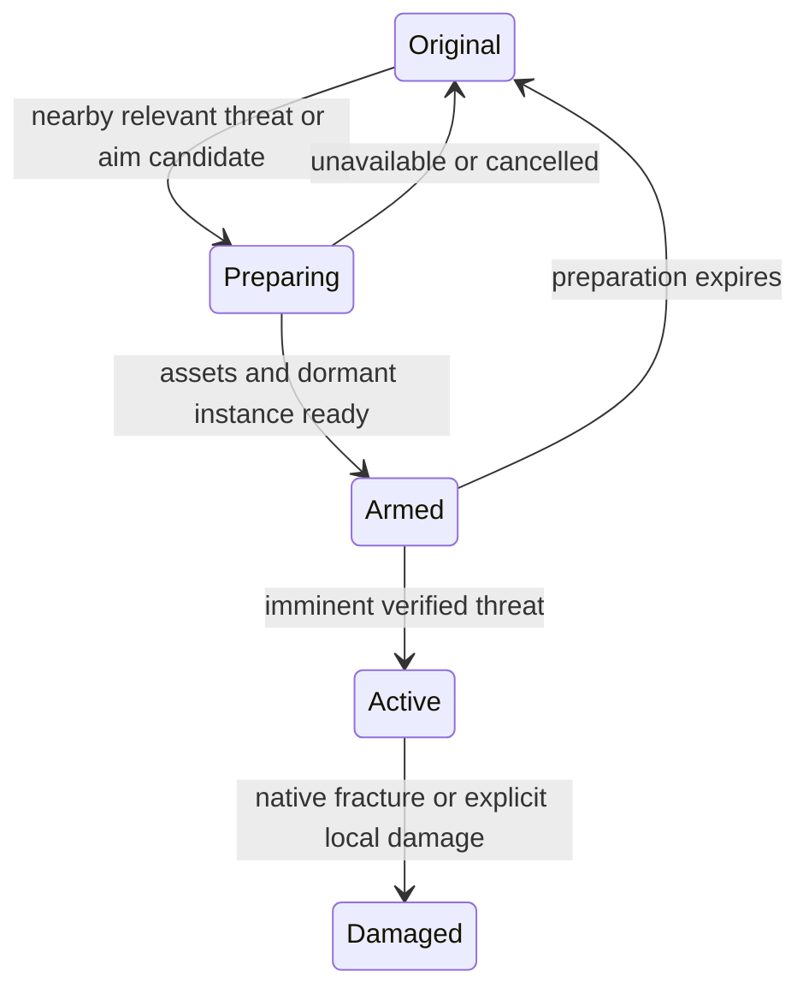

# ASTRA-001 X5 — Just-in-Time Destruction

Technical design and experiment plan · 21 October 2026 · personal offline Story Mode

**Recommendation: use native fragment walls with a small hybrid swap controller. Prepare a few invisible, collision-disabled replacement instances while leaving the original world intact. Activate the replacement shortly before a tracked projectile reaches it. Handle late or instantaneous impacts separately, through local scripted fracture if necessary.** Start with the existing X4 fence and one RPG shot. Do not build a universal interception framework.

This is research and a proposed experiment. No gameplay implementation, installation, GTA launch, or new runtime validation was performed. “Recorded” below means evidence committed by X2–X4, independently read here; “source-verified” means an API or source definition exists; “proposed” means behavior still needs X5 testing. Public native documentation is reverse-engineered documentation, not an engine timing guarantee.

**1. What X2–X4 actually establish**

The reviewed PRs are open drafts and unmerged. Their dependency chain is X2 → X3 → X4; historical acceptance verdicts remain unchanged.

| Work | Reviewed head | Useful result | Limit relevant to X5 |
|---|---|---|---|
| [X2, #289](https://github.com/ComradeGenosse/LSA-Enhanced-essential-fork/pull/289) | `cdc2768779a473cfa8afcc12af22e2769b49568f` | A custom GEN9 fragment wall can remain anchored while a native explosion opens real collision. The original 20-blast cohort had six confirmed traversals across three launches without crashes. | Formal acceptance was partial; locality was 14/20. Weak charges can detach pieces that remain fitted in the opening. |
| [X3, #290](https://github.com/ComradeGenosse/LSA-Enhanced-essential-fork/pull/290) | `d16a4e9cdfd93958e4d2798418bfca5aa81c9e01` | Existing debris, pool and timing harness; ownership-checked cleanup fixed in X3-0.3. | Performance/scalability remains partial. Cold trials reached 405/506 ms; causes are unattributed. “6/8” explosion detections do not prove an engine cap. |
| [X4, #291](https://github.com/ComradeGenosse/LSA-Enhanced-essential-fork/pull/291) | `7ff5bb8ecd547d614661767427cc3b92c74eb691` | Runtime hiding removed the selected fence and its collision; a replacement broke into 16 native fragments under a real RPG; the player crossed within the original footprint with no rise. | The replacement was already visible before firing. JIT latency, first-hit transfer, and seamless presentation were not tested. |

X2’s frozen asset is `lsa_x2_concrete`, 3 × 2.5 × 0.20 m, 30 chunks plus root, with reinforced outer structure and a native physical joint to an invisible frozen anchor. Preserve pack SHA256 `180618adbe9e56bdaa9a6220e82a87effc6d624ea2b78926cc348263e60af347`. Its centre-rocket result is enough to isolate the new timing question. Do not retune fragment strength or repeat the whole locality matrix. [X2 final validation](https://github.com/ComradeGenosse/LSA-Enhanced-essential-fork/blob/cdc2768779a473cfa8afcc12af22e2769b49568f/docs/next-gen-gameplay/astra-001/10-X2-FINAL-VALIDATION-20261021.md)

X3’s cleanup guard is mandatory reuse: identify detached pieces through their verified parent and recheck ownership at deletion. Newly appearing props can be ambient streaming. A global prop-count delta cannot establish a debris leak. X3’s unresolved matrix does not prevent this smaller experiment under the present brief; it prevents claiming scalability has passed. [X3 closeout](https://github.com/ComradeGenosse/LSA-Enhanced-essential-fork/blob/d16a4e9cdfd93958e4d2798418bfca5aa81c9e01/docs/next-gen-gameplay/astra-001/13-X3-PHASE1-CLOSEOUT-20261021.md)

X4 target: `prop_fnccorgm_02e`, hash `1185366416`, at `(1065.758, -1773.716, 34.851)`, heading about `110.189°`, Elysian Island. `CREATE_MODEL_HIDE_EXCLUDING_SCRIPT_OBJECTS` at radius 0.15 changed 360/360 blocked samples to 360/360 clear, with 7/7 sweeps clear and unchanged neighbour samples immediately after hiding. This verifies removal for this freestanding object; it says nothing general about a building’s separate world collision. [X4 report](https://github.com/ComradeGenosse/LSA-Enhanced-essential-fork/blob/7ff5bb8ecd547d614661767427cc3b92c74eb691/docs/next-gen-gameplay/astra-001/14-X4-REPORT-20261021.md)

Keep X4’s conflicting evidence visible: its final raw opening rows say `anchored=false`, root movement 0.025 m and zero full-height sweep window, although its player-crossing row passes. The report attributes the sweep result to a lintel. Restore measured 353/360 blocked cells and `restoredToOriginal=false`; visual restoration was not checked. Neither strict anchoring nor complete restoration should be promoted to a pass from the prose summary. X5 needs ordinary player traversal and a visual restore check, with consistent probes. [X4 raw final run](https://github.com/ComradeGenosse/LSA-Enhanced-essential-fork/blob/7ff5bb8ecd547d614661767427cc3b92c74eb691/docs/next-gen-gameplay/astra-001/x4-evidence/x4-final-run.jsonl)

The old master plan used “X5” for persistence and broadly rejected runtime building hides. This brief assigns X5 to JIT swapping. X4 reopens the hide route for individually removable props only. Persistence and structural collapse remain outside this experiment. The repository’s roadmap/current architecture documents were consulted; no LSA/Essential integration or new competing gameplay host is proposed.

**2. Available interception and sensing capabilities**

The Enhanced native database contains the following native signatures. Presence establishes a callable interface, not that its latency, completeness, or every asset interaction is proven on the installed build. [alloc8or GEN9 native database](https://github.com/alloc8or/gta5-nativedb-data/blob/master/natives_gen9.json)

| Threat | Actual API or facility | What it enables | What it does not establish |
|---|---|---|---|
| Aim / trajectory | `START_SHAPE_TEST_LOS_PROBE` (`0x7EE9F5D83DD4F90E`), `GET_SHAPE_TEST_RESULT` (`0x3D87450E15D98694`) | Ask where a segment intersects the current world; asynchronous results have invalid/pending/complete states 0/1/2. | A future-hit callback or authority over the weapon’s internal trace. Never interpret pending as a miss. |
| Player bullet impact | `GET_PED_LAST_WEAPON_IMPACT_COORD` (`0x6C4D0409BA1A2BC2`); `IS_PED_SHOOTING`; entity weapon-damage queries | Detect shooting and obtain a last known impact position or damage state. | A complete per-shot event stream, reliable pellet history, pre-impact notification, or automatic damage transfer. Repeated hits at one coordinate need shot freshness beyond a changed-coordinate test. |
| Physical projectile | `GET_PROJECTILE_OF_PROJECTILE_TYPE_WITHIN_DISTANCE` (`0x82FDE6A57EE4EE44`), coordinate/type proximity queries | Obtain a nearby projectile and track successive positions/velocity. SHVDNE also exposes projectile enumeration. | Every threat being observed before contact, particularly a very close shot or a long frame. Projectile lifetime/handles must be revalidated. |
| Explosion | `IS_EXPLOSION_IN_SPHERE` (`0xAB0F816885B0E483`), area/type variants | Observe a recent explosion near a target. | An interception hook, exact explosion centre/strength/owner, a unique event ID, or successful damage to this wall. A persistent true result must not cause repeated replay. |
| Physical contact | `SET_ENTITY_RECORDS_COLLISIONS`, `HAS_ENTITY_COLLIDED_WITH_ANYTHING`, `GET_COLLISION_NORMAL_OF_LAST_HIT_FOR_ENTITY` | Post-contact observations on physical entities. | A cancellable universal collision callback; a car’s already resolved impulse cannot be recovered just by swapping the wall afterward. |

For prediction, sweep the projectile’s previous/current position and a short forward segment against the authored wall bounds, then confirm obstruction with a world trace where needed. An aim ray only selects and prepares a candidate. Camera aim, muzzle position, spread, recoil, occluders and ballistic motion can disagree. Never destroy a wall merely because the crosshair points at it. The trace can hit static world geometry without a useful target entity handle; use a registered placement and its bounds for identity.

CFX documents world/object trace flags and separate option flags: option 7 ignores glass, see-through and no-collision surfaces. These descriptions are useful upstream reference, but their detailed behavior is not an Enhanced acceptance result. Use one pinned probe configuration consistently. Include intervening vehicles/peds when validating the gameplay shot; X4’s map+objects mask 17 alone cannot rule them out. [Shape-test reference](https://github.com/citizenfx/natives/blob/master/SHAPETEST/StartShapeTestLosProbe.md)

**SHVDNE is the practical host.** Its upstream README explicitly supports Enhanced; original SHVDN Legacy support is not equivalent. Source exposes projectile enumeration, fragment identification/detachment, parent ownership and native dispatch. These are sufficient ingredients for the experiment, although newly used projectile tracking still needs an installed-build smoke check. Its dedicated script-thread model supplies no documented guarantee of execution immediately before weapon or physics processing. [SHVDNE](https://github.com/Chiheb-Bacha/ScriptHookVDotNetEnhanced), [projectile queries](https://github.com/Chiheb-Bacha/ScriptHookVDotNetEnhanced/blob/main/source/scripting_v3/GTA/World.cs#L769), [fragment helpers](https://github.com/Chiheb-Bacha/ScriptHookVDotNetEnhanced/blob/main/source/scripting_v3/GTA/Entities/Entity.cs#L979)

RPH also supports Enhanced: its publisher records compatibility with Enhanced 1158.16. Its documented execution model uses cooperative fibers and game ticks; that does not supply a universal before-hit hook. No suitable universal cancellable pre-impact API was verified in the public SHVDNE/RPH material reviewed. This is a limit of the verified interfaces, not proof that an internal engine hook is impossible. Changing hosts is unnecessary for X5. [RPH Enhanced publisher changelog](https://www.lcpdfr.com/downloads/gta5mods/g17media/52970-lspd-first-response-enhanced-preview/), [RPH execution model, older API documentation](https://docs.ragepluginhook.net/html/4c04eafe-2474-4f41-9087-ac47bb16d491.htm)

FiveM’s cancellable `explosionEvent` is a OneSync server routing facility. It is not a Story Mode native callback. Its existence does not validate a single-player interception architecture. [CFX OneSync documentation](https://docs.fivem.net/docs/cookbook/2019/08/19/onesync-intercepting-game-events-such-as-explosions/)

**3. Predictive, reactive and hybrid choices**

| Approach | Practical advantage | Main weakness | Decision |
|---|---|---|---|
| Predictive only | A visible rocket or approaching vehicle can encounter the replacement directly; native fracture and impulse stay authentic. | Surprise hitscan has no script-observable flight interval. Prediction can miss, commit early or select the wrong target. | Use for trackable physical threats, beginning with RPGs. |
| Post-impact only | The original survives until a real impact; explosion flash/dust can conceal the transition. | The engine already processed the original collider. The replacement needs a new local damage operation, and first-shot penetration/contact response cannot be recovered. | Useful later for bullets and late detections. |
| Hybrid | Early asset preparation, short predictive commit, reactive fallback when needed. | Requires explicit trigger provenance and protection from duplicate damage. | Recommended architecture, implemented incrementally. |
| Native engine detours | Could intercept the real damage/contact pipeline. | Build-specific reverse engineering, thread and crash risks; no verified drop-in solution found. | Disproportionate for personal play; defer. |

Strictly satisfying “swap before every possible first impact, with the original untouched until then” is not demonstrated through ordinary scripting. Convincing RPG-driven destruction is a much smaller, credible target. Start explosives-first; ordinary bullets may keep their vanilla effect on concrete until a bullet-fracture path is deliberately added.

For a player-only weapon experiment, `DISABLE_PLAYER_FIRING` can suppress combat for the current frame and `SHOOT_SINGLE_BULLET_BETWEEN_COORDS` can emit a controlled replacement shot after a swap. That is a possible way to own shot ordering, but it replaces part of the firing behavior and must preserve ammunition, fire cadence, recoil and animations. It does not cover NPC shots or unrelated blasts. Keep it as a scoped alternative rather than a dependency of X5. These native signatures are present in the [GEN9 database](https://github.com/alloc8or/gta5-nativedb-data/blob/master/natives_gen9.json).

**4. Proposed runtime design**

Keep a curated target registry containing placement ID, original model, transform, bounds, replacement asset class, removal recipe and validation status. Register removable freestanding objects first. Do not start by classifying every building in Los Santos.

The controller has five states:

`Preparing` and `Armed` leave original rendering and collision unchanged. Request the wall, anchor and needed weapon resources asynchronously. Create one replacement and anchor ahead of time at the final X4 transform. Make the replacement invisible and collision-disabled, with physics retained if supported (`SET_ENTITY_COLLISION(false, true)`); preserve X4’s physical anchoring recipe. Dormant damage protection must be removed on activation. Hidden objects can still incur physics/pool cost: invisibility is not deallocation, nor is it proof against damage. Whether this dormant fragment can be activated cleanly is X5’s first hypothesis.

Create/configure the instance without yielding while it is accidentally visible or collidable. Allow preparation and settling over earlier frames. An alternative offsite parking scheme adds transform/joint relocation risk and should be attempted only if dormancy at the final transform fails.

`Armed` means loaded models/collision, valid owned handles, intact fragment state, correct heading and anchor, and no visible or collision effect on the original. If readiness expires or loading fails, retain vanilla behavior. Never block firing while waiting for streaming in the baseline design.

At imminent projectile contact, perform a short commit on the supported script execution path: enable replacement collision, apply the original’s proven model hide, remove dormant damage protection and reveal the replacement, without a deliberate yield between these operations. The intended collision ordering is replacement-on before original-off, avoiding a deliberate empty step. No model requests, creation, attachment, geometry discovery, file writes or full probe grids belong here. Exact propagation order remains experimental: a batch of native calls is not an engine transaction. Reject a sequence that produces a missing collider, double-contact response, or visible flash.

Let the original projectile deliver native damage. Do not manufacture an extra explosion when prediction succeeded. Keep the original hidden for the damaged state; showing it again would close the hole. If a committed prediction misses and no damage occurs, restore when clear of the player/vehicles, rather than leave an obvious intact impostor indefinitely.

Use a short trajectory horizon based on measured activation latency plus recent frame duration and uncertainty. At 60 fps, two frames are about 33 ms; at 30 fps they are about 67 ms. At X4’s requested projectile speed of 80 m/s, 50 ms corresponds to 4 m, assuming that speed is actually achieved. Measure positions and elapsed time rather than assume native speed parameters are an exact flight model. Begin near a two-frame horizon, then choose the shortest repeatably successful horizon. A requirement for hundreds of milliseconds of visible lead would count against this design with the current art.

A later reactive path should use a fresh observed impact, mapped to one registered target, to detach selected native groups and apply a bounded local impulse to verified detached pieces. SHVDNE `DetachFragmentPart` is available; X2 recorded direct group release as a diagnostic, not as native-explosion acceptance. This would be an intentional gameplay approximation and requires its own small test. `DAMAGE_OBJECT_FRAGMENT_CHILD` exists in GEN9, but its parameters remain `Any` in the database; do not pretend it is a verified arbitrary point-damage interface.

Never replay every late hit as a second damaging `ADD_EXPLOSION`: silent/invisible flags affect presentation, not the surrounding damage. `noDamage=true` also cannot be assumed to preserve the fragment damage we need. Sphere polling alone cannot reconstruct an exact original blast. For X5, disable replay and report late detection as failure; this keeps the timing result falsifiable.

**5. Collision, frame timing and presentation constraints**

The essential unknown is the delay between the commit call and a replacement that both collides and accepts fracture. A script stopwatch only measures call duration. Frame IDs, impact timing and captured frames must establish whether the physical/visible change happened in time.

X4’s setup is not reusable as the impact handler. It yields 60 frames after hiding, 12 inside spawn and 60 after anchoring, before readiness, in addition to loading and measurements: at least 132 frame yields after hide, about 2.2 seconds at 60 fps. The setup path also waits 120 frames earlier. Extract its transforms, asset and anchor recipe; move all preparation out of the trigger. [X4 setup and spawn source](https://github.com/ComradeGenosse/LSA-Enhanced-essential-fork/blob/7ff5bb8ecd547d614661767427cc3b92c74eb691/native/fragment-x4/WpsBreachLabX4.3.cs#L353)

X4 reports four crashes using the raw synchronous probe and a stable `World.Raycast` replacement. Current SHVDNE source shows that `World.Raycast` calls **the same** `START_EXPENSIVE_SYNCHRONOUS_SHAPE_TEST_LOS_PROBE`, with final option **7**; X4’s raw call uses **0**. Thus “synchronous raycasting itself is broken” is not established. Options, marshaling or another call-path difference remain possible causes. Keep the observed stable wrapper, avoid raw option-0 probes, and do not reopen crash research before obtaining the playable result. Async prediction is a separate unvalidated path; use at most one outstanding cast per tracked threat and bound result age. [X4 ray code](https://github.com/ComradeGenosse/LSA-Enhanced-essential-fork/blob/7ff5bb8ecd547d614661767427cc3b92c74eb691/native/fragment-x4/WpsBreachLabX4.3.cs#L637), [SHVDNE ray implementation](https://github.com/Chiheb-Bacha/ScriptHookVDotNetEnhanced/blob/main/source/scripting_v3/GTA/World.cs#L2479)

Apply that rule to every helper: X4 still has raw option-0 calls in `X4Neighbours` and `AnchorFaces`, and option-0 sweeps. Do not inherit these unchanged. Witness, baseline, neighbour and restore rays must use one checked configuration; capsule checks need a matching, explicitly verified configuration and proper pending-result handling. [Remaining X4 raw neighbour probes](https://github.com/ComradeGenosse/LSA-Enhanced-essential-fork/blob/7ff5bb8ecd547d614661767427cc3b92c74eb691/native/fragment-x4/WpsBreachLabX4.3.cs#L304)

Check both sides of the wall and its surviving edges. Avoid committing with a ped/vehicle already occupying the replacement’s extra collision volume. X4’s slab is 3 m wide while the fence is about 2.536 m, adding roughly 0.23 m at each end. Trimming a measurement grid does not trim those colliders. This known overhang can be excluded from the timing claim, but it must be visible in review and addressed before general playable deployment.

An imperfect twin is acceptable if its silhouette, scale, main colour/material and surviving perimeter plausibly match. Fracture tessellation, tiny UV seams, decals and exact pre-impact normals can wait. An explosion can mask a short transition; it cannot hide surviving wrong material after dust clears. X4’s concrete-for-corrugated-metal replacement is a useful stress test of timing, not acceptable evidence of finished art. If mechanism passes, the next art task is one matching fence or a concrete target that fits this asset, not a citywide asset campaign.

**6. Preloading and scale**

Explicitly request and separately check model and model-collision readiness (`REQUEST_MODEL` / `HAS_MODEL_LOADED`, `REQUEST_COLLISION_FOR_MODEL` / `HAS_COLLISION_FOR_MODEL_LOADED`). Loading is asynchronous. Current SHVDNE `RequestCollision(int)` calls `Request()` and tests `IsLoaded`, so its return alone is insufficient evidence that collision loaded. Verify the installed version and poll the collision predicate directly. Keep resources requested while armed; release only when no active/armed instance uses them. [SHVDNE model source](https://github.com/Chiheb-Bacha/ScriptHookVDotNetEnhanced/blob/main/source/scripting_v3/GTA/Entities/Model.cs#L420)

Preloaded models are not pre-created physical instances, and neither guarantees first-use fracture/VFX has no hitch. X3’s cold spikes make that distinction worth testing. Record a first activation after readiness as well as warm repeats; do not silently discard the first shot. A later warm-up may be useful, but first attribute enough to know it helps.

Thousands of potential targets should be thousands of registry records, not thousands of spawned fragment roots and anchors. Use a spatial grid for nearby candidates, share a small family of models, and maintain a small bounded armed set. An initial later-play budget of 2–4 armed targets, 4 active walls and roughly 64 live owned debris pieces is a conservative proposed starting policy, **not a measured engine limit**. X5 uses one wall and one anchor only.

Only inspect nearby active threats each frame; refresh distant candidate selection more slowly. While armed and a relevant weapon is active, discover/track nearby projectiles every frame so a short-range shot is not lost to a 100 ms discovery interval. Apply cheap bounds tests before raycasts. Do not scan all city props or cast per-target grids in the hot loop. Defer logging flushes, large debris scans and diagnostic collision grids until outside the impact timing window.

Under load, stop arming new targets before exhausting pools. Cull/fade settled owned debris later, using X3’s deletion guard; never cull unknown ambient objects. One fresh instance is required for another intact trial unless a reset path is separately verified. Keep damaged roots/hides while nearby. Stream-out reconstruction and durable break state are later work; within X5’s bounded site, do not allow the original to reappear through damage.

**7. X5: the smallest decisive experiment**

**Hypothesis:** after preparation that leaves the X4 original intact, a dormant X2 wall can become the sole effective wall early enough for an ordinary-speed RPG to cause native fracture, with no distracting swap, extra explosion, long hitch or phantom barrier.

Use one new experiment version of the existing SHVDNE lab, based on X4’s reviewed head; keep X2–X4 sources/evidence immutable. Reuse the exact fence, frozen pack, corrected common heading, anchor recipe, file bridge, player walk and guarded cleanup. Proposed command responsibilities are `prepare`, `arm`, `fire/observe`, `restore`; these are design labels, not implemented commands. No new assets, loader, framework or LSA integration.

1. **Prepare and untouched control.** Capture the original and neighbours with the stable probe configuration. Load wall/anchor/weapon resources and prepare one dormant twin. Observe for 10 seconds, approach the original and confirm it still renders and blocks normally, with no extra overhang collision or visible twin. Record readiness before any original mutation. A missing resource leaves the original untouched.
2. **Three brief activation/restore controls, without a shot.** Measure the hot commit and first effective collision/render frame. Use only a few fixed witness rays per frame during these controls, plus video; do full geometry checks outside the transition. Check whether the new collider replaces the old, rather than merely counting “a hit.” Restore with the same model/position/radius tuple and verify the original visually and physically. These controls establish a usable lead horizon. Stop if dormancy or collision handoff fails; do not proceed by adding an arbitrary multi-second delay.
3. **Six centre RPG shots with a fresh twin for each.** Preassign session A as scripted 8 m, human 20–25 m, scripted 8 m; session B as human 8 m, scripted 20–25 m, scripted 20–25 m. Include the first shot after readiness in each session. Use X4’s native RPG spawning method for scripted shots at its normal requested speed, time scale 1. Track the actual projectile and commit from observed trajectory/remaining distance, not from a scheduled delay or the fire-command call. Start with the horizon established above. Disable X4’s native-explosion fallback. Both ordinary-control human shots must succeed to establish manual-fire coverage. If those cannot be supplied in the session, label that coverage incomplete.
4. **Two negative controls.** Aim at the target and do not fire; then fire an RPG on a clearly missing trajectory while armed, before a later positive trial. Miss both the original and the wider replacement. Arming is allowed; hiding the original without an imminent intersection is a false activation. Inspect the dormant twin for damage and detached children after the miss. Idle appearance alone cannot validate damage protection; if the miss provides no damaging exposure to the twin, that protection remains unvalidated. An incidental nearby blast that naturally damages the original must be distinguished from a false script activation, followed by a fresh original before the next trial. Let any harmless prepared twin expire.
5. **Gameplay and restoration.** On at least two successful breaches, walk the player through at normal speed, inside the footprint, without climbing, teleportation, deleting obstructing debris or walking around an edge. Inspect surviving structure and neighbouring fence. Restore and visually check both sides; use matching collision samples to investigate any discrepancy, rather than dismiss it as a probe artifact. Count surviving owned objects after each cleanup.

This is six damaging trials, three handoff controls and two negative controls, not a new multi-material or multi-wall campaign. A slow-motion replay may diagnose a failure but cannot satisfy normal-speed acceptance. A badly fitted current slab may yield a mechanism pass and an art-limited result; report those separately.

Minimal telemetry: immutable script/pack/build IDs; real monotonic time and game frame ID; model/collision readiness; target and replacement identity/state; trigger type; projectile identity and positions; estimated time-to-contact; commit begin/end; observed impact/explosion; first visible fracture; fallback count (must remain zero); frame times around the event; verified detached pieces and cleanup survivors. Correlate video with the event markers. An explosion sphere boolean or detached-piece count alone cannot pass the trial. Flush the buffered record after the event.

**Proposed GO criteria, frozen before a future run:**

| Concern | Small-experiment criterion |
|---|---|
| Original preserved | Armed idle/aim controls retain original appearance and blocking; no visible/damaging dormant twin. A missing trajectory produces no scripted swap. Natural blast damage is logged separately and cannot count as an intact-control pass. |
| Native damage delivery | At least 5/6 direct centre shots fracture the replacement through the original RPG, including both human-fired shots and at least one at each distance in each session. No hidden fallback explosions. Any miss/late commit remains recorded. |
| Visible response | For accepted shots, visible fracture starts within two rendered frames of observed impact. No visible empty wall, doubled wall, or conspicuous intact-slab flash at normal playback. The reviewer judges timing from ordinary third-person gameplay; slow motion supports diagnosis. |
| Collision quality | No observed open frame before impact in handoff controls; no abnormal projectile pass-through/double contact; two ordinary player crossings through a persistent opening. The standing-body probe must fit the actual player below the lintel. Unresolved probe/walk disagreement stays unresolved. |
| Performance | No recurring pause; target hot-controller work ≤2 ms and no event-correlated frame over 100 ms. Compare baseline/p95 and max with the same site/settings, including first-use results; a burst p95 more than one baseline frame worse needs investigation. These are practical thresholds, not causal attribution by themselves. |
| Stability/cleanup | Zero crashes, exceptions or unrelated deletions; no accumulating owned fragments/anchors across the six trials. Original and neighbours restored visually and physically at end of both sessions. |
| Art verdict | Separate timing acceptability from known concrete/metal mismatch and overhang. A persistent conspicuous mismatch prevents calling the current wall a finished playable asset. |

If a frame is missed despite a correct trigger, make one bounded comparison using a modestly earlier horizon, up to about 100 ms, and report it as a separately labelled revision. If this requires visible lead the reviewer dislikes, stop predictive tuning and select reactive local fracture or earlier activation with a better matched asset. Two failed variants of dormancy/handoff are enough to change architecture. A crash ends the run for diagnosis; do not repeat the known raw-probe crash sequence. No escalation to many walls is needed to decide X5.

**8. Alternatives and real blockers**

| Issue / alternative | Assessment |
|---|---|
| Exact target drawable and collision cannot be removed independently | Genuine blocker for that target. A model hide is model+spatial matching, not a per-handle transaction. Test neighbouring same-model objects and independent collision. Skip unsupported assets; X4 does not validate monolithic buildings. [Model-hide semantics](https://github.com/citizenfx/natives/blob/master/ENTITY/CreateModelHideExcludingScriptObjects.md) |
| Dormant fragment cannot activate before the incoming hit | Genuine blocker for short-lead predictive swapping on this runtime. Try one earlier horizon; otherwise use reactive fracture or a different preparation scheme. |
| First surprise hitscan / unseen blast / contact already resolved | Genuine limitation of this strict promise through verified APIs. Scope the first playable version to explosives and add approximate local reaction later. Do not label polling “interception.” |
| Persistent invisible wall, wrong-instance hide, crashes, ambient deletion | Genuine blockers to playable use; fix before expanding targets. |
| Small UV differences, broad rather than exact fracture, weak bullets not opening concrete, finite debris lifetime | Acceptable MVP compromises if the wall reacts convincingly, stays stable and yields usable openings. |
| All of X3’s matrix, perfect material physics, per-pellet accuracy, exact debris replay, navmesh regeneration, multiplayer authority | Can wait. Manual player traversal needs collision continuity, not regenerated AI routing. Structural collapse remains out of scope. |
| Direct `CREATE_MODEL_SWAP` | Fewer calls, but object-only and no verified equivalence to a separately spawned, joint-anchored fragment. Try later only if it removes actual complexity; it does not solve separate static collision or first-hit timing. [Native reference](https://github.com/citizenfx/natives/blob/master/ENTITY/CreateModelSwap.md) |
| Activate a small combat area earlier with matched replacements | Likely simpler and more tolerant of hitscan/contact timing. It relaxes the strict untouched-until-imminent requirement, and consumes more active instances. Reasonable fallback if invisible JIT cannot be made convincing. |
| Post-impact authored breach state plus a few debris pieces | More deterministic than hoping a late native blast damages the new wall. Less physically emergent but a reliable way to prioritize playable holes. Keep damage local and explicitly label the approximation. |
| Permanent destructible replacements / small collision overlays | Reliable for curated locations where runtime removal fails, but changes the untouched-world premise and requires asset work. Keep as a target-specific fallback. |

The next decision should be made from one thing the player can see and use: the original fence stays ordinary, an RPG hits, the fence breaks immediately, and the player walks through. If this works with bounded preparation and no hitch, improve one matching asset and expand to a handful of removable Los Santos props. Thousands of potential placements become a registry and budgeting problem only after that result.
