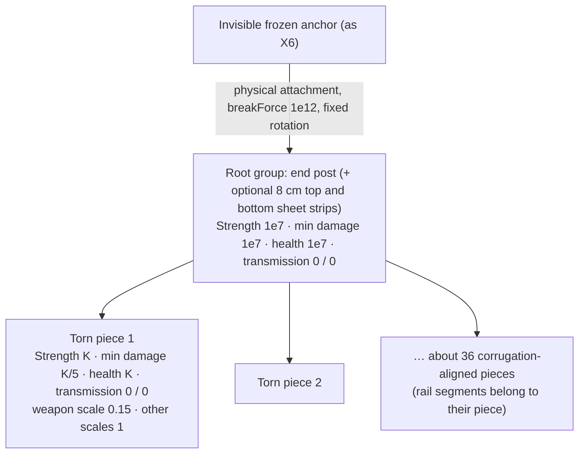
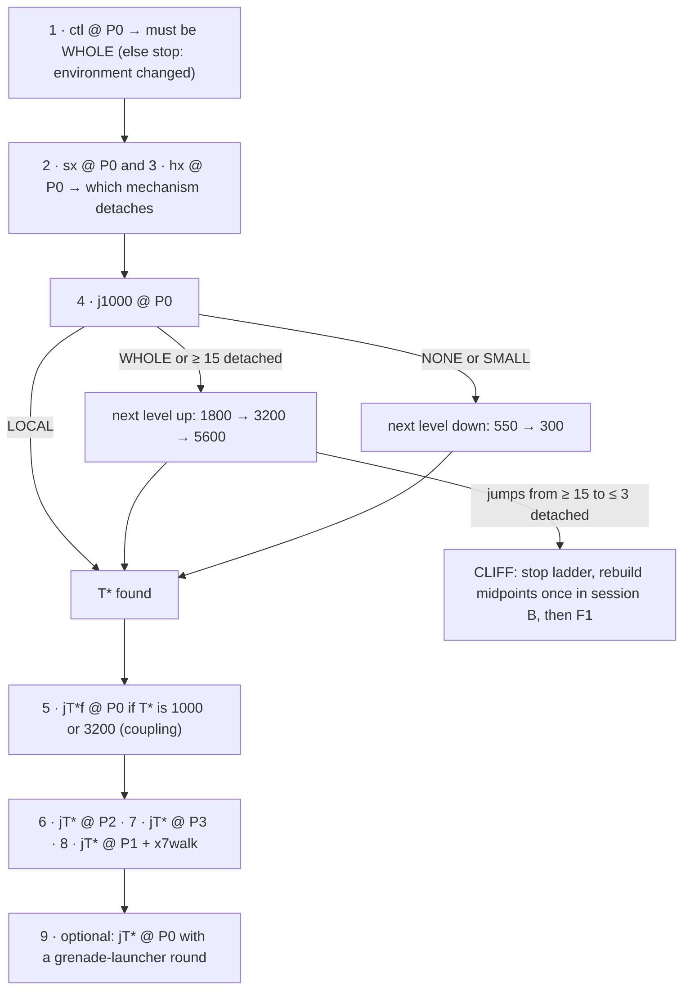

# ASTRA-001 · 16 — X7 Localized Fracture Research

**Date:** 2026-10-21 · **Status:** research and planning only. No gameplay code changed, no assets deployed, GTA not launched. · **Base:** X6 `experiment/astra-001-x6-visual-fence-twin` @ `b647b29` ([draft PR #294](https://github.com/ComradeGenosse/LSA-Enhanced-essential-fork/pull/294)). · **Branch:** `research/astra-001-x7-localized-fracture-20261021`.

Evidence tags: **[REPO]** committed lab evidence · **[CALC]** recomputed here from committed evidence by [`x7-research/breakage_zone_analysis.py`](x7-research/breakage_zone_analysis.py) (output: [`breakage_zone_analysis.txt`](x7-research/breakage_zone_analysis.txt)) · **[SRC]** tool source code (Sollumz, its `szio` I/O library, CodeWalker, SHVDN Enhanced) · **[DOC]** official tool docs or native databases · **[MOD]** community data (public `explosion.meta` copies, a third-party vanilla YFT export) · **[INFER]** reasoning, not observed · **[UNTESTED]** needs a run. RAGE's internal breaking formulas are not publicly documented; nothing below claims them.

**How this was produced:** read-only review of docs 06–15, the X1–X6 code and evidence (including every file in PR #294 and the committed X6 YFT XML); source inspection of Sollumz and `szio`, CodeWalker, SHVDN Enhanced, the GEN9 NativeDB and the CFX native docs; public explosion data; and offline recomputation with the script above. GTA was not launched, nothing was installed, and no gameplay code changed.

---

## 0. The answer on one page

**Localized, position-dependent fracture is reachable with RAGE's own fragment system and the unchanged X5/X6 hot swap.** What is missing is the calibration and structure of the twin asset, not a new runtime, solver or mesh generator.

**Why X6 releases all 30 pieces (§3).** No engine quirk is needed to explain it:

1. **The native damage zone is bigger than the fence.** The frozen X2 wall (strength 500, min damage force 100, health 100) shows a repeatable native break radius of about **1.1–1.3 m in the wall plane** around the blast point, and that radius barely changes between a grenade at damage scale 0.25 and a rocket at scale 10 [CALC from REPO, X2 final pass and the X3 repeats]. **Every X6 sheet piece lies within 1.37 m of X6's aim point; 26 of 30 lie within 1.26 m** [CALC].
2. **X6's thresholds sit far below even that regime.** Sheet strength 35 (X2: 500), min damage force 5 (X2: 100), health 25 (X2: 100), against public vanilla explosion data of `fragDamage` 1500 and `forceFactor` 80 for `EXP_TAG_ROCKET` [REPO; MOD].
3. **Nothing is protected or decoupled.** All 30 sheets are equal-strength direct children of a 5 cm end post; there are no reinforced groups (X2 kept 10), and the root's force transmission (0.25 up and 0.25 down) can pass a share of any blast it receives to all 30 children. Rockstar's own root groups use 0/0 [REPO; MOD].

So whole-fence release is the expected result, and it is native behavior working as configured. The one contrary datum is X6's own rejected **candidate1**, an "art/strength candidate" whose parameters were never committed: it detached **5 pieces and left a 0.9 m hole with the rest of the fence standing** [REPO]. That is direct evidence that the zone shrinks into a local hole when the thresholds are higher.

**Recommended architecture: a "native thresholded twin."** Keep everything X5/X6 proved: dormant twin, projectile time-to-contact prediction, one-tick commit, physical anchor, guarded cleanup, restore and install rollback. Change only the twin:

- Frame-protected root (end post, never breaks, force transmission 0/0).
- Decoupled sheet pieces (force transmission 0).
- Per-piece strength and health raised into the sub-zone regime and **calibrated with a threshold ladder against the real RPG**, with min damage force at ⅕ of health to stop debris cascades.
- About 36 corrugation-aligned, torn-edged pieces instead of the 6 × 5 tile grid, still on box collision.
- Optionally, crumpled flying debris through the fragment's native damaged drawable and the `DAMAGE_WHEN_BROKEN` group flag, gated by an offline conversion check.

The driver change is small and measurement-only: a model selector, aim offsets and a dense hole mask. No new runtime orchestration, impulses, detaches or deletes.

**Plan (§7).** X7-0 offline forensics (recover candidate1's thresholds, read the installed explosion data). X7-1 builds a 12-model ladder pack on the *unchanged* X6 mesh. X7-2 is the driver. X7-3 is one session of at most 11 shots that separates the breaking mechanisms, finds the threshold band and tests three impact positions. X7-4 builds the torn asset at the found threshold. X7-5 is one acceptance session.

**If the ladder shows a cliff** (whole fence at one level, nothing at the next), fall back in this order (§4): **F1** independently anchored sheet modules, armed only near the predicted impact; **F2** impact-zone twin variants; **F3** scripted local detachment with native debris.

**Milestone (§8):** one fence, three RPG impact points, three different holes. Each hole is 0.6–2.8 m² with its centroid within 0.45 m of the impact, at least 40 % of the sheet still stands and collides, and the player walks through the low-centre hole. No fallback blast, scripted detach or delete, and no frame over 50 ms.

**Buildings (§9):** the same primitive (calibrated per-piece thresholds inside an anchored fragment) is the right building block for wall panels. Structure needs a script support layer, because RAGE fragments and attachments are trees, not support graphs. Per-file limits (128 geometries on Enhanced) and debris budgets bound panel size.

---

## 1. Evidence reviewed

| Source | What it settled | Locality lesson |
|---|---|---|
| [06 master plan](06-MASTER-PLAN-explosion-destruction-20261020.md) | RAGE fragments are the substrate; Onigiri DLC packs; SHVDN lab | — |
| [X1](07-X1-RESULTS-20261020.md) | Vanilla `prop_fnccorgm_03a` (27 groups) breaks natively; a grenade cleared most of a 5 m panel | Vanilla fences are tuned for spectacle, whole panels go [REPO] |
| [X2](10-X2-FINAL-VALIDATION-20261021.md) and its [evidence](x2-evidence/final-validation.json) | Custom GEN9 wall; dynamic root held by a physical attachment to a frozen anchor; reinforced outer columns never broke | Break zone ≈ 1.1–1.3 m, nearly charge-independent; a left impact broke only 5 chunks [CALC] |
| [X3](13-X3-PHASE1-CLOSEOUT-20261021.md) and its [trials](x3-evidence/analysis/trials.csv) | Same asset, repeated: centre rocket 16 detached (3 valid repeats), centre grenade 12–14 detached in place, left rocket 5, upper rocket 16 | The zone is repeatable, not noise [REPO] |
| [X4](14-X4-REPORT-20261021.md) | Model hide plus replacement; a real RPG detached 16 chunks and a lintel survived | A real projectile reproduces the AddExplosion pattern [REPO] |
| X5 design (doc 15, branch `research/astra-001-x5-jit-destruction-20261021`) and X5 README | Dormant twin plus predictive one-tick swap 3–4 frames before impact | Timing is solved and independent of the asset [REPO] |
| X6 [PR #294](https://github.com/ComradeGenosse/LSA-Enhanced-essential-fork/pull/294): README, `build_fence.py`, YFT XML, acceptance, `candidate1/`, `pre-fix/` | Corrugated twin, 30/30 pieces released, 1.6 m lane; candidate1 released 5 pieces and left a 0.9 m hole | The twin's thresholds decide locality [REPO] |

---

## 2. RAGE fragments as they apply here

### 2.1 The data model (field names verified; meanings marked)

A fragment (`.yft`) holds a drawable, an optional fragment-level **damaged drawable**, and a physics LOD. The physics LOD holds a **tree of groups**, linked by `ParentIndex`, with at most 255 groups and children because the counts are bytes. It also holds **children**, each a bound and mass belonging to one group. Breaking a group detaches it, *with its whole subtree*, as a new physical object; the rest stays one rigid body [INFER from the tree layout in CodeWalker `Frag.cs` and the `szio` fragment model, SRC; REPO: X2/X3 "detached-from-parent" debris].

| Field | X6 sheet / root | Meaning and evidence | X7 lever? |
|---|---|---|---|
| Tree (`ParentIndex`) | flat: 30 sheets → root | Subtrees leave together [SRC] | Keep flat for locality; two levels later (A2) |
| `Strength` | 35 / 1e7 | "How easily a part separates; −1 never separates but still reacts to physics" [DOC Sollumz] | **Yes, ladder** |
| `ForceTransmissionScaleUp/Down` | 0.25 / 0.25 on both | Force passed to parent / to children [SRC names; DOC DeepWiki, AI-generated] | **Set 0** (vanilla roots use 0/0 [MOD]) |
| `MinDamageForce` | 5 / 1e7 | Minimum force that causes damage [DOC DeepWiki, AI-generated] | **Yes, ⅕ of health** |
| `DamageHealth` | 25 / 1e7 | Damage a group absorbs before failing [DOC DeepWiki, AI-generated] | **Yes, ladder** |
| `WeaponHealth` and 8 per-source scales: weapon, vehicle, ped, ragdoll, **explosion**, object, ped inverse mass, melee | 0 and all 1 | Per-source multipliers; CodeWalker shows them only as `UnkFloat5C…UnkFloatA8`, Sollumz/szio name them [SRC]. Rockstar's CCTV pole uses weapon 0/0.3 and vehicle 0.8 [MOD] | weapon ≈ 0.15 in X7b; explosion scale is a candidate lever [UNTESTED] |
| Group flags: `DISAPPEAR_WHEN_DEAD`, `USE_GLASS_WINDOW`, `DAMAGE_WHEN_BROKEN`, `DOESNT_AFFECT_VEHICLES`, `DOESNT_PUSH_VEHICLES_DOWN`, `HAS_CLOTH` | none | Stored in CodeWalker's `GlassFlags` byte [SRC]; behavior inferred from names [INFER] | `DAMAGE_WHEN_BROKEN` for crumpled debris (X7b, gated) |
| Joint fields (`JointStiffness`, soft angles, rotation/restoring, `LatchStrength`) | defaults | Used only by articulated fragments: Sollumz creates a link when a bone has a *Limit Rotation/Location* constraint and flags the fragment articulated; at most 22 joints [SRC] | Bent flaps, research only (X7c) |
| Child `UnkFloat` | 0 | szio calls it `min_breaking_impulse`; Sollumz always writes 0 and exposes no UI [SRC] | Not used [UNTESTED] |
| Fragment `DrawableArray` "damaged", child `Drawable2`, damaged composite | none | Sollumz exports one `.damaged` drawable sharing the skeleton, plus a damaged composite [SRC]; Sollumz docs still say destroyed variants are unsupported [DOC]; CodeWalker reads and writes `DrawableArray` XML [SRC, public branch] | Crumpled debris (X7b, gated) |
| LOD `min_move_force` | 0 | Rockstar's CCTV pole uses −1 [MOD] | No |

**Vanilla reference** (public third-party export of Rockstar's `prop_cctv_pole_01a` [MOD]): root strength −1 with force transmission 0/0; pole group strength 1000, min damage force 100, health 1000, transmission 0.25/0.25, weapon scale 0, vehicle scale 0.8, explosion scale 1, for a 180 kg part. Rockstar's thresholds are one to two orders above X6's and its root does not transmit force.

### 2.2 What can detach a group

| # | Mechanism | Evidence | Status |
|---|---|---|---|
| M1 | Impulse on a child exceeds its group's `Strength` | Sollumz docs; X2's strength 100 → 500 change (made together with a bounds fix) shrank the centre-rocket set from 20 to 16 chunks [DOC; REPO] | Real; magnitude unknown |
| M2 | Explosion `fragDamage` (and collisions above `MinDamageForce`) drain `DamageHealth`; failure detaches the group | Field names [SRC]. X2/X3 weak grenades **detached 12–14 chunks that stayed fitted in place**: detachment with almost no impulse [REPO]. That fits damage-driven detachment [INFER] | Plausible; not separated from M1 yet |
| M3 | Force transmission spreads a hit to the parent and its other children | Field names [SRC]; X6 root 0.25/0.25 [REPO] | Effect [UNTESTED] |
| M4 | Flying debris hits neighbours | 4.5 kg pieces against strength 35 and min damage force 5 [INFER] | Plausible for X6 |
| M5 | The explosion's effective reach | Public data: a 5 m end radius at 25 m/s [MOD]. The measured zone (≈ 1.2 m) is far smaller and nearly charge-independent [CALC] | Real; cause unknown |

**Which of M1 and M2 dominates is not public and has not been separated in the lab.** X7-3's two discriminator models answer it (§7).

### 2.3 Explosion inputs

Public `explosion.meta` copies (two identical FiveM repositories; unverified against this Enhanced install, so X7-0 reads the installed data) [MOD]:

| Tag | forceFactor | fragDamage | endRadius | initSpeed | damageAtCentre / Edge |
|---|---:|---:|---:|---:|---|
| `EXP_TAG_ROCKET` | 80 | 1500 | 5 | 25 | 500 / 50 |
| `EXP_TAG_GRENADE`, `EXP_TAG_GRENADELAUNCHER` | 60 | 1500 | 5 | 25 | 500 / 75 |
| `EXP_TAG_STICKYBOMB` | 80 | 1500 | 5 | 25 | 500 / 75 |
| `EXP_TAG_TANKSHELL` | 100 | 1500 | 5 | 50 | 3000 / 300 |

- **Fragment damage is the same 1500 for every common explosive** [MOD]. If M2 dominates, a grenade and an RPG will cut similar holes and differ mainly in how far the debris flies. That matches X2, where grenade and rocket break sets differ by only 14 vs 16 chunks [CALC].
- SHVDN's `World.AddExplosion` passes its "radius" argument as the native's `damageScale` [SRC]. X2's 40× change of this value barely moved the break zone, so whatever it scales, it is not the zone [CALC].
- X6's real RPG detonates on contact (0 m standoff). X2's AddExplosion trials used 0.4 m (rocket, grenade) and 0.1 m (sticky).

### 2.4 The native break zone, measured [CALC]

X2 frozen final pass. Mask cells are 0.25 m: `#` twin collision, `.` clear, `d` detached debris still in place. The outer two columns on each side were reinforced (strength, health and min damage force all 1e7).

```text
centre rocket x10 (16 detached)  centre grenade x0.25 (14, in place)  left rocket x10 (5)   upper rocket x10 (16)
    ##|########|##                   ##|########|##                    ##|########|##         ##|........|##
    ##|########|##                   ##|########|##                    ##|########|##         ##|........|##
    ##|........|##                   ##|##dddd##|##                    ##|..######|##         ##|........|##
    ##|........|##                   ##|##dddd##|##                    ##|..######|##         ##|........|##
    ##|........|##                   ##|dddddddd|##                    ##|..######|##         ##|........|##
    ##|........|##                   ##|dddddddd|##                    ##|..######|##         ##|........|##
    ##|........|##                   ##|dddddddd|##                    ##|....####|##         ##|........|##
    ##|........|##                   ##|dddddddd|##                    ##|....####|##         ##|........|##
    ##|........|##                   ##|dddddddd|##                    ##|##..####|##         ##|########|##
    ##|........|##                   ##|dddddddd|##                    ##|##dd####|##         ##|########|##
```

| Blast (X2 frozen asset) | Detached | Farthest broken chunk | Nearest surviving chunk |
|---|---:|---:|---:|
| Centre rocket ×10 / sticky ×3 | 16 / 16 | 1.06 m | 1.27 m |
| Centre grenade ×0.25 | 14 (in place) | 1.06 m | 1.06 m |
| Upper rocket ×10 / sticky ×3 | 16 / 16 | 1.25 m | 1.52 m |
| Left rocket ×10 | 5 | 0.90 m | **0.56 m** |
| Left sticky ×3 / grenade ×0.25 | 3 / 3 | 0.56 m | 0.56 m |

Distances are in-plane chunk-centre distances from the blast projection. Four lessons:

1. **Zone ≈ 1.1–1.3 m, charge-independent.** A 40× damage-scale change moves the edge by at most one chunk ring.
2. **Weak charges detach pieces in place.** Detachment and clearance are separate events, so the hole needs the impulse.
3. **Native damage is position-dependent but not radial.** A blast next to the reinforced column broke 3–5 chunks and spared chunks only 0.56 m away, so strong structure near the impact suppresses breakage. This repeats exactly in X3, so it is a property of the system, not noise.
4. **The edge is a threshold effect.** X2's strength change (100 → 500, together with a bounds fix) moved the centre edge inward by one ring (20 → 16 chunks).

**X6 candidate1 vs accepted** (lane mask at four heights, 0.1 m columns; `0` clear, `1` twin, `3` other) [REPO]:

```text
candidate1 (5 pieces)            accepted (30 pieces)
z+1.7  11111111111111111111111   z+1.7  00000330000000000000000
z+1.3  11111110000000001111111   z+1.3  00000330000000000000000
z+0.9  11111110000000001111111   z+0.9  00000330000000000000000
z+0.5  11111111111100001111111   z+0.5  00000330000000000000000
```

Candidate1 broke the two pieces nearest the impact plus three of the four next-nearest. That is a zone radius of about 0.47 m: a genuine local hole with everything around it standing.

---

## 3. Root cause: why X6 releases all 30 pieces

X6 aims the RPG at the twin's centre, 1.05 m up, on a 2.536 × 2.131 m sheet of 30 pieces of 0.42 × 0.43 m (4.5 kg each). Piece distances from that point: 2 within 0.45 m, 8 within 0.75 m, 20 within 1.06 m, 26 within 1.26 m, all 30 within 1.37 m [CALC].

| # | Cause | Evidence | Confidence | Falsified by (X7-3) |
|---|---|---|---|---|
| 1 | **The native break zone at X2-like thresholds already spans the whole fence** (≈ 1.1–1.3 m vs a 1.37 m maximum piece distance) | §2.4 [CALC] | High | A ladder level that yields a local hole proves the zone is threshold-controlled |
| 2 | **Thresholds 4–20× below X2's**: strength ÷14, min damage force ÷20, health ÷4, all far below 1500 frag damage | YFT XML [REPO]; [MOD] | High | `ctl` vs ladder |
| 3 | **No protected structure**: every sheet is equally weak; only a 0.05 × 0.07 m post is unbreakable | `build_fence.py` [REPO] | Certain | — |
| 4 | **Root coupling**: transmission 0.25 down on the root can hand part of any force on the post to all 30 children | YFT XML [REPO]; vanilla 0/0 [MOD] | Medium-low | `j1000` vs `j1000f`, `j3200` vs `j3200f` |
| 5 | **Debris cascade**: flying 4.5 kg sheets can exceed strength 35 and min damage force 5 on neighbours | [INFER] | Medium | Edge behaviour across the ladder; the `sx` and `hx` discriminators |
| 6 | **Coarse grid**: 0.18 m² tiles make any hole blocky; one ring is already 6–8 pieces | [REPO]; [CALC] | Certain (resolution) | X7b torn layout |

**Not causes:** the hot swap armed the twin 3 frames (28 ms) before the explosion and fracture was seen 3 frames after it. The anchor held, the projectile was a real RPG and no fallback blast fired [REPO, `acceptance/summary.json`]. X7 does not touch any of these.

---

## 4. Architectures compared

All options keep the X5/X6 hot swap. They differ in how locality is produced.

| Rank | Architecture | What changes | Who breaks what | Locality and position dependence | Main risk | Effort |
|---|---|---|---|---|---|---|
| **1** | **A1 Native thresholded twin** (recommended) | Twin asset only: thresholds, decoupling, frame, torn pieces. The driver only measures | RAGE alone (no new script action) | Emergent from blast position and calibrated thresholds | A **cliff**: no ladder level gives a mid-size hole | Small |
| 2 | **A2 Two-level native hierarchy** (A1 upgrade) | Sheet modules become strong intermediate groups; pieces hang under modules with small force transmission inside a module | RAGE alone | Multi-scale: an RPG punches a hole, a tank shell tears off a whole sheet | More parameters; a broken module takes its whole subtree | Small–medium |
| 3 | **F1 Independently anchored sheet modules** | 3 module fragments plus a frame, each physically attached to the anchor. At commit, arm only modules within ~0.9 m of the predicted impact; re-arm the rest after ~0.5 s | RAGE breaks; script only arms | Guaranteed at module granularity (~0.85 m), native inside the module | `SET_DISABLE_FRAG_DAMAGE`/`SET_DISABLE_BREAKING` protection against a live blast is unverified; 4 entities; seams | Medium |
| 4 | **F2 Impact-zone twin variants** | K dormant twins whose pieces are weak only inside one zone; the commit picks the twin nearest the predicted impact | RAGE breaks | Guaranteed but quantized to K zones and authored | K× dormant pool cost; feels canned up close | Medium |
| 5 | **F3 Scripted local detachment with native debris** | At commit or explosion detection: `DetachFragmentPart` (or `BREAK_OBJECT_FRAGMENT_CHILD`) for pieces within R(weapon) of the impact, optional outward `ExternalImpulse` | Script selects; RAGE simulates debris | Exact and charge-aware; also covers late detection and hitscan | "Manufactured" breach; X2-0.8 proved single-group detach only; first-frame timing | Medium |
| 6 | F4 Authored damage-state swap | Swap to pre-holed meshes after impact | Canned | Quantized | Not physical | Medium |
| ✗ | Runtime mesh or collision generation; custom physics solver | — | — | — | No API exists (master plan H3); disproportionate for a personal mod | — |

**Why A1 first.**

- *It is native and already half-proven.* X2 shows native, repeatable, position-dependent zones; candidate1 shows a 0.47 m zone is reachable on this exact fence and pipeline.
- *It is the smallest change.* Group fields plus one builder rewrite; the driver gains measurement only.
- *It preserves the hot swap and its performance* (0.067 ms commit), and it **reduces** debris: about 6–12 pieces instead of 30.
- *It generalizes as data*: material presets (§9) instead of per-wall code.
- *It is cheap to falsify*: one session, pre-registered decision rules.

**Why the fallbacks are ordered this way.**

- **F1 keeps RAGE in charge of breaking** and adds one decision the script already has the data for: the predicted impact point. It is also a natural place to use **breakable connections**. A module's physical attachment can get a finite `breakForce`, so a big blast tears a whole sheet off natively, the X7 analogue of a Blast "bond".
- **F2** is deterministic but authored.
- **F3** is the most controllable and the only answer for impacts the predictor never sees, but it picks pieces in script. Keep it for late or hitscan cases (as X5's design already suggested), not as the primary look.

### 4.1 Recommended twin structure (A1)



`K` is the threshold the X7-3 ladder finds. Mass stays at X6's 25 kg/m² so the calibration transfers from the X6 mesh to the torn mesh.

---

## 5. Tearing, bending and residual geometry without runtime meshes

Everything here is authored offline and executed natively. GTA offers no way to cut, bend or re-mesh a prop at runtime [master plan H3; DOC: no such native in the GEN9 database].

| Technique | Native mechanism | Status | X7 use |
|---|---|---|---|
| **Torn outlines** | Jagged polyline edges shared exactly by neighbours (no gaps), so whatever comes out leaves a torn rim | Static geometry; certain | X7b |
| **Corrugation-aligned staggered strips** | Pieces 1–3 corrugations wide (0.127–0.38 m) and 0.3–0.75 m tall, with horizontal tears staggered so no straight line crosses the sheet. Real corrugated sheet tears along its folds and fastener rows, and near-rectangular pieces keep the proven box collision (±2 cm of jag) | Authoring; certain | X7b |
| **Crumpled flying debris** | Fragment-level damaged drawable holding a bent, crushed copy of each piece on the same bone, plus `DAMAGE_WHEN_BROKEN` on pieces. Intact pieces stay flat; broken ones should switch to the crumpled copy | Export path [SRC]; CodeWalker GEN9 conversion and in-game behavior [UNTESTED] | X7b, gated offline and by one screenshot |
| **Bent rim flaps ("petals")** | Articulated fragment: a hinge from a bone *Limit Rotation* constraint plus `LatchStrength`. Like a car door: held until hit, then swings open and stays attached | Sollumz builds links [SRC]; props in game [UNTESTED]; at most 22 joints per fragment [SRC] | X7c research only |
| **Damaged-but-attached pieces** | Group health below zero switches to damaged geometry while still attached | **Semantics unknown**; X2/X3 suggest health failure detaches [INFER] | One pistol diagnostic in X7-5 |
| Scorch and bullet decals | Native explosion and weapon decals | Certain | Free |
| Rebar or stud reveal | Unbreakable visual layer behind breakable skins | Static geometry | Concrete and drywall later (§9) |
| Pre-cracked lip curls on every internal edge | Authored | Likely telegraphs the fracture lines on the intact fence | Rejected for now |

**Bottom line:** torn strip outlines and natively simulated debris are certain wins. Crumpled debris is a cheap, gated maybe. True bending of surviving metal needs either articulated flaps (research) or the unknown damaged-while-attached behavior (one diagnostic).

---

## 6. What must change in X6

| Item | X6 now | X7 | Why |
|---|---|---|---|
| Sheet `Strength` | 35 | Ladder `K` (start 1000; ×1.8 steps from 300 to 10000) | Move the native zone inside the fence (§3, causes 1–2) |
| Sheet `MinDamageForce` | 5 | `K/5` | Stop bumps and debris from eroding neighbours (cause 5) |
| Sheet `DamageHealth` | 25 | Ladder `K` | Same as strength; mechanism unseparated (§2.2) |
| Root and sheet force transmission | 0.25 / 0.25 | **0 / 0** (A2 later: 0.1 inside a module only) | Decouple siblings through the root (cause 4); Rockstar's convention |
| Root | 5 cm post, strength 1e7 | Unchanged; optionally plus 8 cm top and bottom sheet strips | A guaranteed standing rim (cause 3) |
| Piece layout | 6 × 5 tiles, 0.18 m² | X7a: **unchanged** (physics-only variants). X7b: about 36 torn, corrugation-aligned strips | Isolate physics first, then resolution and look |
| Collision | One cell-sized box per tile | X7b: one box per strip core, 0.07 m thick | Keep the proven bound type; jag ≤ 2 cm |
| Per-source scales | All 1 | X7b: weapon 0.15, others 1 | Bullets chip; explosions and vehicles break |
| Flags and damaged drawable | None | X7b: `DAMAGE_WHEN_BROKEN` plus crumpled copies, only if the offline gate passes | Convincing debris without runtime meshes |
| Mass | 4.5 kg per 0.18 m² | 25 kg/m² kept | Calibration transfer |
| Driver constant `AssetModel` | `lsa_x6_corrugated` | `x7prepare model=` from an allowlist the pack builder writes | Several variants per session |
| Aim | Centre, 1.05 m (`miss=` lateral only) | `x7shot aimu= aimv=` (defaults reproduce X6) | Position tests |
| Measurement | 9 witness rays plus a 4-row lane mask | Adds an `x7_mask` row: a 0.1 m grid over the twin, reusing the stable SHVDN `World.Raycast` classifier, after the 60-frame settle | Hole area, centroid and IoU offline |
| Analysis | — | `analyze_x7.py`: mask to removed area, centroid error, largest component, per-piece state, IoU, verdict | Pre-registered numbers |
| Install | `test-install.ps1` (X6 names) | Copy with X7 pack and script names; same backup and hash-verified restore | Rollback unchanged |

**Unchanged, and asserted by `validate_x7.py`:**

- Dormant staging and the one-tick, no-yield, no-log commit.
- Time-to-contact prediction with the reacquisition fix.
- The anchor recipe and the stable raycast path.
- Ownership-verified cleanup, original re-find on restore, and the no-fallback default.
- No `DetachFragmentPart`, `BREAK_OBJECT_FRAGMENT_CHILD`, scripted impulses or deletes in the shot path.

---

## 7. X7 plan: small, falsifiable, two sessions

**Rules.**

- Master plan §8 applies: one active experiment, pre-registered thresholds, two strikes, hard time boxes.
- The owner's standing rules apply:
  - offline Story Mode only, experimental branch, draft PR, no merge;
  - MSI Afterburner preset 1 running before any Blender or GTA test;
  - press F6 once after GTA loads (DLSS5 off);
  - shut GTA down when testing ends, and hash-verify the install restore.
- **Impact points** are in twin-local metres: *u* is measured from the twin's centre, negative toward the end post; *v* is the height above the twin base.
  - **P0** = (0, 1.05), X6's aim
  - **P1** = (0, 0.80), low centre, used for the walk test
  - **P2** = (−0.70, 1.10), post side
  - **P3** = (+0.65, 1.60), far side, high

### X7-0 Forensics and installed data (offline, ≤ 45 min, no GTA)

1. **Candidate1 thresholds.** `build_pack.ps1` renames the previous pack to `pack/dlc.rpf.previous-*`, and Blender keeps the previous save as `lsa_x6_corrugated.blend1`. Both are git-ignored and may still sit in the X6 working copy. Read the group strength, min damage force, health and force transmission from them (CodeWalker YFT → XML, or headless Blender). *Prediction:* candidate1's thresholds are at least 3× the accepted ones. If they are not, causes 1–2 weaken and the ladder's low end matters more.
2. **Installed explosion data** (read-only CodeWalker): `forceFactor`, `fragDamage`, `endRadius`, `initSpeed` and `decayFactor` for ROCKET, GRENADE, GRENADELAUNCHER, STICKYBOMB and TANKSHELL. Record the numbers only.
3. *Optional:* the group thresholds of vanilla `prop_fnccorgm_02e` (local XML export; record only the minimum, median and maximum).

### X7-1 Ladder pack on the unchanged X6 mesh (offline, ≤ ½ day)

`build_fence_x7.py --layout grid6x5` must reproduce X6's geometry, UVs, texture, collision boxes and masses exactly. One pack, `lsa_fence_x7a`; one YTYP holding all archetypes. In every model the root (end post) keeps strength, min damage force and health at 1e7, and all per-source scales stay 1.

| Model | Strength | Min damage force | Health | Force transmission (root and sheets) | Purpose |
|---|---:|---:|---:|---|---|
| `lsa_x7a_ctl` | 35 | 5 | 25 | 0.25 / 0.25 | In-session X6 control |
| `lsa_x7a_sx` | 1e7 | 5 | 25 | 0 / 0 | Can damage alone detach? |
| `lsa_x7a_hx` | 35 | 1e7 | 1e7 | 0 / 0 | Can impulse alone detach? |
| `lsa_x7a_jK`, K ∈ {300, 550, 1000, 1800, 3200, 5600, 10000} | K | K/5 | K | 0 / 0 | Joint ladder, ×1.8 steps |
| `lsa_x7a_j1000f`, `lsa_x7a_j3200f` | K | K/5 | K | 0.25 / 0.25 | Coupling check at the likely band |

`validate_x7.py` checks:

- identical vertex and bound arrays across all `grid6x5` models (hash compare);
- 31 groups, and the exact parameter matrix above;
- GEN9 version 171 after CodeWalker conversion, with a bone-count reload check;
- at most 128 geometries;
- archetype bounds of 2.536 × 2.351 m.

### X7-2 Driver and analyzer (≤ 2 h)

`build_x7.py` produces `WpsBreachLabX7.3.cs` from the frozen X6 driver through asserted string replacements, exactly like `build_x6.py`:

- Rename X6 to X7 and set the version to `X7-0.1`.
- `x7prepare model=` accepts only models on the builder's allowlist; the default is `lsa_x7a_ctl`.
- `x7shot aimu= aimv=` (defaults reproduce X6's aim); log which side the post is on.
- After the existing 60-frame settle, write an `x7_mask` row: a 0.1 m grid over the twin, classified by the existing SHVDN `World.Raycast` path. Add model and aim to `x7_result`.

`analyze_x7.py` turns each shot into:

- detached count;
- removed sheet area (cells not hitting the twin, end post excluded) and blocked fraction;
- centroid error, largest component and per-piece state;
- pairwise IoU between shots on the same model;
- the class below.

Shot classes:

| Class | Rule |
|---|---|
| **WHOLE** | ≥ 25 detached or < 25 % of the sheet blocking |
| **LOCAL** | 4–14 detached, removed area 0.6–2.8 m², ≥ 40 % blocking and centroid error ≤ 0.45 m |
| **SMALL** | 1–3 detached, or removed area 0.2–0.6 m² |
| **NONE** | 0 detached and removed area < 0.2 m² |
| **PARTIAL** | anything else |

### X7-3 Session A (≤ 60 min in game, ≤ 11 shots, X6 site and prepare arguments)

Every shot uses a fresh twin: `x7prepare model=…` → `x7cam …` → `x7shot label=… aimu=… aimv=…` → `x7restore`.



At most four ladder shots. If two adjacent levels are both LOCAL, T* is the one with the bigger hole (better traversal).

**Reading the discriminators.** `sx` has unbreakable strength but X6's health; `hx` has X6's strength but unbreakable health.

| `sx` result | `hx` result | Reading | Consequence |
|---|---|---|---|
| WHOLE / PARTIAL | NONE / SMALL | Damage (health) detaches; impulse at strength 35 does not | Calibrate health; strength only stops cascades |
| NONE / SMALL | WHOLE / PARTIAL | Impulse (strength) detaches | Calibrate strength; health only stops cascades |
| Large | Large | Either alone suffices at X6's values | Joint ladder (the default) |
| Small | Small | Needs both, or something else | Joint ladder still valid; report it |

**Predictions** (low confidence; frozen here so they can fail):

- `ctl` WHOLE.
- `j300` WHOLE or PARTIAL (X2's 500/100 zone covers about 26 pieces).
- The LOCAL band lies in **K ≈ 1000–5600**.
- `j10000` SMALL or NONE.
- The `f` variants detach at least as many pieces as their decoupled twins.

### X7-4 Torn asset at T* (offline, ≤ 1 day)

`build_fence_x7.py --layout torn36` builds `lsa_x7b_torn_{T*/1.8, T*, T*×1.8}`:

- **Strips:** about 36 corrugation-aligned strips, each 1–3 corrugations wide and 0.30–0.75 m tall, with horizontal tears staggered against the neighbours.
- **Edges:** jagged ±2 cm, shared exactly by neighbours, and no straight line across the whole sheet.
- **Collision and mass:** one box per strip core, rails split per strip, 25 kg/m².
- **Physics:** weapon scale 0.15; T*'s other values, with force transmission 0/0.
- **Crumpled debris (gated):** a crumpled damaged drawable plus `DAMAGE_WHEN_BROKEN`, only if Sollumz export → CodeWalker GEN9 → reload keeps the `DrawableArray` named "damaged" and stays at 128 geometries or fewer. Otherwise ship without it and say so.

`validate_x7b.py` checks: 37 groups, piece boxes covering at least 97 % of the sheet, identical shared edges, and unchanged bounds.

### X7-5 Session B (≤ 45 min, ≤ 7 shots)

- `torn_T*` at P1 (plus walk), P2 and P3, then a P1 repeat on a fresh twin, with same-camera before/after screenshots for each.
- One pre-registered step (T*/1.8 or T*×1.8) is allowed, only if P1 falls outside LOCAL.
- Optional pistol diagnostic: 5 rounds into one intact piece of an armed twin. Does it show damaged geometry while still attached?
- Restore, stop GTA, verify hashes.

**Time box:** about 2.5 working days plus two sessions.

**Stop rules:**

- A crash ends the session for diagnosis.
- `ctl` not WHOLE → stop.
- A cliff in both sessions, or no LOCAL level → write the F1 design note instead of tuning further.
- Two failed variants of one hypothesis → escalate to the owner.

---

## 8. Success criteria (personal-mod scale)

**X7a gate (session A → build the torn asset)**

- One ladder level T* is LOCAL at P0, P2 and P3, with pairwise removed-region IoU ≤ 0.5.
- P1 lets the player cross inside the footprint (max rise ≤ 0.45 m).
- Zero fallback blasts and zero scripted detaches.
- Commit ≤ 0.2 ms; no frame over 50 ms within ±1 s of the swap; no crash; restore re-finds the original (9/9 witness rays).

**X7 milestone: one convincing local-breach fence (session B)**

| # | Criterion | Threshold |
|---|---|---|
| 1 | Native only | No fallback blast and no scripted detach, break, impulse or delete in the shot path. The unchanged predictor commits ≥ 1 frame before the explosion on every accepted shot |
| 2 | Local holes | At P1, P2 and P3: 4–16 of 36 pieces detached, removed area 0.6–2.8 m², ≥ 40 % of the sheet blocking, and the end post plus ≥ 60 % of the top and bottom 0.15 m bands blocking |
| 3 | Position dependence | Each hole's centroid within 0.45 m of its own impact; pairwise IoU ≤ 0.5 |
| 4 | Repeatability | P1 repeat: removed area within ±40 % and centroid within 0.3 m of the first P1 |
| 5 | Traversal | The player crosses inside the footprint through the P1 hole; max rise ≤ 0.45 m |
| 6 | Look (owner's call) | Same-camera screenshots read as "a torn hole in a standing corrugated fence": not a missing fence, not a tile grid. Debris looks torn (crumpled if the gate passed) |
| 7 | Safety and performance | Commit ≤ 0.2 ms; no frame over 50 ms within ±1 s; no crash; original restored (9/9); install hashes match |

**Measured but not gated:** grenade vs RPG hole size (vanilla `fragDamage` is the same 1500 for both [MOD]), bent rims, a manual launcher shot, persistence, multiple fences.

---

## 9. Scaling to other materials, and what it means for buildings

The X7 primitive is **calibrated per-piece thresholds inside an anchored, frame-protected fragment**. It becomes a per-material preset (data) plus a ladder calibration per mass class. Per-material starting points (calibrate each with the X7 ladder):

**Corrugated metal (X7)**
- Pieces: strips 1–3 corrugations wide.
- Mass and debris: 25 kg/m²; light pieces clear the hole.
- Thresholds: ladder K; weapon scale 0.15.
- Residual look: torn rims; crumpled debris (gated).

**Concrete (X2 asset class)**
- Pieces: 0.25–0.5 m Voronoi chunks.
- Mass and debris: 2400 kg/m³. Heavy chunks **stay fitted under weak charges** (X2/X3 grenade cases).
- Thresholds: a higher K band; possibly a lower explosion scale on perimeter chunks [UNTESTED].
- Residual look: `DISAPPEAR_WHEN_DEAD` for the innermost "pulverized" chunks so a clean opening forms under the dust [UNTESTED]; an exposed-rebar visual layer.

**Brick**
- Pieces: clusters of 3–8 bricks with stepped, running-bond outlines (mortar lines are the fracture lines).
- Mass and debris: about 1800 kg/m³; same fitted-debris risk as concrete, smaller clusters help.
- Thresholds: between metal and concrete.
- Residual look: stepped hole edges read as brick.

**Drywall**
- Pieces: two 12 mm skins as separate piece layers, with studs as strong frame groups every 0.4 m.
- Mass and debris: very light, many pieces, so the debris budget matters.
- Thresholds: very low K and a high weapon scale; bullets remove small pieces near typical shot heights, decals do the rest.
- Residual look: layered holes (front skin larger than back), studs left standing.

**Implications for destructible buildings**

1. **Panels, not buildings.** One fragment per wall panel. The 128-geometry limit on Enhanced [DOC] allows about 100 pieces per panel, or about 55 with crumpled copies, so roughly a 3 × 3 m panel at 0.3 m pieces. Each panel's root is its frame (beams and columns), anchored to its support.
2. **Structure is a script layer.** Fragment groups form a tree, and an entity has one attachment parent [SRC for groups; INFER for attachments]. RAGE alone therefore models single load paths: a broken group takes its subtree. Redundant support, arches and "collapse when the last column goes" need master-plan M5's support graph. Two native helpers exist:
   - A finite `breakForce` on physical attachments acts as a breakable bond between panels and supports.
   - Detaching or unfreezing an anchor hands the fall to RAGE.
   - X7's per-piece mask gives each panel's remaining-area fraction as a capacity input.
3. **Charge dependence is not native by default.** Public data gives the same `fragDamage` 1500 to grenade, sticky, rocket and tank shell [MOD]. Weapon-dependent hole sizes need one of two things:
   - an explosion-data override (global effect; the Onigiri override path is [UNTESTED]);
   - type-aware twin selection at commit (`Projectile.WeaponHash` is available [SRC]).
4. **World integration differs by target type.** Hot-swap twins work for prop walls (model hide is object-only [DOC, REPO X4]). Real building shells need the master plan's offline collision-excision overlays or mod-placed structures, and breaches into non-enterable buildings hit the hollow-shell problem (H8).
5. **Budget.** Expect 6–16 pieces per panel per blast. X3 showed 4–6 anchored walls × 16 debris within budget, while `fragInstGta` usage is still unobservable. Buildings need X3's ownership-guarded cleanup, freeze-on-settle and caps from day one.
6. **Persistence.** The X7 mask gives a broken-piece bitset per panel. Replaying it on reload with `DetachFragmentPart` (verified for one group in X2-0.8) is master-plan M4 and unchanged by X7.

---

## 10. Tool and engine limits: verified vs assumed

**GTA V Enhanced** (2.0.1158.16)
- *Verified:*
  - GEN9 v171 fragments load from Onigiri packs (X2–X6).
  - Native explosions break custom groups; a physically anchored dynamic root holds (X2–X6).
  - Frozen fragments did not break (X2 stock-fence control).
  - Model hide removes a prop and its collision (X4).
  - Weak blasts detach pieces in place (X2/X3).
  - Raw option-0 synchronous probes crashed near fragment walls; the SHVDN raycast is stable (X4).
- *Assumed or untested:*
  - Installed explosion data equals the public copies.
  - The 128-geometry crash limit [DOC].
  - Damaged drawable and `DAMAGE_WHEN_BROKEN` behavior; articulated props.
  - Whether `SET_DISABLE_FRAG_DAMAGE` / `SET_DISABLE_BREAKING` protect an unarmed twin from a live blast (per object only, no per-group native exists [DOC]).
  - `fragInstGta` usage (not observable).

**Sollumz 2.9** (source at `e124bdd`, 2026-10-18)
- *Verified:*
  - Every group field, including the 8 per-source scales and 6 flags [SRC].
  - GEN9 export (X2/X6).
  - Aggregate bounds are underestimated, so `finalize_bounds.py` is needed (X2).
  - `.damaged` drawable and composite export code; joint links from bone limit constraints [SRC].
  - Child min-breaking impulse is always written as 0 [SRC].
- *Assumed or untested:*
  - Docs still say destroyed variants are unsupported, which conflicts with the source [DOC].
  - No explicit articulated-body joint data is written [SRC], so whether props articulate at runtime is untested.
  - Non-vehicle glass windows are unsupported [DOC].

**CodeWalker** (dev48 for GEN9)
- *Verified:*
  - XML → `EnsureGen9` → save v171 → reload bone check (X6).
  - The public source names scale and flag fields only as `UnkFloat*` / `GlassFlags`.
- *Assumed or untested:*
  - `DrawableArray` (damaged) surviving the GEN9 conversion.
  - dev48 is a Discord build, not on public GitHub.

**SHVDN Enhanced** (3.9)
- *Verified:*
  - Fragment helpers and detached-parent ownership (X2–X6).
  - Projectile enumeration and `Projectile.WeaponHash` [SRC].
  - `World.Raycast`; in-game compile.
  - `ExternalImpulse` "can detach fragment parts" [SRC comment].
- *Assumed or untested:*
  - Whether `APPLY_FORCE_TO_ENTITY` can target one fragment component: SHVDN says the component index matters only for peds [SRC], while CFX docs say it matters for breakable objects [DOC]. Conflicting.
  - `DAMAGE_OBJECT_FRAGMENT_CHILD` takes untyped (`Any`) parameters [DOC].
  - There is no explosion callback; polling only.

**Onigiri**
- *Verified:* loads `lsa_destruct` and `lsa_fence_x6`; `dlclist` edits with backup and restore (X2–X6).
- *Assumed or untested:* overriding explosion data; ordering of new packs after NVE (rule: append after NVE).

---

## 11. Sources

**Repository (this branch's base):**
- [06 master plan](06-MASTER-PLAN-explosion-destruction-20261020.md) and [07–14](.) reports.
- [`x2-evidence/final-validation.json`](x2-evidence/final-validation.json) and [`x3-evidence/analysis/trials.csv`](x3-evidence/analysis/trials.csv).
- `native/fragment-x2/build_wall.py`.
- `native/fragment-x6/{README.md, build_fence.py, build_x6.py, validate_x6.py, WpsBreachLabX6.3.cs, assets/lsa_x6_corrugated.yft.xml, evidence/acceptance/*, evidence/candidate1/*}`.
- X5 design: `docs/next-gen-gameplay/astra-001/15-X5-JIT-DESTRUCTION-DESIGN-20261021.md` on `research/astra-001-x5-jit-destruction-20261021`.

**Tool sources and docs (accessed 2026-10-21):**
- Sollumz docs: [Fragments](https://docs.sollumz.org/documentation/fragments.yft), [Bone physics](https://docs.sollumz.org/2.6/documentation/fragments.yft/bone-physics), [Asset conversion for Enhanced](https://docs.sollumz.org/tutorials/asset-conversion-for-gtav-enhanced) (128 materials/geometries per file).
- [Sollumz source](https://github.com/Sollumz/Sollumz) `yft/properties.py`, `yft/yftexport.py` (commit `e124bdd`), and its `szio` 1.4.0.dev2 dependency (`gta5/fragments.py`, `gta5/cwxml/fragment.py`, `gta5/cwxml/adapters/fragment.py`).
- [CodeWalker source](https://github.com/dexyfex/CodeWalker), `CodeWalker.Core/GameFiles/Resources/Frag.cs`.
- [SHVDN Enhanced source](https://github.com/Chiheb-Bacha/ScriptHookVDotNetEnhanced): `Entity.cs` (Fragment region), `ForceType.cs`, `Projectile.cs`, `World.cs` (`AddExplosion`).
- [alloc8or NativeDB, `natives_gen9.json`](https://github.com/alloc8or/gta5-nativedb-data).
- [CFX native docs](https://github.com/citizenfx/natives) (`ApplyForceToEntity` component parameter, `FixObjectFragment`).
- [DeepWiki, Sollumz fragment physics](https://deepwiki.com/Sollumz/Sollumz/5.1-fragment-physics) (AI-generated; low weight).

**Community data [MOD]:**
- Public `explosion.meta` copies: [darkosiel/Ora-RolePlay](https://github.com/darkosiel/Ora-RolePlay) `[others]/addon-weapons/weapons/explosion.ymt`; [TXPVP/map](https://github.com/TXPVP/map) `weapons/data/[smoke]/explosion.ymt`. Identical values; unverified against this install.
- Vanilla `prop_cctv_pole_01a` export: [theskiratta/fixedALPR](https://github.com/theskiratta/fixedALPR) `assets/prop_cctv_pole_01a.yft.xml`.

**Design references (concepts only):**
- [NVIDIA Blast concepts](https://docs.omniverse.nvidia.com/kit/docs/blast-sdk/latest/docs/api/introduction.html): support chunks, bonds, world bonds, health, island splitting.
- [Geo-Mod 2.0 overview](https://www.redfactionwiki.com/wiki/GeoMod_2.0): pre-broken meshes plus stress.
- [Frostbite 2 destruction masking](https://www.slideshare.net/DICEStudio/siggraph10-arrdestruction-maskinginfrostbite2) (SIGGRAPH 2010): shader masks, not available in GTA.

---

## 12. X7 handoff prompt (for Claude or Codex)

Copy everything in the block below.

```text
ASTRA-001 X7 — implement and test localized fence fracture ("native thresholded twin")

Repository: ComradeGenosse/LSA-Enhanced-essential-fork
Work branch: experiment/astra-001-x7-localized-fracture, created from
experiment/astra-001-x6-visual-fence-twin @ b647b29 (bring in docs 16 and x7-research from
research/astra-001-x7-localized-fracture-20261021). All new code and assets go under
native/fragment-x7/. Open a draft PR against experiment/astra-001-x6-visual-fence-twin.
Never merge. Report the head SHA and CI status in every update.

READ FIRST
1. docs/next-gen-gameplay/astra-001/16-X7-LOCALIZED-FRACTURE-RESEARCH-20261021.md.
   Sections 6-8 are binding: the change list, the plan, and frozen thresholds and classes.
2. docs/next-gen-gameplay/astra-001/x7-research/breakage_zone_analysis.txt.
3. native/fragment-x6/: README.md, build_fence.py, build_x6.py, validate_x6.py, convert_xml.ps1,
   build_pack.ps1, test-install.ps1, collect-evidence.ps1, smoke-tests.txt, and
   WpsBreachLabX6.3.cs (X6Prepare, X6SetDormant, X6Commit, X6Shot, X6FindOpening, X6Walk,
   X6Restore, Probe, Classify).

HARD RULES
- Offline Story Mode only, never GTA Online. No LSA, Essential or production code changes.
  X2-X6 files stay byte-identical.
- RAGE is the only physics authority. The shot path gets no fallback blast, no DetachFragmentPart,
  no BREAK_OBJECT_FRAGMENT_CHILD or DAMAGE_OBJECT_FRAGMENT_CHILD, no scripted impulses and no
  deletes.
- Keep X6's dormant staging, one-tick no-yield/no-log commit, TTC predictor with the
  reacquisition fix, physical anchor, ownership-guarded cleanup and original re-find on restore
  exactly as they are. validate_x7.py must assert this.
- Before any Blender or GTA test, MSI Afterburner must be running with preset 1 applied.
  After GTA reaches Story Mode, press F6 once (DLSS5 off) and confirm it in the RenoDX log.
  When testing ends, shut GTA down, run the restore, and verify every pre-test hash.
- Doc 16 sections 7-8 thresholds, classes and decision rules are frozen. Never change them after
  seeing results. Two failed iterations of one hypothesis means stop and report options.
- Personal project: keep it small. Copy the X6 scripts rather than building frameworks.
  CI: one workflow equal to astra-x6.yml, pointed at fragment-x7.
- If Claude drives the PC: request every needed folder in a single access request (ask for the
  parent folder); batch predictable click/wait/screenshot sequences and end with one scaled
  screenshot; keep shell polling loops under about 100 s; verify sha256 after device_commit_files.

PHASE X7-0 — forensics (offline, no GTA, at most 45 min)
a) Candidate1 thresholds. In the X6 working copy, look for
   native/fragment-x6/pack/dlc.rpf.previous-* and native/fragment-x6/assets/lsa_x6_corrugated.blend1,
   plus any session notes. Read the group Strength, MinDamageForce, DamageHealth and
   ForceTransmissionScaleUp/Down (CodeWalker: open the RPF, export the YFT to XML; or headless
   Blender). Write native/fragment-x7/evidence/x7-0-forensics.json. Say plainly if nothing is
   recoverable.
b) Installed explosion data (read-only, CodeWalker). Record forceFactor, fragDamage, endRadius,
   initSpeed and decayFactor for EXP_TAG_ROCKET, GRENADE, GRENADELAUNCHER, STICKYBOMB and TANKSHELL.
   Numbers only; commit no Rockstar files.

PHASE X7-1 — ladder pack on the unchanged X6 mesh (offline)
- native/fragment-x7/build_fence_x7.py (Blender 5.2.2 + Sollumz 2.9) is a parameterized copy of
  build_fence.py. --layout grid6x5 must reproduce X6 geometry, UVs, texture, collision boxes and
  masses exactly; only group physics fields may differ.
- Outputs: one YFT per model, one YTYP named lsa_x7a holding all archetypes, models.json and the
  driver allowlist.
- Models. In every model the root (end post) has Strength, MinDamageForce and DamageHealth of 1e7.
  All per-source scales stay 1 and no flags are set.
    lsa_x7a_ctl    : S35, MDF5, H25, force transmission 0.25/0.25 on root and sheets (X6 exact)
    lsa_x7a_sx     : S1e7, MDF5, H25, transmission 0/0
    lsa_x7a_hx     : S35, MDF1e7, H1e7, transmission 0/0
    lsa_x7a_jK     : S=K, MDF=K/5, H=K, transmission 0/0,
                     for K in 300, 550, 1000, 1800, 3200, 5600, 10000
    lsa_x7a_j1000f, lsa_x7a_j3200f : like j1000 and j3200, but transmission 0.25/0.25 everywhere
- validate_x7.py checks: geometry and bound arrays hash-identical across the grid6x5 models;
  31 groups; the exact parameter matrix; GEN9 version 171 after conversion with a bone reload
  check; at most 128 geometries; archetype bounds 2.536 x 2.351 m. It also checks the driver
  contract described in X7-2.
- Convert each model with CodeWalker dev48 (loop convert_xml.ps1), then build the pack
  lsa_fence_x7a (copy build_pack.ps1).

PHASE X7-2 — driver, analyzer, install
- native/fragment-x7/build_x7.py builds WpsBreachLabX7.3.cs from the frozen X6 driver using
  asserted single-occurrence string replacements, like build_x6.py. Changes:
    * Rename X6 to X7; set the version to X7-0.1.
    * x7prepare model=<allowlisted name>; the default is lsa_x7a_ctl.
    * x7shot aimu= aimv=. These are twin-local metres: u from the twin centre, negative toward
      the end post; v above the twin base. Defaults reproduce X6's aim (u 0, v 1.05). Log which
      side the post is on.
    * After the existing 60-frame settle, write an x7_mask row: a 0.1 m grid over [U0,U1]x[V0,V1]
      classified by the existing Classify (SHVDN World.Raycast path). Fields: label, model, aimU,
      aimV, u0, v0, pitch, nu, nv, mask.
    * Add model, aimU and aimV to x7_result. Change nothing else.
- native/fragment-x7/analyze_x7.py computes, per shot: detached count; removed sheet area (cells
  not hitting the twin inside the sheet rectangle, post excluded); blocked fraction; centroid error;
  largest component; per-piece state for grid6x5; pairwise IoU; the class (WHOLE, LOCAL, SMALL,
  NONE, PARTIAL, per doc 16 section 7); and the discriminator and ladder decisions. It also prints
  the masks as ASCII and writes a Markdown summary.
- native/fragment-x7/test-install-x7.ps1 is test-install.ps1 with lsa_fence_x7a and scripts-x7,
  keeping the same backup, refusal and hash-verified restore.

PHASE X7-3 — session A (at most 60 min in game, at most 11 shots; use the X6 site and the
prepare arguments from native/fragment-x6/smoke-tests.txt)
Each shot uses a fresh twin: x7prepare model=... -> x7cam ... -> x7shot label=... aimu=... aimv=...
-> x7restore.
Impact points: P0 (0,1.05), P1 (0,0.80), P2 (-0.70,1.10), P3 (+0.65,1.60).
   1. ctl at P0. It must be WHOLE; otherwise stop, the environment differs from X6.
   2. sx at P0.
   3. hx at P0.
   4. j1000 at P0, then step x1.8 toward LOCAL, at most 4 ladder shots in total.
      A jump from 15 or more detached to 3 or fewer between adjacent levels = CLIFF:
      stop the ladder.
   5. jT*f at P0, only if T* is 1000 or 3200.
   6. jT* at P2.
   7. jT* at P3.
   8. jT* at P1, then x7walk.
   9. Optional: jT* at P0 with a grenade-launcher round.
Collect with an adapted collect-evidence.ps1, restore, stop GTA, verify hashes.
Go to X7-4 only if the X7a gate in doc 16 section 8 passes. CLIFF or no LOCAL level: write a
1-page F1 design note (independently anchored sheet modules, armed only near the predicted impact)
and stop.

PHASE X7-4 — torn asset at T* (offline)
build_fence_x7.py --layout torn36 builds lsa_x7b_torn_{T*/1.8, T*, T*x1.8}:
- About 36 corrugation-aligned strips: 1-3 corrugations wide (pitch W/20), 0.30-0.75 m tall,
  horizontal tears staggered against neighbours.
- Jagged +/-2 cm edges shared exactly by neighbours, and no straight line across the full sheet.
- One box per strip core, 0.07 m thick; rails split per strip; 25 kg/m2; weapon scale 0.15;
  force transmission 0/0.
- Optional crumpled copies in the Sollumz ".damaged" drawable, plus DAMAGE_WHEN_BROKEN on pieces.
  Only if Sollumz export -> CodeWalker EnsureGen9 -> save -> reload keeps the DrawableArray
  "damaged" and the total stays at 128 geometries or fewer. Otherwise ship without and say so.
validate_x7b.py: 37 groups; piece boxes cover at least 97 % of the sheet; shared edges identical;
bounds unchanged. Pack lsa_fence_x7b.

PHASE X7-5 — session B (at most 45 min, at most 7 shots)
- torn_T* at P1 (then x7walk), P2, P3, then a P1 repeat on a fresh twin. Take same-camera
  before/after screenshots for each.
- One pre-registered step to T*/1.8 or T*x1.8 is allowed, only if P1 falls outside LOCAL.
- Optional diagnostic: 5 pistol rounds into one intact piece of an armed twin. Note damaged
  visuals vs detachment.
- Restore, stop GTA, verify hashes.

DONE MEANS
Doc 16 section 8 milestone criteria 1-7 are reported with numbers, masks and screenshots in
native/fragment-x7/README.md and the PR body. Failed and partial runs are kept. The report
separates what is proven from what is untested: bent flaps, grenade-vs-RPG size, a manual
launcher shot, and persistence.
```
