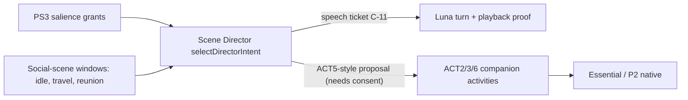
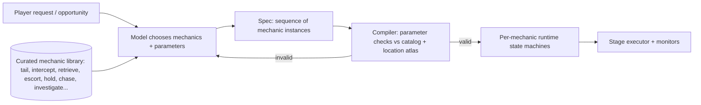
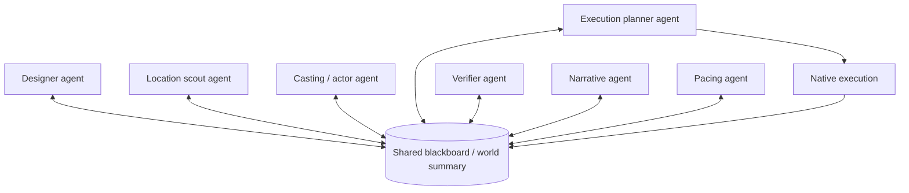
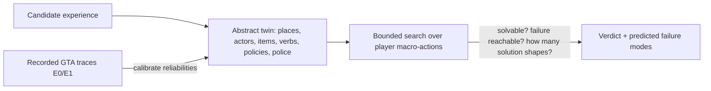
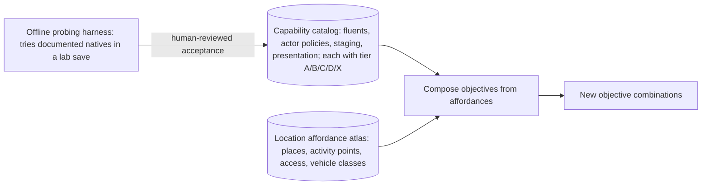

# ASTRA-002 · 03 — Competing AI Game Master architectures

> **Status:** architecture research, 2026-10-19. No architecture below has been run in GTA. Offline results (X-1…X-6, [offline-experiments/](offline-experiments/README.md)) test *contracts and algorithms* on an abstract model; they rank architectures but cannot accept one. Terms: **AGM** = AI Game Master (not the F11 "GM" menu), **IR** = intermediate representation of an experience, tiers **A/B/C/D/X** as in [01 §0](01-current-lsa-capability-audit.md).

## 0. Verdict in one paragraph

**Recommended: F — Grounded Experience Algebra (GEA).** The AGM writes experiences in a typed *algebra* of observable world fluents, actor policies and staged rules; a deterministic critic bank and an abstract-twin solver reject anything unobservable, unauthorised, impossible, trivial or stakeless; a new, narrowly-authorised **Stage Executor** realises only entities the experience itself created; **objective monitors** accept only authenticated world evidence; **precompiled accommodations** absorb player improvisation without live model calls; an idle-time **candidate bench** removes latency from offers; an **experience ledger** keeps verified progress and consequences across reloads. **Strongest alternative: B — a declarative compiler over a curated mechanic library**, which is cheaper and more predictable but measurably less novel (X-3), and which is also F's fallback if E2 shows a model cannot write valid IR at a useful rate. A (expanded Director) is the right *surface* for offers and narration but the wrong *foundation*; C's multi-agent roles survive only as offline design passes; D and E are components of F rather than complete architectures; G (runtime code synthesis) and H (neural world model) are rejected.

## 1. Criteria

Every candidate is scored on the fourteen criteria in the brief (§6): gameplay freedom; novelty/replayability; LSA compatibility; new native capabilities; ordinary GTA entities; multi-stage invention; player improvisation; verifiable outcomes; persistence; safety/recovery; inference cost; latency/performance; multi-actor scalability; feasibility/evidence gaps. Scores (0 = cannot, 3 = strong) are judgements anchored to the cited evidence; §10 collects them.

## 2. Architecture A — Expanded existing Director



**What it can do with little engineering.** Offer an outing during an idle or travel window ("there's a pier fishing contest at Del Perro — want to check it out?"), let Nathan *propose* ACT6 travel and ACT3 boarding with the existing consent flow, and narrate verified state. This is a real #20/#3 seed: an opportunity, a consented companion activity, a destination, an honest completion or abandonment.

**Where it becomes the wrong foundation** — at the first physical scene element:

* Admission is speech-only by contract (`validProposal` rejects anything but `kind:'speech'`, [`sceneDirectorAdmission.mjs:29-35`](../../../lsa-essential-e1-candidate/src/perception/sceneDirectorAdmission.mjs)); selection consumes PS3 entitlements, not designs ([`sceneDirector.mjs:57-122`](../../../lsa-essential-e1-candidate/src/perception/sceneDirector.mjs)).
* ACT targets resolve only to the player, the player's vehicle or a place ([`intentTemplates.mjs:51-54`](../../../lsa-essential-e1-candidate/src/activities/intentTemplates.mjs)); combat, flee, aim, weapon and policing families are excluded by the registry ([`activity-capabilities.v1.json`](../../../contracts/activity-capabilities.v1.json)).
* There is no spawn path besides P2's promoted-character spawn ([`PromotedCharactersIntegration.cs:418-440`](../../../native/promoted-characters/PromotedCharactersIntegration.cs)) and no objective tracking anywhere.

Growing the Director into scene authorship would break its own invariants (speech-only proposals, no provider call in selection) and duplicate ACT's planner (forbidden by the master plan, "no second planner"). **Keep A as the offer/narration surface of whatever architecture wins.**

## 3. Architecture B — Declarative gameplay compiler over a curated mechanic library



Each mechanic is an authored, tested module (like an LSPDFR callout or Essential's hostage controller): its own spawn rules, actor behaviour, success/failure sensors and authored adaptations. The model selects, parameterises (place, actors, vehicles, timers, complications) and sequences them.

* **Strengths:** predictable; each mechanic gets E0-level acceptance once; adaptation is authored per mechanic; ordinary engineering; works with a small library (3–5 mechanics) for a first fun slice.
* **Limits:** novelty is bounded by library size × composition. In X-3 a template baseline modelled on existing GTA mission mods produced **6 mechanically distinct experiences out of 294 valid** (unique-mechanical ratio 0.02) despite 85 % unique surface descriptions; sequencing mechanics multiplies combinations but never changes what is inside a mechanic. Adaptation is limited to what each module author anticipated.
* **Could it support surprisingly open-ended gameplay without code generation?** Partly: with ~15–25 mechanics and 2–4 stages it yields thousands of *sequences*, which feels varied for a while (L4D-style structured unpredictability). It cannot express "make this true under this pressure" for a combination nobody authored — the defining property of #20's "experiences no developer explicitly authored".

## 4. Architecture C — Hierarchical Game-Master agents



* **Latency and cost:** a design that passes through 5–7 dependent model calls is unusable mid-action. The only measured LSA model latency is for short dialogue turns — median model request 1.44 s, STT 0.66 s, TTS first byte 0.48 s over 13 turns ([`E6-GTA-verification-2026-10-01.md:31`](../../../docs/E6-GTA-verification-2026-10-01.md)); experience-sized generations will be longer (unmeasured, E2).
* **Contradictory state and duplicated authority:** concurrent agents writing a shared world summary recreate the "free prose asserting state" failure that *Orchestrated Reality* explicitly designs against with a single owner [02 S-29]; a *verifier agent* is a model judging outcomes, which violates R2 (doc 02 §11) and D-017.
* **X-4 evidence (structural, offline):** unchecked event-triggered re-planning showed players up to 0.14 incoherent objectives per episode at default parameters (0.33 at a 30 % bad-plan rate) and lowered designed-stake success *below* a static plan (0.60 vs 0.68 on the courier job); gating each re-plan with deterministic critics removed that exposure at the price of 1–2.5 model calls and ~6–26 s of waiting per episode, and still could not save a stage whose failure condition was the threat itself ([X-4 in 05](05-falsifiable-experiment-ladder.md#x-4-adaptation-strategies-run-2)).

**Salvage:** the roles are real *concerns*; in F they become **passes of one offline design loop** (designer → scout → casting → critics → solver), run during idle time with deterministic critics between passes, model tiers per pass, and no runtime authority.

## 5. Architecture D — Simulation-based planning



* **Can it predict playability?** At the abstraction level, yes and cheaply: the offline twin validates a spec in ~0.1–0.3 s on two cores (X-1/X-2 timings) and returns solvability, failure reachability and up to six distinct *solution shapes* (ways to win), which is a direct measure of improvisation room. In X-1, over a quarter of schema-valid generated specs (83/300) were unsolvable (critic `H7_UNSOLVABLE`): the twin catches what a JSON schema cannot.
* **What it cannot do:** the twin has no line of sight, traffic, navmesh, streaming, physics or AI tactics. A "solvable" verdict is a statement about the model only.
* **Reconciliation with real play:** (1) calibrate per-capability reliabilities from E0 traces, the pattern Code World Models use with unit tests from trajectories [02 S-30]; (2) never let the twin overrule live evidence — progress advances only on real world states, as in Mind-Studio's rule of rolling back to the last verified checkpoint [02 S-31]; (3) treat a twin/world disagreement as an accommodation trigger, and log it as calibration data.

**Verdict:** an indispensable *component* (feasibility oracle and failure-mode predictor), not an architecture: it neither invents nor executes.

## 6. Architecture E — General gameplay affordance engine



Two halves with very different risk:

* **Curated affordances (ordinary engineering + measurement).** A catalog that says *what can be observed* (fluents), *what can be made to happen* (policies, staging) and *how well it is known* (tier). The desk census found 31 fluents, 28 actor policies, 17 staging and 5 presentation capabilities ([`capability_catalog.json`](offline-experiments/gea/capability_catalog.json), X-1). The split is the key finding: **21 of 31 fluents are already A/B (LSA can largely *see* what an AGM must verify), but only 8 of 28 actor policies and 1 of 17 staging capabilities are A/B (LSA cannot yet *make* scene events happen)**. Composition over this catalog is what produced 171 mechanically distinct valid experiences out of 300 in lab mode.
* **Discovering affordances (research).** Automatically finding *new* executable affordances (e.g., probing natives or props) runs into constraint 10 (no invented native signatures), is slow to verify and overlaps #38/#40. It belongs in an offline, human-reviewed harness that promotes a capability's tier only through E0-style evidence.

**Verdict:** the curated half is F's grounding layer; the discovery half is deferred research.

## 7. Architecture F — Grounded Experience Algebra (recommended, independently synthesised)

### 7.1 Picture

```mermaid
flowchart TB
  subgraph Always-on, deterministic, cheap
    SIT[Situation model: world-level read model + change detection]
    DIR[Opportunity and pacing director: intensity, relax windows, story-sifting patterns]
    MON[Objective monitors: evidence ladder]
    ACC[Accommodation engine: precompiled contingencies]
    LED[(Experience ledger: timeline-scoped, verified checkpoints)]
  end
  subgraph Idle-time or on request, model + critics
    DES[Designer passes: concept, scout, cast, pressure]
    CRIT[Critic bank H1-H13 / S1-S7]
    TWIN[Abstract-twin solver: solvable, failure reachable, solution shapes]
    BENCH[(Candidate bench: quality-diversity archive)]
  end
  subgraph Execution, narrowly authorised
    COMP[Compiler: bind IR to atlas places, spawn points, budgets]
    STX[Stage Executor: scene-owned entities only, SceneOwnerToken]
    ACTB[ACT bridge: consented companion activities]
    NARR[Narration bridge: C-11 speech beats bound to ledger facts]
    KNOW[Knowledge bridge: PS4 lane items, observer-qualified]
  end
  SIT --> DIR
  DIR -->|offer| BENCH
  DES --> CRIT --> TWIN --> BENCH
  BENCH -->|accepted by player| COMP --> STX
  COMP --> ACTB
  STX --> MON
  SIT --> MON
  MON --> LED
  MON --> ACC --> STX
  LED --> NARR
  LED --> KNOW
```

### 7.2 What is new

1. **Gameplay is an algebra over observable fluents, not a script.** An objective is a formula (`and`, `or`, `not`, `held n`, `within n`, `before`, `ever`) over fluents that have a *sensor* in the catalog (`near(case, safehouse)`, `holding(player, case)`, `vehicle_driveable(w_car)`, `conversed(farmer)`, `player_busted`). A narrative claim cannot even be written as an objective (critic H5). This is what makes the IR *executable*: every objective has a monitor.
2. **Pressure synthesis by opposition analysis.** A spec is rejected unless failure is reachable (H13 + search) — the designer must attach actor policies (flee, chase, guard, combat, drive-to) whose effects threaten the objective's fluents. Stakes are mechanical, not narrated.
3. **Design-time verification against a calibrated twin with solution-shape counting.** "Several distinct ways to win" (S4 warns on one) is the formal version of "the player can solve it in an unanticipated way" and feeds plan recognition at runtime (BQ-3).
4. **Precompiled accommodation with stake-continuity islands.** For each critical role the critics demand an accommodation (S1) — "if the case is destroyed, the ledger in the courier's car becomes the target" — validated at design time (and S7 flags accommodations that silently replace the designed path). Runtime adaptation is a table lookup, not a model call.
5. **Idle-time quality-diversity bench.** During idle windows the designer fills an archive keyed by mechanic features × place class, so an offer is instant and the bench itself is the novelty instrument (MAP-Elites, [02 S-20]).
6. **Dual authority.** The AGM adjudicates the world *omnisciently* (it may read any scene entity's state), while NPCs keep knowing only what they witness or are told (D-004). Adjudication never flows into prompts except as typed, observer-qualified PS4 lane items.
7. **A new, narrow executor instead of a second general one.** The Stage Executor may create, task and clean up only entities stamped with its own `SceneOwnerToken`; companions move only through consented ACT proposals; Essential keeps every actor it owns. This is the explicit D-001 change the brief requires to be proposed (D-024 candidate, [04 §3](04-gameplay-generation-execution-contract.md)).

### 7.3 Lifecycle (summary; full contract in 04)

`opportunity / request → concept (bench or designer) → capability grounding (catalog tiers) → feasibility (critics + twin) → offer & consent → compile & stage (StageLease) → activate objectives (stamp) → GTA execution (player, scene actors, Nathan via ACT) → world observation (monitors) → accommodation / conclusion → verified completion or failure → cleanup (release/delete scene entities) → consequences (ledger facts, memory offers)`.

### 7.4 Offline evidence for F (abstract model, not GTA)

| Claim | Result | Source |
| --- | --- | --- |
| Composition over a tiered catalog yields mechanically distinct gameplay where today's verified surface yields almost none | 0 / 2 / 171 distinct valid experiences per 300 in accepted / play / lab modes | X-1 |
| Hard critics reject the fault classes that make generated missions fake, unsafe or unplayable | 759 / 760 faulty specs rejected across 19 classes, 0 of 40 valid specs rejected; the one fault that passed was flagged by soft critics S1/S7 | X-2 |
| The algebra produces mechanical (not just surface) novelty | unique-mechanical ratio 0.83 vs 0.02 for templates; 98 vs 3 archetype sequences; surface variety similar (0.99 vs 0.85) | X-3 |
| Precompiled accommodation beats live re-planning on exposure and timing | best designed-stake success with 0 runtime model calls and 0 incoherent objectives; critic-gated re-planning matches it only when the threat leaves time to react; a generic fail-forward only moves goalposts | X-4 ([05](05-falsifiable-experiment-ladder.md#x-4-adaptation-strategies-run-2)) |
| An evidence ladder refuses fabricated completion | 0 false or early "achieved" over 20 000 traces with 11 fault types; p50 latency cost ~0.6 s | X-5 |
| Solver-guided mysteries are fair and repairable | 100 % uniquely solvable vs 51 % unchecked (4.4 % misleading); every single-clue loss repaired | X-6 |

## 8. Architecture G — Runtime code synthesis (rejected)

The model writes C#/script code at runtime (Voyager / Code-as-Policies style) that is compiled and run inside the plugin. It maximises freedom on paper, but: correctness cannot be known a priori [02 S-07]; Voyager's verification is another model [02 S-06]; a crash or a stray native in an RPH plugin affects the owner's whole game; and the brief forbids reliance on unvalidated model-generated scripts. **Kept only for #40**, as an *offline* generator of new mechanic modules that pass tests, review and manual enablement before they ever become catalog entries.

## 9. Architecture H — Neural world model as Game Master (rejected)

A generative world model (Genie 3, GameNGen) renders or predicts the game. It cannot read or write GTA's state, so it cannot be "the authority on what actually happened"; it holds consistency for minutes, not sessions [02 S-32, S-33]. Rejected; nothing in the AGM depends on it.

## 10. Comparison

| Criterion | A Director+ | B Compiler+library | C Agents | D Twin | E Affordances | **F GEA** | G Code synth | H Neural WM |
| --- | :-: | :-: | :-: | :-: | :-: | :-: | :-: | :-: |
| Gameplay freedom | 0 | 2 | 2 | – | 2 | **3** | 3 | 1 |
| Novelty / replayability | 1 | 1 | 2 | – | 2 | **3** | 3 | 2 |
| Compatibility with LSA | 3 | 2 | 1 | 3 | 2 | **2** | 0 | 0 |
| New native capability needed (3 = little) | 3 | 1 | 1 | 3 | 2 | **1** | 0 | 0 |
| Uses ordinary GTA entities | 1 | 3 | 2 | – | 3 | **3** | 3 | 0 |
| Multi-stage invention | 0 | 2 | 2 | – | 2 | **3** | 3 | 1 |
| Player improvisation | 1 | 2 | 1 | 2 | 1 | **3** | 2 | 1 |
| Verifiable outcomes | 2 | 3 | 1 | 2 | 2 | **3** | 1 | 0 |
| Persistence & consequences | 2 | 2 | 1 | – | 1 | **3** | 1 | 0 |
| Safety & recovery | 3 | 3 | 1 | 3 | 2 | **3** | 0 | 1 |
| Inference cost (3 = cheap) | 3 | 2 | 0 | 3 | 2 | **2** | 1 | 0 |
| Latency & performance | 3 | 3 | 0 | 2 | 2 | **3** | 1 | 0 |
| Multi-actor scalability | 1 | 2 | 1 | 2 | 2 | **2** | 1 | 0 |
| Feasibility / evidence (3 = best known) | 3 | 2 | 1 | 2 | 1 | **1** | 0 | 0 |

"–" = not a complete architecture on that criterion. F's weakest scores are the honest ones: it needs a new native capability (Stage Executor, owner decision) and its runtime feasibility is the least proven, because the parts that make it general (scene staging, scene-actor control, world sensors) are tier C today.

## 11. Recommendation, strongest alternative, and what would flip the decision

* **Recommend F**, built so that **B is a strict subset**: a curated mechanic is just a validated macro in the algebra. Every early experiment (E1–E4) can therefore start with hand-picked macros and widen toward free composition as evidence accumulates — templates serve as experiments, never as the claimed end state (brief constraint 12).
* **Strongest alternative: B.** Choose it outright if E2 shows the designer cannot reach a useful validity/novelty rate (≥ 30 % of first drafts valid after ≤ 3 critic rounds, see 05), or if E6 shows players cannot tell algebra-composed experiences from library sequences.
* **Flip conditions against both:** if E0 shows LSA-spawned peds cannot keep tasks under Essential and GTA AI (U-01/U-06), the executable surface collapses to vehicles, props, pickups and companions, and the AGM shrinks to A-plus-props (outings, races, deliveries, scavenger hunts); #6 action scenes would then need the standalone native core.

## 12. How F could fail fundamentally (and the counter-move)

| # | Failure | Detected by | Counter-move |
| --- | --- | --- | --- |
| FF-1 | Scene actors lose their tasks to Essential reflexes, GTA ambient AI or police | E0.2, E0.6 | Make Essential yield via `NpcState` flags (ACT6 precedent); restrict to vehicle-bound actors; host in the standalone native core |
| FF-2 | The twin is too coarse: specs it calls solvable are not playable (navmesh, traffic, line of sight) | E1–E4 disagreement log | Calibrate reliabilities per capability and place class; add place-class constraints; widen accommodations |
| FF-3 | World sensors are unreliable (pickup collection, area tests, ownership after streaming) | E0.5, E1 | Restrict objective algebra to fluents with measured reliability; require two independent sensors for decisive fluents |
| FF-4 | The model cannot write valid IR often enough | E2 | B: curated macros + parameter filling; small fine-tuned local designer for the bench |
| FF-5 | Mechanical novelty does not feel new or fun | E6 | Add authored set-piece macros; player-taste model from accepted/declined offers; human curation of the bench |
| FF-6 | Latency or cost budgets are exceeded | E2, E8 | Bench-only generation; disable live re-design; local models |
| FF-7 | Reloads break continuity (handles, streamed-out entities) | E7 | Conclude-on-reload by default; re-stage only stages whose state is reconstructible from verified checkpoints |
| FF-8 | The owner keeps D-001 strict (no new executor) | owner decision | AGM limited to offers, narration, companion outings and Essential-owned compositions (tier D) |
