# ASTRA-002 · 04 — Gameplay generation and execution contract

> **Status:** proposed contract, 2026-10-19 — **not implemented, not approved, not tested in GTA.** It defines what the recommended architecture (F, [03 §7](03-architecture-candidates.md)) must guarantee so that generated experiences are playable, verifiable, recoverable and compatible with LSA's existing authorities. Labels: **[EXISTING]** cites a current decision/contract; **[PROPOSED]** is new; **[UNVERIFIED]** is an assumption a GTA experiment must confirm (IDs U-xx, register in §16); **[OWNER]** needs the owner's decision.

## 1. Three levels of AI involvement — and the test for the third

| Level | What the AI does | Example for "Let's pull off a job" | Is it gameplay invention? |
| --- | --- | --- | --- |
| **1 Narrative invention** | Describes a mission, character or event. | Nathan: "There's a courier at the docks carrying a case. Let's take it." Nothing is spawned; nothing can be checked. | No. |
| **2 Game-state orchestration** | Coordinates existing entities and validated capabilities into a real encounter. | A van with an armed courier is spawned at Terminal and drives toward Mission Row; a blip appears. | Not by itself — it is staging. |
| **3 Genuine gameplay invention** | Composes mechanics into a new interactive experience with verifiable progress, several possible outcomes and consequences. | The case is an item the courier really holds; success is `near(player, safehouse) ∧ holding(player, case)` under a pursuit policy; failure is the van reaching Mission Row, Wasted or Busted; destroying the van destroys the fragile case, which re-targets the job onto a ledger hidden in the courier's car; the docks crew's hostility persists. | **Yes, if it passes §1.1.** |

### 1.1 Operational test for level 3 [PROPOSED]

An experience counts as *genuinely invented gameplay* only if all of the following hold, each mechanically checked:

1. **Observable objectives** — every success/failure condition is a formula over catalog fluents with sensors (critic H5); no claims.
2. **Reachable success and reachable failure** — the abstract twin finds a success path and a failure path (H7, H13).
3. **Room to improvise** — at least two distinct solution shapes (soft critic S4 warns on one).
4. **A consequential decision** — at least one point where the player's choice changes later world state (e.g., ram vs. shoot the courier changes whether the case survives).
5. **World-authored completion** — terminal states come only from the objective monitors (§9).
6. **Not a template** — its mechanical signature ([`novelty.py`](offline-experiments/gea/novelty.py)) is not in the template set; anything that fails this is reported as a *template experiment*, never as general invention (brief constraint 12).

## 2. The seven questions every experience must answer — and the IR field that answers each

| Question (brief §3) | IR field(s) | Checked by |
| --- | --- | --- |
| Where does it physically happen? | `roles[].place` (atlas place), `player_start`, compiler's concrete binding | H1, H11, compiler place-class rules |
| Which characters, objects, vehicles and locations exist? | `roles[]` with `source: spawn / companion / atlas / existing / player` | H1, H8 (no orphans), H9 (budgets), StageLease readback (§7) |
| Which mechanics make the objectives executable? | `stages[].policies[]`, `rules[]`, catalog capabilities with tiers | H2, H3, H4 |
| What observable conditions define progress, success and failure? | `stages[].objectives[]` formulas, `invariants[]` | H5, H6, H7, H13; runtime monitors (§9) |
| What happens if the player ignores, changes or breaks the plan? | `accommodations[]`, stage `on_timeout`, conclusion rules, solution shapes | S1, S4, S7; X-4 |
| Which consequences genuinely persist? | `consequences[]` (closed vocabulary) | H12; ledger (§11) |
| What makes it enjoyable rather than merely executable? | `pitch`, `genre`, pressure policies, pacing tags, solution-shape count | S3/S4/S6 + **human evaluation (E6)** — cannot be proven by critics |

## 3. Authority map

| Component | May | May not | Basis |
| --- | --- | --- | --- |
| **AGM Designer** (model passes) | Propose ExperienceSpecs; propose speech-beat *text templates*; propose accommodations | Execute anything; read prompts of characters; assert outcomes | [PROPOSED]; R1 |
| **Critic bank + abstract twin** | Reject/accept specs; compute solution shapes and failure modes | Change a spec silently (it returns diagnostics to the designer) | [PROPOSED] |
| **Compiler** | Bind IR roles to concrete places, models and spawn points; reserve budgets; emit a StageLease request | Exceed budgets; choose places outside the atlas | [PROPOSED] |
| **Stage Executor** (new native) | Create, persist, task, blip and delete entities **stamped with its own `SceneOwnerToken`**; set relationship groups among them | Task the player, a promoted character, an Essential-managed ped, or any entity it did not create (unless an explicit *adopt* capability is later accepted); set the mission flag; teleport the player | **[OWNER] D-024**, amends D-001 (LOCKED) |
| **Objective monitors** | Read world state for scene entities, the player and companions; write ObjectiveEvidence | Write NPC knowledge; act | **[OWNER] D-025**; D-004 kept |
| **Accommodation engine** | Fire precompiled responses on monitored threats; request ≤ 2 async re-designs | Invent unvalidated responses at runtime | [PROPOSED] |
| **Experience ledger** | Persist verified checkpoints, facts and consequences per timeline | Persist entity handles, claims, or anything unverified | [PROPOSED]; C-07 |
| **Scene Director / PS6** | Deliver AGM narration as C-11 speech tickets; detect opportunity windows | Author scenes; execute; select AGM actions | [EXISTING] D-013, C-11 |
| **ACT** | Execute consented companion activities proposed with `source:'game_master'` | Accept AGM proposals without the player's consent | [EXISTING] ACT5 pattern; D-013 |
| **Essential** | Remain sole executor for every actor it owns; keep conversations | — | [EXISTING] D-001, D-012, D-016 |
| **PS0–PS4** | Keep observer-qualified knowledge; PS4 assembles prompts | Treat AGM adjudication as an observation | [EXISTING] D-004, D-008 |
| **Memory K / P2** | Store what promoted characters witnessed or were told | Store AGM world state or claims | [EXISTING] D-003, D-018, D-023 |
| **Provider inference / voice** | Run designer passes (tiered), Luna dialogue, TTS | Run in the per-frame loop; decide outcomes | [PROPOSED] §14 |
| **Player** | Request, accept, decline, steer ("we go in through the back"), cancel, ignore | — (never controlled by the AGM) | brief constraint 9 |

### 3.1 Proposed decisions and contracts [OWNER]

| ID | Proposal |
| --- | --- |
| **D-024** Scene staging authority | Amend D-001: "Essential is the sole native executor for actors it owns. An LSA Stage Executor may create, task and clean up *scene-owned entities* — entities it created for an accepted experience and stamped with a `SceneOwnerToken` — within StageLease budgets. It never tasks the player, promoted characters (ACT only), Essential-owned actors or ambient peds." Alternative if refused: host the Stage Executor in the standalone native core with Essential absent. |
| **D-025** World adjudication | "The AGM may read world state for scene entities, the player and companions to adjudicate objectives. Adjudication is not observation: it never becomes NPC knowledge except through a typed PS4 lane item describing what a character was told or witnessed." |
| **C-16** ExperienceSpec v1 | IR schema of §4 plus the compile modes of §6. |
| **C-17** StageLease + SceneOwnerToken | §7. |
| **C-18** ObjectiveEvidence | §9. |
| **C-19** ExperienceLedger | §11. |
| **C-20** Offer, consent and interruption policy | §12. |

## 4. ExperienceSpec v1 (C-16) [PROPOSED]

The offline prototype implements this schema in [`validator.py`](offline-experiments/gea/validator.py) and [`fixtures.py`](offline-experiments/gea/fixtures.py). Condensed:

```text
ExperienceSpec {
  id, mode: mission|adventure|action_scene|immersive, genre[], consent: player_requested|offered,
  pitch,                                  // shown to the player; never evidence
  player_start?,                          // advisory; the player is never moved
  roles[] { id, kind: player|ped|vehicle|item|prop|pickup|place,
            source: player|companion|spawn|atlas|existing,
            place?, tags[] (armed, fragile, informant, vip, animal, clue, affordance, ...),
            in?, driver?, deferred?, revealed_by? },
  start: stageId,
  stages[] { id, timeout (steps or seconds),
             objectives[] { id, kind: success|failure, formula },
             policies[] { role, cap, args{}, consented? },          // actor behaviour while the stage is active
             rules[] { id, on: formula, then: response[] },          // reactive, deterministic
             on_success, on_failure, on_timeout: stageId|END_* },
  invariants[] { id, formula },
  accommodations[] { threat { role_lost | objective_blocked | player_far | police_interrupt | companion_failed },
                     then: response[] },                             // validated at design time
  consequences[] { on: END_*, effect: ledger_fact|relationship_note|reputation|unlock_followup|memory_offer
                   | player_money|player_wanted|vehicle_ownership (only with player_opt_in) },
  budgets { peds, vehicles, props, pickups, items, steps, model_calls }
}
formula := fluent(args) | and[...] | or[...] | not f | held{f, n} | within{f, n} | ever f | before[f, g]
response := activate{role, cap, args} | deactivate{role} | spawn{role} | reassign{from, to}
          | transform{objective, to: formula} | goto{stage} | conclude{outcome} | speak_beat{beat} | note | blip
forbidden := set_player_money | kill_player | teleport_player | set_mission_flag | exec_code | set_stat
          | give_player_weapon_permanent | clear_area_all
```

Fluents, policies, staging and presentation capabilities come only from the catalog ([`capability_catalog.json`](offline-experiments/gea/capability_catalog.json)); each entry carries an evidence tier and a reference. The [courier job fixture](offline-experiments/gea/fixtures.py) is a complete worked example (three stages, deferred pursuers, fragile item, ledger accommodation, persistent consequence).

**Why this is not "valid JSON":** schema validity is critic H1 only. In X-1, 83 of 300 schema-valid generated specs were unsolvable in the twin (H7) and 7 placed vehicles where they cannot exist (H11). All 19 fault classes in X-2 are well-formed JSON; only one of them (dangling references) is a pure schema error — the other 18 need semantic critics or the twin to be caught.

## 5. Lifecycle

```mermaid
stateDiagram-v2
  [*] --> CANDIDATE: designer pass or bench entry
  CANDIDATE --> VALIDATED: hard critics pass, twin solvable, failure reachable
  CANDIDATE --> REJECTED: diagnostics back to designer (max 3 rounds)
  VALIDATED --> OFFERED: opportunity window or player request
  OFFERED --> DECLINED: player declines or ignores (expiry)
  OFFERED --> ACCEPTED: exact accepted player turn (D-022)
  ACCEPTED --> STAGING: compiler binds places, StageLease granted
  STAGING --> ACTIVE: readback confirms entities; objectives stamped
  STAGING --> ABORTED: lease refused, spawn readback failed, budget exceeded
  ACTIVE --> ACTIVE: stage transition at a verified checkpoint
  ACTIVE --> ADAPTING: threat detected
  ADAPTING --> ACTIVE: accommodation applied
  ADAPTING --> CONCLUDING: no accommodation; graceful ending
  ACTIVE --> CONCLUDING: success, failure, timeout, cancel, abandonment
  ACTIVE --> INTERRUPTED: world epoch change, reload, GTA exit, story mission starts
  INTERRUPTED --> STAGING: re-stage current stage from last verified checkpoint (if reconstructible)
  INTERRUPTED --> CONCLUDING: otherwise
  CONCLUDING --> CLEANED: scene entities released/deleted, blips and setup effects reverted
  CLEANED --> [*]: consequences written to ledger; memory offer (optional)
```



| Brief lifecycle stage | Contract stage | Requires |
| --- | --- | --- |
| Player request or world opportunity | OFFERED (from bench) or on-request design | §12 windows; situation model (§8) |
| Gameplay concept | CANDIDATE | Designer passes (§14) |
| Capability grounding | CANDIDATE → VALIDATED | Catalog tiers + compile mode (§6) |
| Feasibility validation | VALIDATED | Critics H1–H13, twin search |
| Scene preparation | STAGING | StageLease, spawn placement, readback (§7) |
| Objective activation | ACTIVE | Stamp: hostRunId, worldEpoch, entity incarnations, t_activate (§9) |
| Actual GTA execution | ACTIVE | Player plays; Stage Executor runs scene policies; ACT runs consented companion activities |
| World observation | ACTIVE | Monitors at ~4 Hz (budgeted) |
| Adaptation | ADAPTING | §10 response ladder |
| Verified completion/failure | CONCLUDING | ObjectiveEvidence ACHIEVED/FAILED |
| Cleanup | CLEANED | Release/delete owned entities; revert setup effects (§11.2) |
| Persistent consequences | CLEANED → ledger | C-19 rows; memory *offer* only |

## 6. Capability contracts and compile modes [PROPOSED]

```text
Capability {
  id, kind: fluent|policy|staging|presentation, tier: A|B|C|D|X,
  actor?: promoted|scene|essential_managed|essential_scene,
  preconditions (twin), effects (twin), sensors (for fluents: how it is read, sample rate, cost),
  reliability { observed_successes, observed_trials, last_gta_session } (filled by E0/E1),
  known_failures[], refs[] (repo path or native DB / RPH member)
}
```

* **Compile modes** (implemented offline): `accepted` (A only), `play` (≤ B), `lab` (≤ C, lab saves only), `bridge` (≤ D, Essential internals). Player-facing play uses `accepted` once E0/E1 have promoted the needed capabilities; until then experiences run only in `lab` mode on a dedicated save. [PROPOSED]
* **Promotion rules:** C → B requires production-path LSA source and tests; B → A requires timestamped GTA evidence from the owner's runtime with the exact build pins of [01 §0](01-current-lsa-capability-audit.md). Demotion on any regression. [PROPOSED]
* **Never in the catalog:** invented natives or signatures; GTA Online or anti-cheat-related functionality; `SET_MISSION_FLAG` (tier X: it blocks saving and silences Nathan, [01 §1 F8](01-current-lsa-capability-audit.md)).

## 7. Stage leasing and actor ownership (C-17) [PROPOSED][OWNER]

```text
StageLease { leaseId, experienceId, sceneOwnerToken, hostRunId, worldEpoch, budgets, expiresAt, entities[] }
SceneEntity { roleId, handle, incarnation (model + creation gameMs + handle), kind, persistent, owner: agm_stage,
              state: REQUESTED|CREATED|PERSISTENT|TASKED|RELEASED|DELETED|LOST }
```

1. **Creation:** only for roles with `source: spawn`; out of the player's view (`on_screen`/sphere-visibility checks) and inside a distance band; on a navigable, class-compatible spot (vehicles on roads, boats in water) [UNVERIFIED U-02, U-05]. Every creation is confirmed by **readback** (entity exists, model, position) before the stage becomes ACTIVE.
2. **Ownership exclusion:** the Stage Executor never tasks the player, promoted characters (ACT only), Essential-managed actors, or ambient peds. *Adopting* an existing world entity is a separate capability (tier C) that would need its own acceptance.
3. **Coexistence with Essential:** scene peds near the player are exposed to Essential's perception and reflexes. The Stage Executor must mark them so Essential yields (the `NpcState` flags ACT6 uses for promoted actors) or prove that Essential ignores non-managed peds [UNVERIFIED U-01, U-06].
4. **Owner token:** C-06's `Encounter.Owner` gains `agm_stage` so arbitration never sees an AGM ped as idle [EXISTING C-06 extended].
5. **Release and cleanup:** on every terminal state, each entity is released (`SET_*_AS_NO_LONGER_NEEDED`-class) or deleted; the lease registry is persisted so that a plugin reload can sweep orphans by handle+incarnation within the same host run; a world-epoch change voids all handles [UNVERIFIED U-09].
6. **Budgets:** per experience (default peds 8, vehicles 4, props 6, pickups 4, items 4) and per session; final numbers from E0.8 pool measurements.

## 8. Situation model (BQ-4) [PROPOSED]

A compact, typed, world-level read model rebuilt incrementally; the AGM never scans the whole world and never calls a model per frame.

| Field | Source | Rate |
| --- | --- | --- |
| Player: place, zone, interior, on foot/vehicle, speed, wanted level, health band, scripted/mission state | existing natives (A/B), M9 | 1–4 Hz |
| Companion(s): presence, activity/owner token, ACT state | P2, ACT, C-06 | on change |
| Scene entities of the active experience: alive, place, holder/occupant, driveable, fleeing/in-combat | Stage Executor readback | 4 Hz while active |
| Nearby notable entities (anchors) | PS anchors (≤ 100 m, ≤ 32/tick) | existing budget |
| Recent incidents (crash, firing, death seen, wanted change) | PS2/M9 events | event-driven |
| Intensity estimate (L4D-style) | firing, damage, wanted, speed, near-misses; decays when calm | 1 Hz |
| Opportunity tags | story-sifting patterns over the event log; social-scene windows | event-driven |
| Location affordances | LSA-owned atlas file (places, activity points, access, vehicle classes) | static |
| Time, weather | natives | 0.1 Hz |

**Dual authority:** this model is for *adjudication and design*. NPC knowledge still flows only through PS2 witness → PS3 salience → PS4 lanes (D-004, D-015). When an experience gives Nathan knowledge (he pitched the job, so he knows the pitch), that knowledge enters as a typed lane item `SITUATION.experience { told: pitch, stage, verified_facts[] }`, never as raw adjudication.

## 9. Objective evidence (C-18) [PROPOSED]

### 9.1 The five-way distinction (BQ-6)

| State | Meaning | Who writes it | Evidence |
| --- | --- | --- | --- |
| **Proposed** | Appears in a spec or an ACT proposal | Designer / AGM | none required |
| **Accepted** | Player consented; ACT admitted; native handler acknowledged | Player turn (D-022), ACT, Essential | acceptance receipts — **never physical evidence** (D-017) |
| **Attempted** | A task or staging call was issued and returned | Stage Executor / ACT | call receipts |
| **Physically changed** | A sensor shows the state changed (entity exists, moved, died, item held) | Monitors | authenticated native samples / ACT `PHYSICALLY_COMPLETED` for companion fluents |
| **Objective achieved** | The objective formula held under the evidence ladder | Monitors only | §9.2 |

### 9.2 Evidence ladder for objectives

`PROPOSED → ACCEPTED → STAGED → ACTIVE → OBSERVED → ACHIEVED` (or `FAILED`, or `VOID`).

* An objective becomes **ACTIVE** with a stamp `{hostRunId, worldEpoch, entity incarnations, t_activate}` (C-13).
* **Admissible evidence:** authenticated native sensor samples for the stamped host run, epoch and incarnations; ACT `PHYSICALLY_COMPLETED` receipts for companion fluents; M9 incidents for Wasted/Busted/wanted. **Inadmissible:** model or Luna text, handler acknowledgements, player utterances, unauthenticated frames, samples before `t_activate`, stale epochs, reused handles.
* **ACHIEVED** requires the formula to hold for ≥ 3 consecutive in-order samples spanning ≥ 500 ms, with no gap > 600 ms and no physically implausible jump (> 90 m/s) — the parameters of monitor M3 in X-5; real values come from E1.
* **Three-valued verdicts** (runtime-verification style): `true`, `false`, `inconclusive`. An epoch change or a lost handle before a verdict makes the objective **VOID**, which triggers re-staging or accommodation, never success.
* **Decisions vs outcomes:** the player's words can *select a branch* ("we go in through the back" activates the back-door stage variant) but are never evidence that anything happened.

Offline (X-5, 20 000 synthetic traces with model claims, handler acks, stale epochs, handle reuse, teleports, out-of-order/duplicate delivery, dropouts, unauthenticated and pre-activation frames, flicker): naive monitors declared fabricated completions in 77–93 % of never-true traces; the ladder declared none and missed none, at a p50/p95 latency of 0.63/1.38 s after the true event.

## 10. Adaptation contract (BQ-3) [PROPOSED]

**Objectives specify *what* must become true, never *how*.** Any trajectory that satisfies the formula counts, so an unanticipated approach (ramming instead of shooting, a boat instead of a car) succeeds without re-planning.

| Threat (detected by monitors) | Response ladder (first that applies) |
| --- | --- |
| Critical role lost (courier killed, van destroyed, witness fled) | 1 continue if another solution shape remains → 2 precompiled accommodation → 3 graceful conclusion → 4 one async re-design (≤ 2 per experience) → 5 abort + cleanup |
| Objective blocked (fragile case destroyed) | 2 → 3 → 4 |
| Player far / disengaged for N checks (abandonment) | narrate once, then conclude; offer resumption only if the state is reconstructible |
| Police interruption (wanted ≥ n) | built-in stage rule (escape becomes an objective) or pause objectives' timers |
| Companion activity failed (ACT terminal non-success) | proceed without the companion; narrate truthfully (ACT4) |
| Story mission / cutscene / mission flag detected | INTERRUPTED → conclude (never fight a Rockstar mission) |
| Reload / epoch change / GTA exit | INTERRUPTED (§11) |

**Anti-churn rules:** ≤ 1 objective change per stage without stage progress; ≥ 20 s dwell before another change; no cosmetic re-wording of an unchanged objective; every change is narrated once, with its world cause. **Stake continuity:** an accommodation must keep the experience's core stake (the job is still "get the score home"), or end it as `CONCLUDED`; a success reached only after the goalposts moved is reported as such (`END_SUCCESS_MOVED` in X-4) and never as the original success. Re-design runs asynchronously, never blocks, never applies during high intensity, and must pass the same critics.

## 11. Persistence, cleanup and consequences (C-19) [PROPOSED]

### 11.1 Ledger

```text
ExperienceLedgerRow { experienceId, timelineId (C-07), worldProfileId, hostRunId, specHash,
                      state, stage, checkpoints[] { stageId, evidenceRefs[], at {utc, gameClock} },
                      outcome?, consequences[] { fact, scope, expires? }, offeredMemory?: bool }
```

* Only **verified stage boundaries** are checkpoints; mid-stage progress is never persisted.
* Rows are timeline-scoped and fail closed under TimelineGuard (no guessing save lineage) [EXISTING C-07].
* **Never persisted:** entity handles, claims, model text, unverified progress, strangers' identities (scene-local SubjectRefs only, C-15).
* **Memory:** the ledger does not write Memory K. Nathan remembers what he witnessed (PS2 → M3 attribution, D-023) and what the player tells him; the AGM may *offer* "want Nathan to remember this?" via the existing explicit-memory path.

### 11.2 Reversible setup vs irreversible player actions

| Reversible AGM setup (reverted at cleanup) | Irreversible player actions (recorded, never undone) |
| --- | --- |
| Spawned peds/vehicles/props/pickups; blips and routes; relationship groups among scene peds; scenario-blocking areas; temporary weather/time-cycle changes; help text | Kills, destroyed property, wanted level earned, vehicles the player took, money the player spent, anything Essential or GTA did on its own |

### 11.3 Discontinuities

| Event | Contract behaviour |
| --- | --- |
| Player death (Wasted) / Busted | Stage failure objective (default); optional authored "second chance" only if declared in the spec |
| Save loaded / clock regression | INTERRUPTED; re-stage the current stage from the last checkpoint if every role is re-creatable and no player-irreversible fact contradicts it; otherwise conclude |
| GTA shutdown or crash | Ledger row stays INTERRUPTED; on next start the AGM may offer "pick up where we left off" from the last checkpoint |
| Missing actor (streamed out, despawned) | Monitor VOID → accommodation or conclusion |
| Partial completion | Stage-level checkpoint only |
| Long-running experiences | Split into stages with checkpoints; nothing waits on RAM state across sessions |

## 12. Offer, consent and interruption (C-20) [PROPOSED]

* **Offers only in opportunity windows:** not wanted, not in a Rockstar mission/cutscene/switch, not in combat, not while the player is talking, no active experience; social-scene windows (idle, travel) are preferred.
* **Rate limits:** ≥ 15 min between unsolicited offers by default; every decline doubles the interval for that genre; "not now" suppresses for the session; a per-session cap.
* **Consent:** an unsolicited experience starts only after an exact accepted player turn (D-022), mirroring ACT5's 90 s proposal expiry and repeat suppression [EXISTING ACT5 pattern].
* **Always cancellable:** "stop", "forget it", or the F11 menu ends the experience and cleans up; the AGM never pauses GTA and never removes free-roam control.
* **No artificial urgency:** timers only where the fiction motivates them, and never extending beyond the experience.

## 13. Integration sequences

```mermaid
sequenceDiagram
  participant P as Player
  participant D as Director/PS6
  participant G as AGM (bench, compiler)
  participant S as Stage Executor
  participant A as ACT
  participant M as Monitors
  participant L as Ledger
  D->>G: opportunity window (idle, travel)
  G->>D: speech beat "offer" (C-11 ticket)
  D->>P: Nathan pitches the job
  P->>G: accepted turn "let's do it" (D-022)
  G->>S: StageLease(spawn courier, van, case; budgets)
  S-->>G: readback ok (handles, incarnations)
  G->>A: ActivityProposal follow_player (source game_master, consented)
  G->>M: activate objectives (stamp hostRunId, epoch, incarnations)
  M-->>G: evidence: holding(player, case) ACHIEVED
  G->>L: checkpoint stage s2
  G->>D: speech beat "we have the case" (bound to ledger fact)
  M-->>G: threat: van destroyed, case destroyed
  G->>S: accommodation: spawn ledger item in courier car
  G->>D: speech beat "case is gone, get the ledger"
  M-->>G: near(player, safehouse) and holding(player, ledger) ACHIEVED
  G->>S: release/delete scene entities
  G->>L: outcome + consequence crew_from_docks_hostile
```

## 14. Inference, latency and budget contract (§10 of the brief) [PROPOSED]

| Moment | Allowed latency | How it is met |
| --- | --- | --- |
| Unsolicited offer | 0 s model time | Served from the idle-time bench |
| Player request ("create a mystery for me") | ≤ ~20 s, with diegetic filler ("let me make a call…") | Bench match first; otherwise designer passes + critics; abort to a bench entry on timeout |
| In-action adaptation | ≤ one monitor tick (~250 ms) | Precompiled accommodations only |
| Async re-design | ≤ ~30 s, applied at a calm boundary | ≤ 2 per experience; must pass critics; never during high intensity |
| Narration | Existing Luna/TTS path (measured median model request 1.44 s, STT 0.66 s, TTS first byte 0.48 s on 13 dialogue turns — [`E6-GTA-verification-2026-10-01.md:31`](../../../docs/E6-GTA-verification-2026-10-01.md)) | Beats are short and optional; gameplay never waits on speech |

* **Model tiers:** a strong model for designer passes (rare), a cheap or local model for bench variants and parameter fills, **no model** in monitors, accommodations, staging or pacing.
* **Budgets (owner-set):** design calls per hour (e.g., ≤ 6), bench size (e.g., ≤ 20 validated candidates), tokens per design, a monthly monetary cap; generation pauses when the cap is reached. Background generation runs only in idle windows and only when the AGM is enabled.
* **Provider-agnostic:** designer passes go through one interface; the default reuses the configured LSA provider.
* **Degradation:** no provider → bench and curated macros only; no bench → AGM silent; any Stage Executor fault → AGM disabled for the session with cleanup.

## 15. Safety rules

1. No control of the player; no teleport; no player money/stat/weapon changes unless the player opted in for that consequence.
2. Never set the GTA mission flag; never start or interfere with Rockstar story missions.
3. No runtime code generation or execution; catalog capabilities only.
4. Single-player only; no GTA Online, anti-cheat, network or multiplayer functions in the catalog.
5. Every spawned entity is owned, budgeted and cleaned up.
6. A kill switch (F11) disables the AGM and cleans up immediately.

## 16. Unverified assumptions (contract-specific; see also [01 §6](01-current-lsa-capability-audit.md))

| ID | Assumption | Resolved by |
| --- | --- | --- |
| U-01 … U-10 | Platform assumptions (scene-ped task retention, persistence, hostility, sensors, pools, Essential coexistence, ACT6 travel, LSPDFR-free Essential mechanics, cleanup, model validity rate) | E0–E2 (01 §6) |
| U-11 | Readback after creation is reliable enough to gate ACTIVE (handles valid, model correct) | E0.1 |
| U-12 | Monitor sampling at ~4 Hz for ≤ 12 entities fits the existing intelligence budget (~1 ms/tick class) | E0.8, E8 |
| U-13 | Spawn-out-of-view placement avoids visible pop-in at typical driving speeds | E0.3, E4 |
| U-14 | Essential's conversation system tolerates AGM narration beats without breaking D-016 turn invariants | E1 |
| U-15 | Re-staging after reload produces a coherent continuation (players accept "the courier is back at the docks") | E7 |
| U-16 | Offer rate limits avoid annoyance while still surfacing enough experiences | E6, E8 (owner play) |
