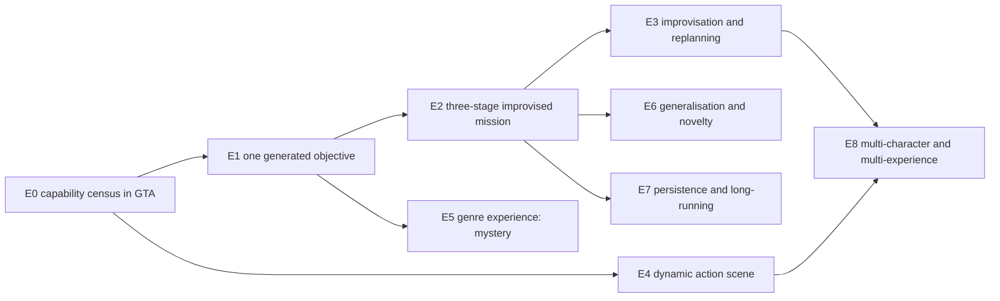
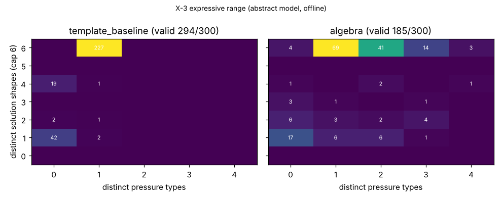

# ASTRA-002 · 05 — Falsifiable experiment ladder (E0–E8)

> **Status:** experimental design, 2026-10-19. **None of E0–E8 has been run.** The offline experiments X-1…X-6 (bottom of this document) were run in a sandbox on an abstract model; they reduce uncertainty about algorithms and contracts and they tell E0–E8 what to measure first, but **they are not GTA runtime acceptance.** All GTA experiments run in a **lab plugin on a dedicated save**, behind a feature flag, without touching production gameplay code until an experiment passes and the owner approves.

## 0. Ladder and dependencies

**Fastest decisive experiments** (cheapest ways to validate or kill the most ambitious claims):

1. **E0.2 + E0.6 — do LSA-spawned scene peds keep their tasks next to Essential?** One evening in a lab save, no model calls. If they don't, the general Stage Executor (and with it most of #6 and #23) is not viable under D-001 and the AGM falls back to vehicles/props/companions or the standalone core (FF-1).
2. **E1 with fabricated-completion injection** — proves or refutes "the world is the authority" end to end in GTA.
3. **E2-lite with the hand-written courier IR (no model)** — measures twin-vs-world disagreement before any model is involved; separates "the representation fails" from "the model fails".
4. **E6 paper round** — the owner blind-ranks 12 pitches+mechanics (6 algebra, 6 library) before any building; a cheap early signal on perceived novelty (not a substitute for E6 proper).

## E0 — GTA gameplay capability census

| Field | Design |
| --- | --- |
| **Hypothesis** | A narrowly authorised Stage Executor in a lab RPH plugin can create, task, observe and clean up the roughly fifteen tier-C capabilities X-1 ranked as blockers — spawn ped/vehicle/prop/pickup, give weapon, guard/flee/chase/drive/combat/follow policies, `holding`, `interacted`, `vehicle_driveable`, `pickup_collected` — plus the persistence, release and relationship-group operations they need, with: ≥ 95 % creation readback, ≥ 90 % task retention over 60 s with Essential yielding, sensor error ≤ 2 % at 4 Hz, 0 orphaned entities after cleanup. |
| **Minimal dependencies** | Lab plugin (separate assembly, lab save, hotkey-triggered probes); no model; no ACT/Director changes. |
| **Interfaces** | RPH managed API (`Ped`/`Vehicle`/`Object` constructors, `IsPersistent`, `Dismiss`, `Delete`, `Tasks`, `RelationshipGroup`, `World.PedCapacity/VehicleCapacity/ObjectCapacity`); only natives present in the pinned gen9 DB and listed in the catalog; Essential `NpcState` yield flags as ACT6 uses them; OBS2 inventory. |
| **Setup** | Probes E0.1 spawn+readback; E0.2 task retention (walk, drive, flee, guard, chase) with Essential loaded, yield flags on/off; E0.3 persistence at 100/250/400/800 m for 5 min; E0.4 hostility (relationship groups + combat; collateral on ambient peds, police, Nathan); E0.5 sensor accuracy vs video ground truth; E0.6 Essential side effects (reflexes, PerceptionSnapshot, conversation hijack, Luna lines about scene peds); E0.7 cleanup incl. plugin reload mid-scene and save reload; E0.8 pool capacities and frame time with 12 peds + 6 vehicles + monitors; E0.9 (optional, bridge) Essential LocationRegistry reads and hostage controller without LSPDFR. Fixed sites: Terminal docks, Grapeseed, Vinewood Blvd, Del Perro; day and night; Nathan present/absent; N = 20 per spawn probe, N = 10 per task probe. |
| **Acceptance** | Thresholds of the hypothesis per capability; a reliability table that promotes catalog tiers (C → B with source+tests; toward A with this evidence). |
| **Negative controls** | Same probes with Essential not loaded (GTA baseline); Essential loaded with yield flags off; ambient (non-scene) peds must show 0 LSA task issuances; an invalid model must be refused at readback. |
| **Failure / rollback** | Crash → disable that probe and file the native as tier X. Task retention < 50 % with yield → FF-1 (restrict to vehicle-bound actors, props, pickups; or standalone native core). Orphans → fix sweeper before any further experiment. Rollback = unload the lab plugin; nothing in production changed. |
| **Instrumentation** | JSONL per probe: `hostRunId`, `worldEpoch`, `gameMs`, UTC, handle, model, positions, task status reads, Essential `NpcState` snapshot, frame-time; screen capture for sensor ground truth; OBS2 manifest hash. |
| **Inference latency / cost** | None. Frame-time target for executor + monitors ≤ 0.5 ms/frame average (to be checked against the existing ~1 ms intelligence budget). |
| **Proves** | Which staging, actor and sensor capabilities are real on the owner's exact runtime, with reliability numbers. |
| **Does not prove** | That generated experiences work or are fun; long sessions; multi-stage play. |
| **Supports / disproves** | Gate for F *and* B. Disconfirms F's general Stage Executor if E0.2/E0.6 fail with yield flags on. |

## E1 — One generated executable objective

| Field | Design |
| --- | --- |
| **Hypothesis** | Given the E0-accepted catalog and the situation model, a model generates a one-stage objective that is observable and solvable, and the evidence ladder marks it ACHIEVED exactly when the world makes it true — never from narration, acknowledgements or claims. |
| **Minimal dependencies** | E0 capabilities used by the objective; designer prompt + critics (offline code ported); monitors for ≤ 3 fluents; C-11 speech beat for the offer. |
| **Interfaces** | Situation-model snapshot; catalog (`accepted`/`lab` mode); Stage Executor; monitors; Director speech ticket; accepted player turn (D-022). |
| **Setup** | 20 trials at varied places/times: "make one objective for right now" (e.g., *get the van parked behind the diner to the pier*, `in_vehicle(player, van) ∧ near(van, pier)`). Injected fabrications during each trial: Luna says "done"; an ACT/handler acknowledgement; a reload; a reused handle; the player says "we did it" without doing it; a completion before activation. |
| **Acceptance** | ≥ 18/20 correct terminal verdicts; **0 fabricated ACHIEVED**; p95 verdict latency ≤ 2 s after ground truth; designer ≥ 50 % valid first draft and ≥ 90 % within 3 critic rounds. |
| **Negative controls** | A spec with a claim objective must be rejected (H5); a monitor fed only text never achieves; pre-activation completion is not credited. |
| **Failure / rollback** | Any fabricated ACHIEVED stops the ladder until fixed. Verdict latency > 5 s → retune hold/debounce. Validity < 30 % → simplify the IR prompt or use macros (FF-4). |
| **Instrumentation** | Evidence stream (stamped samples), ground-truth annotations from video, spec hash, critic diagnostics, model latency and tokens per call. |
| **Inference latency / cost** | 1 designer call + ≤ 3 repair rounds per trial; record median/p95 latency and tokens. |
| **Proves** | End-to-end authority of world evidence for one objective in GTA; baseline designer validity. |
| **Does not prove** | Multi-stage structure, adaptation, novelty, fun. |
| **Supports / disproves** | F and B (both need monitors). Disconfirms "a model can be trusted to report outcomes" — by design. |

## E2 — A multi-stage improvised mission ("Let's pull off a job")

| Field | Design |
| --- | --- |
| **Hypothesis** | From a player request, the AGM generates, validates, stages and runs a three-stage mission that supports success, failure, interruption and abandonment, and whose composition is not a library template. |
| **Minimal dependencies** | E0 + E1; full designer passes; twin; compiler; accommodations; ledger (stage checkpoints only); ACT companion follow/board with consent. |
| **Interfaces** | All of [04](04-gameplay-generation-execution-contract.md) §3–§11 at lab scale. |
| **Setup** | E2-lite first: the hand-written courier IR (no model), 10 runs. Then 10 generated missions from different requests/contexts, each played three ways by the owner — straightforward, creative alternative, abandon midway — plus one forced interruption (wanted level or reload). |
| **Acceptance** | ≥ 7/10 generated missions playable end to end; all four terminal types reached with correct verdicts; the twin predicted ≥ 2 solution shapes and at least one alternative used by the owner succeeded; ≥ 7/10 mechanical signatures outside the template set; 0 orphans; designer ≥ 30 % valid first draft, ≥ 80 % within 3 rounds; twin-vs-world disagreements logged and < 20 % of stages. |
| **Negative controls** | (a) A template mission through the same pipeline (passes, labelled *template*); (b) a model-only baseline without critics/twin (expected unplayable rate, lab only); (c) the same missions with accommodations removed. |
| **Failure / rollback** | < 5/10 playable → classify by cause: representation (twin disagreements → FF-2), model (validity → FF-4 → B macros), platform (E0 regressions). |
| **Instrumentation** | Ledger, evidence, twin-vs-world disagreement log, owner rating sheet (fun, clarity, agency, coherence 1–5), video. |
| **Inference latency / cost** | Designer passes per mission; target ≤ 20 s from request to offer with bench fallback; tokens and spend per accepted mission. |
| **Proves** | Level-3 gameplay invention (04 §1.1) in GTA at small scale. |
| **Does not prove** | Breadth across genres, long-term enjoyment, concurrency. |
| **Supports / disproves** | F vs B: run arm (c) "B macros only" on the same requests for comparison. Disconfirms F if model-generated IR is consistently unplayable while hand-written IR plays fine (→ B). |

## E3 — Player improvisation and replanning

| Field | Design |
| --- | --- |
| **Hypothesis** | Precompiled accommodation keeps experiences coherent and on-stake more often, with less churn and waiting, than live re-planning; live re-design is needed only for threats the design did not cover. |
| **Minimal dependencies** | E2 missions with accommodations; S2 critic-gated live re-plan path (lab); S4 bounded re-design. |
| **Interfaces** | Monitors' threat detection; accommodation engine; designer (for S2/S4); speech beats. |
| **Setup** | Scripted disruptions from the brief: kill an important character; destroy a mission vehicle; travel somewhere unintended; police interruption; companion activity failure; an unanticipated solution; abandon and return later. Strategies S0 static / S2 critic-gated re-plan / S3 precompiled / S4 hybrid, counterbalanced over 4 missions × 7 disruptions. |
| **Acceptance** | S3/S4: coherent continuation in ≥ 80 % of covered threats, ≤ 1 objective change per threat, 0 incoherent objectives shown; uncovered threats end gracefully within 10 s; owner coherence ≥ 4/5. S2's waiting time and incoherence recorded for comparison. |
| **Negative controls** | S0 should produce dead experiences on blocking threats; an unchecked re-plan arm (lab only) to measure exposure. |
| **Failure / rollback** | If S2 beats S3 on owner ratings at acceptable latency, revise the recommendation toward live re-design for that threat class. |
| **Instrumentation** | Threat and response timestamps, response type, churn, dwell, incoherence flags, owner ratings. |
| **Inference latency / cost** | S2: 1–3 calls per disruption; S3: 0; S4: ≤ 2 per experience. |
| **Proves** | Which adaptation strategy works in real GTA play; whether X-4's structural result transfers. |
| **Does not prove** | Novelty or fun beyond coherence. |
| **Supports / disproves** | F's accommodation-first design vs C-style live replanning. |

## E4 — Dynamic action scene (#6)

| Field | Design |
| --- | --- |
| **Hypothesis** | The Stage Executor and monitors can run a pursuit, ambush or rescue whose course changes with the player's movement, combat and vehicle choices — rules, not scripted paths — within the performance budget. |
| **Minimal dependencies** | E0 (policies `gm_vehicle_flee`, `gm_vehicle_chase`, `gm_combat`, `gm_guard_area`, relationship groups); monitors; rule engine; no model at runtime. |
| **Interfaces** | Stage Executor policy switches; rule triggers over fluents; Nathan via ACT `take_cover`/`enter_vehicle_seat` with consent. |
| **Setup** | Three scenes (tail-and-intercept the witness; ambush at a crossroads; car-borne rescue), N = 10 each, the owner varying approach (on foot / vehicle / shooting / ramming / distant tail). |
| **Acceptance** | Rule-triggered policy switches within ≤ 1 s; ≥ 3 distinct outcome types per scene; no actor stuck > 20 s or losing its task; frame time within E0 budget; owner excitement ≥ 4/5 in ≥ 50 % of runs. |
| **Negative controls** | Same scene with a fixed scripted path (expect fewer outcome types); Essential yield flags off (measure hijacks). |
| **Failure / rollback** | Task loss or stuck actors in > 20 % of runs → FF-1; restrict to vehicle scenes. |
| **Instrumentation** | Task states, rule firing times, trajectories, outcome labels, video, frame time. |
| **Inference latency / cost** | 0 at runtime; scenes come from the bench. |
| **Proves** | #6 is playable with real actors whose behaviour responds to the player. |
| **Does not prove** | Variety across many scenes; concurrency. |
| **Supports / disproves** | F and B; disproves narration-only "action scenes". |

## E5 — Genre experience: mystery / horror investigation (#72)

| Field | Design |
| --- | --- |
| **Hypothesis** | A solver-guided mystery with physical clues (props, documents, a vehicle at a scene), suspects with observable attributes and an informant whose lines are bound to case facts is discoverable, fair and completable at a real location; atmosphere (time, weather, timecycle, audio scene) is staged and fully reverted. |
| **Minimal dependencies** | E0 (props, interaction sensor, appearance variation, weather/time/timecycle); X-6 solver; dialogue templates bound to testimony facts; monitors. |
| **Interfaces** | Stage Executor; `interacted`/`conversed` fluents; speech beats; Luna turns for informants constrained to case facts. |
| **Setup** | 6 generated cases at 3 locations (e.g., Paleto forest cabin, Grapeseed farm, La Mesa rail yard); one clue loss forced per case (the witness is shot). |
| **Acceptance** | Player finds ≥ 80 % of clues within the window; correct accusation in ≥ 70 % of runs; 0 misleading cases (unrefuted false testimony); every lost clue repaired with a new verifiable clue; atmosphere reverted 100 %; owner tension/fun ≥ 4/5. |
| **Negative controls** | An unchecked model-authored mystery at the same site (expect ambiguous/misleading cases, X-6); informant free-talk without fact binding (expect contradictions). |
| **Failure / rollback** | Discoverability < 50 % → placement rules; informant contradictions → fact-bound templates only or drop informants. |
| **Instrumentation** | Clue discovery timestamps, accusation, ground truth, transcripts checked against facts. |
| **Inference latency / cost** | Design-time solver + designer; informant dialogue uses the existing turn path. |
| **Proves** | An investigation genre experience can be generated and played fairly in GTA. |
| **Does not prove** | That horror or other genres are fun; long mysteries. |
| **Supports / disproves** | F + solver; disproves narration-only mysteries. |

## E6 — Generalisation and novelty

| Field | Design |
| --- | --- |
| **Hypothesis** | With the same catalog and world, the AGM produces mechanically distinct experiences for **held-out** goal/constraint combinations, and the owner perceives them as more varied — and not less fun — than template or library sequences. |
| **Minimal dependencies** | E2 pipeline; template generator (PGM-style); B macro library; novelty metrics ([`novelty.py`](offline-experiments/gea/novelty.py)). |
| **Interfaces** | Bench; metrics; blind session runner. |
| **Setup** | Held-out combinations of request × place class × constraint (on foot only, night, no weapons, stealth, Nathan absent) never used during development. 30 candidates per arm (template / B / F); 12 blind owner sessions with ratings (fun, surprise, coherence, "felt different", replay desire) and pairwise preferences. |
| **Acceptance** | F unique-mechanical ratio ≥ 0.6 on held-out combinations (offline: 0.83); owner rates F above B on surprise (sign test, p < 0.1 at small N) and not below on fun or coherence. **No model-judged novelty counts toward acceptance.** |
| **Negative controls** | Surface-only reskins (same mechanics, new names) must be recognised as similar by the owner — validates the metric. |
| **Failure / rollback** | Owner cannot tell F from B → adopt B (cheaper). |
| **Instrumentation** | Specs, signatures, expressive-range grids, ratings, preferences. |
| **Inference latency / cost** | Cost per accepted, played experience per arm. |
| **Proves** | Mechanical novelty that a player can feel. |
| **Does not prove** | Long-term engagement over weeks. |
| **Supports / disproves** | F vs B decision point. |

## E7 — Persistence and long-running experience

| Field | Design |
| --- | --- |
| **Hypothesis** | An interrupted multi-stage experience (save reload, GTA exit, long abandonment) is either continued coherently from verified checkpoints or concluded gracefully, and its consequences surface later without corrupting character memory or crossing save lineages. |
| **Minimal dependencies** | Ledger (C-19), TimelineGuard (C-07), re-staging, consequence callbacks. |
| **Interfaces** | Ledger store; world-epoch events (C-13); Memory K read-only audit. |
| **Setup** | A three-stage adventure interrupted at each boundary and mid-stage by (a) loading an earlier save, (b) quitting and restarting GTA, (c) 30 min of unrelated free roam; a later session checks a consequence callback ("the docks crew is hostile"); a different save lineage must show no callbacks. |
| **Acceptance** | 100 % of interruptions handled without crash or orphan; re-staging only when reconstructible, else conclusion; 0 AGM rows in Memory K; 0 cross-lineage leaks; owner coherence ≥ 4/5. |
| **Negative controls** | RAM-only continuation (expect broken state); an attempted direct memory write (must be refused). |
| **Failure / rollback** | Incoherent re-staging → default to conclude-on-reload. |
| **Instrumentation** | Ledger rows, timeline IDs, epoch events, Memory K audit. |
| **Inference latency / cost** | Negligible (re-offer only). |
| **Proves** | The persistence model across real discontinuities. |
| **Does not prove** | Enjoyment of long campaigns. |
| **Supports / disproves** | F's ledger; disproves RAM-only designs (A, C). |

## E8 — Multi-character and multi-experience coordination

| Field | Design |
| --- | --- |
| **Hypothesis** | The AGM coordinates allies (Nathan via ACT, a scene-owned getaway driver), enemies, a witness and untouched bystanders in one experience, and arbitrates with new opportunities, Director speech and player priority without ownership conflicts or budget overruns. |
| **Minimal dependencies** | E3 + E4; C-06 owner token with `agm_stage`; offer queue; inference budget enforcement. |
| **Interfaces** | C-06, ACT leases, Director budgets, player priority epoch, provider budget counters. |
| **Setup** | One experience with 1 companion + 1 scene ally + 3 enemies + 1 witness; mid-scene player speech; a spontaneous Director line; a second opportunity arising; a two-hour soak with the AGM enabled. |
| **Acceptance** | 0 ownership conflicts (owner-token timeline); 0 tasks to non-owned peds; player speech always pre-empts AGM narration; second offer deferred until conclusion; ≤ 1 active experience; frame time within budget; soak inference spend within the owner's cap; no background calls outside idle windows. |
| **Negative controls** | Token check disabled (lab only) to show the conflict detector works. |
| **Failure / rollback** | Conflicts → serialise further; multi-NPC conversation waits for PS7/C-12. |
| **Instrumentation** | Owner-token timeline, task issuance log, speech queue, inference log, frame time. |
| **Inference latency / cost** | Calls/hour and spend vs budget. |
| **Proves** | Coexistence and budgets at realistic load. |
| **Does not prove** | PS7 multi-NPC social routing; several simultaneous experiences. |
| **Supports / disproves** | F; disproves C-style concurrent agents with shared authority. |

## Offline evidence (X-1…X-6)

All runs: [offline-experiments/](offline-experiments/README.md), Python 3.13, two vCPUs, seeded; numbers below are **run 2** (after the world-model fixes recorded in the README's revision log). They are statements about an abstract model and synthetic players, not GTA.

| Exp. | Feeds | Question | Result | Caveat |
| --- | --- | --- | --- | --- |
| **X-1** | E0 | How much gameplay composes from today's capabilities? | Valid / mechanically distinct of 300 generated specs: `accepted` 0/0, `play` 7/2, `lab` 208/171. A companion-only generator: 91/100 valid in `play`, 14 distinct mechanics. Top blockers: spawn ped, arm, spawn vehicle, `holding`, `interacted`, guard, props, vehicle chase, `vehicle_driveable`, items, drive-to, combat. | Tiers from a desk audit. |
| **X-2** | E1, E2 | Do hard critics reject the faults that make generated missions fake, unsafe or unplayable? | 759/760 faulty specs rejected across 19 fault classes; 735 with the expected critic code; 0/40 valid specs rejected; 38 of the 40 lab-valid specs need tier-C capabilities and are refused in `play` mode (H3). The one fault that passed (an unsolvable objective bypassed by an accommodation path in the outing fixture) was flagged by soft critics S1 and S7. | Faults are researcher-authored; real model fault rates need E1/E2. |
| **X-3** | E6 | Does the algebra give mechanical novelty, not just surface variety? | Template baseline: 294/300 valid, **6** distinct mechanics (ratio 0.02), 3 archetype sequences, surface uniqueness 0.85. Algebra: 185/300 valid, **154** distinct (ratio 0.83), 98 archetype sequences, 137 mechanic features (5.47 bits), surface 0.99; 71 % beyond any single-archetype template; mean 4.7 solution shapes. Validation bias: `hold` (28 %) and `disable` (31 %) objectives survive critics least often. | Mechanical novelty ≠ fun. |
| **X-4** | E3, E7 | Which adaptation policy survives player improvisation, world disruption and reloads? | See below. | Model behaviour parameterised, not measured. |
| **X-5** | E1 | Can a monitor refuse fabricated completion and still be fast? | 20 000 traces, 11 fault types: naive monitors falsely achieved 77–93 % of never-true traces and credited 72–89 % of genuine ones too early; the evidence ladder: 0 % false, 0 % early, 0 % missed; latency after the true event p50 0.63 s, p95 1.38 s. | Synthetic sensor traces. |
| **X-6** | E5 | Can generated mysteries be guaranteed fair and repairable? | 3 000 cases: unchecked authoring 51 % uniquely solvable, 23 % ambiguous, 22 % no consistent suspect, **4.4 % misleading** (points at an innocent); solver-guided 100 % unique, 0 % misleading, deduction depth ≥ 2 by construction; every single-clue loss either stayed solvable (29 %) or was repaired with a new verifiable clue (71 %). | Logic only; discoverability is E5. |

*X-3 expressive range (abstract model). Each cell counts valid experiences by number of distinct pressure types (x) and distinct solution shapes found by the twin (y, capped at 6). Templates concentrate in a single cell; the algebra covers the space but also produces low-pressure, single-path experiences (bottom-left) that a bench filter should reject.*

### X-4 adaptation strategies (run 2)

Setup: two fixtures (the courier job of [04](04-gameplay-generation-execution-contract.md) with a fragile case and a ledger accommodation; the lost-dog outing), four synthetic players (planner, creative, chaotic, wanderer), two conditions (normal: 3 % per-step chance that traffic/police/ambient AI kills or wrecks a critical role or its carrier, 10 % chance of a reload; turbulent: 8 % and 30 %), 120 episodes per cell, plus sweeps over model bad-plan rate, model latency and accommodation coverage. Model behaviour is **parameterised** (defaults: 15 % bad re-plans, critics catch 97 % of incoherent and 80 % of continuity-breaking ones, latency 0–1 steps ≈ 0–20 s).

**Designed-stake success** (`END_SUCCESS`; endings reached only after the goalposts moved are counted separately as *moved*), normal condition:

| Strategy | Courier: planner / creative / chaotic / wanderer | Outing: planner / chaotic / wanderer | Model calls per episode | Incoherent objectives shown per episode |
| --- | --- | --- | --- | --- |
| S0 static | 0.99 / 0.85 / 0.66 / 0.23 | 0.95 / 0.50 / 0.49 | 0 | 0 |
| S1 live re-plan, unchecked | 0.86 / 0.76 / 0.57 / 0.23 (+0.02–0.12 moved) | 0.94 / 0.44 / 0.41 | 0.0–2.2 | 0.00–0.14 |
| S2 live re-plan, critic-gated | 0.99 / 0.96 / 0.77 / 0.28 | 0.95 / 0.50 / 0.42 | 0.05–2.5 | 0.00 |
| **S3 precompiled accommodation** | **1.00 / 1.00 / 0.75 / 0.26** | **0.98 / 0.63 / 0.45** | **0** | **0** |
| S4 hybrid (S3 + ≤ 2 re-designs) | 1.00 / 1.00 / 0.75 / 0.26 | 0.98 / 0.63 (+0.08 moved) / 0.45 (+0.22 moved) | 0–0.2 | 0 |

Findings (abstract model; N = 120 per cell, standard error ≈ 0.04):

1. **Precompiled accommodation gave the best designed-stake success with no runtime model calls, no incoherent objectives and no dead experiences.** Averaged over players: courier 0.75 (S3) vs 0.68 (S0) vs 0.60 (S1); outing 0.69 vs 0.65 vs 0.60. Under turbulence, chaotic players finished the outing as designed 0.63 (S3) vs 0.35 (S0).
2. **Critic gating repairs most of the damage of live re-planning, at a price.** S2 matched S3 on the courier job (0.75 vs 0.75 averaged) but needed 1.1–2.5 model calls and 0.6–1.3 steps (~6–26 s) of waiting per episode and still produced 0.01–0.04 coherence breaks per episode.
3. **Adaptation must be decided in the same tick as the threat.** In the outing, the threat (the informant dies) *is* the stage's failure condition, so a re-plan arriving even one step later is too late: S2 0.62 vs S3 0.69 (normal), 0.52 vs 0.66 (turbulent). Only a precompiled response can pre-empt the failure transition.
4. **Unchecked live re-planning was worse than doing nothing** (courier 0.60 vs 0.68 static; outing 0.60 vs 0.65), showed up to 0.14 incoherent objectives per episode at default parameters (0.33 at a 30 % bad-plan rate), and a further 8 % of its courier episodes ended in a "win" only after the goalposts had moved.
5. **The hybrid added nothing once moved goalposts are separated.** All of S4's extra wins over S3 (8–22 % for chaotic and wandering players in the outing) were `END_SUCCESS_MOVED`: a generic fail-forward makes the experience *easier*, not better. Live re-design must preserve stakes or be presented as an alternative ending (failed hypothesis FH-6 in [06](06-breakthrough-questions-and-roadmap.md)).
6. **Coverage matters:** removing all precompiled accommodations from the courier job lowered designed success from 1.00 to 0.93 (planner) and 0.72 to 0.67 (chaotic); S3 turned the losses into graceful conclusions, S4 into moved-goalpost endings.
7. **Reloads:** S0–S2 lost 0.6–2.9 % of episodes to a simulated reload; S3/S4 resumed from the last verified stage checkpoint instead.
8. **Latency:** raising re-plan latency from 0 to 1–2 steps raised waiting from 0 to ~1.5–2.6 steps per episode with no change in success — because the model does not represent boredom. What waiting costs a player is an E3 question.

**Limits that matter:** in S1/S2 a *good* re-plan can only apply the repairs S3 has precompiled, so S1/S2 cannot beat S3 by construction — the experiment measures exposure and timing, not the creativity of live re-plans. Two fixtures and synthetic players only. Run 1 (superseded) had an insensitive courier fixture and counted moved-goalpost endings as wins; see the [revision log](offline-experiments/README.md#revision-log).
