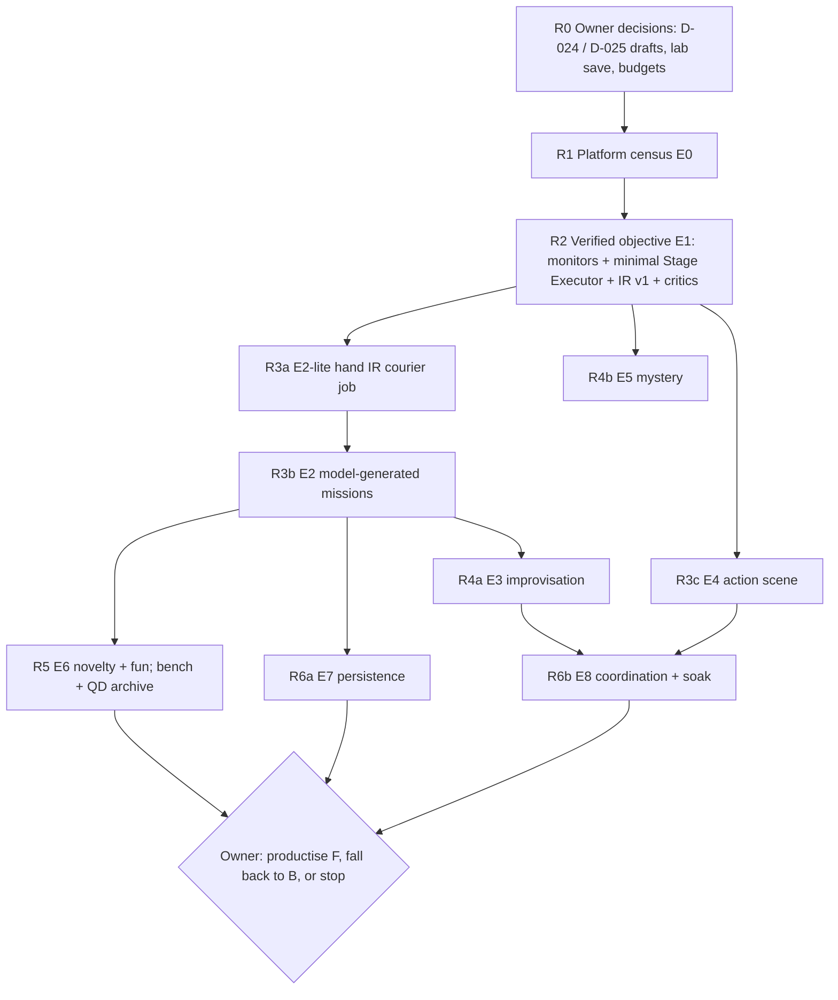

# ASTRA-002 · 06 — Breakthrough questions and roadmap

> **Status:** research roadmap, 2026-10-19. It ranks the unsolved questions, answers BQ-1…BQ-10 as far as the evidence allows, and maps a path from today's LSA to a Game Master that invents playable experiences. **"Engineering"** means known techniques applied to LSA; **"research"** means the outcome is uncertain and an experiment decides it. Nothing here authorises implementation; each phase starts only after the previous gate passes and the owner approves.

## 1. Ranked research questions (importance × dependency)

| Rank | Question | BQ | Why this rank | Decided by | Kind |
| --- | --- | --- | --- | --- | --- |
| **1** | Can LSA create, own and task *scene actors* next to Essential and GTA's own AI, and clean them up? | BQ-8, BQ-1 | Everything except companion outings depends on it; X-1's top blockers are all staging/actor capabilities; it needs an owner decision (D-024) and a platform measurement (U-01, U-06). | E0.2, E0.6, E0.7 | Platform research + owner decision |
| **2** | Can objectives be adjudicated *only* from world evidence, fast and reliably, on Enhanced? | BQ-6 | Without it the AGM narrates rather than plays; the contract is proven offline (X-5) but sensor reliability is unknown. | E0.5, E1 | Research (measurement) |
| **3** | Is a *grounded gameplay algebra* expressive enough, and can the twin predict playability well enough, that validated specs play in GTA? | BQ-1, BQ-2 | The core invention of architecture F; the twin–world gap is the riskiest scientific unknown (FF-2). | E2-lite, E2 | **Breakthrough research** |
| **4** | Can a model write valid IR often and cheaply enough? | BQ-1 | Decides F vs B; X-1/X-3 show 62–69 % of *programmatic* algebra drafts survive the critics in lab mode, but no real model was measured. | E1, E2 | Research (measurement) |
| **5** | Does precompiled accommodation keep experiences coherent under real improvisation, and when is live re-design worth its cost? | BQ-3 | Offline evidence favours accommodation (X-4) but players may value surprise over coherence. | E3 | Research |
| **6** | Is mechanical novelty *perceptible* and does it stay fun? | BQ-5, BQ-10 | Only the player can answer; it decides whether F's extra cost buys anything over B. | E6 | Research (human evaluation) |
| **7** | When should the AGM offer, escalate, stay silent and end? | BQ-10 | Determines whether the AGM is welcome; policy shapes are known (L4D, RimWorld), parameters are not. | E6, E8 soak | Research (tuning) |
| **8** | What compact world-level model is enough, at what cost? | BQ-4 | Mostly existing samplers; needs a separate adjudication read model and budgets. | E0.8, E8 | Engineering |
| **9** | How do consequences persist without corrupting character memory or save lineages? | BQ-7 | Ledger + TimelineGuard design is clear; continuation quality after reloads is not. | E7 | Engineering + small research |
| **10** | How are many actors and several experiences coordinated? | BQ-8 | Needs ranks 1 and 5 first; multi-NPC dialogue waits for PS7/C-12. | E8 | Engineering after research |
| **11** | Can new *mechanics* (not compositions) be generated safely? | BQ-9 (#40) | Separate vision; offline generator + tests + review + manual enablement only. | (#40 research) | Breakthrough research, separate track |

## 2. Answers to the breakthrough questions

### BQ-1 — Generating gameplay instead of text
**Representation:** the ExperienceSpec IR ([04 §4](04-gameplay-generation-execution-contract.md)) — roles bound to atlas places and catalog entities, stages whose objectives are temporal formulas over **sensed fluents**, actor policies and deterministic rules that create pressure, precompiled accommodations, consequences, budgets. It is executable because every objective has a monitor and every policy/staging operation maps to a catalog capability with an evidence tier. **Validation that entities and mechanics exist:** critics H1–H4 (schema, capability, tier, authority) at design time, compiler binding to the atlas, and **readback after staging** before objectives activate. *Offline:* 19 fault classes caught (X-2). *Open:* real models' validity rate (E1/E2) and whether the twin's verdicts hold in GTA (E2).

### BQ-2 — Physically achievable goals
A general planner can invent objectives without hand-authored missions by composing fluent relations (reach, acquire, deliver, escort, intercept, tail, hold, examine, rescue, disable, eliminate, meet …) over catalog fluents; X-3's algebra produced 154 mechanically distinct valid experiences from 300 drafts versus 6 for a template generator. **Impossible objectives are rejected before play** by the twin's bounded search (H7 unsolvable, H6 trivially true, H13 no reachable failure) and place-class rules (H11: boats on land, vehicles indoors). X-1 shows why this matters: ~28 % of well-formed drafts were unsolvable. *Open:* twin fidelity (navmesh, traffic, line of sight) — calibrated from E0/E2 traces.

### BQ-3 — Real-time improvisation
Objectives say *what*, never *how*, so unanticipated solutions succeed automatically. Breaks are handled by a fixed response ladder — continue if another solution shape remains → precompiled accommodation (validated at design time, keeping the stake) → graceful conclusion → at most two asynchronous re-designs → abort with cleanup — with anti-churn rules (≤ 1 objective change per stage without progress, ≥ 20 s dwell, no cosmetic re-wording). **Endless replanning is prevented structurally**: runtime adaptation is table lookup, live re-design is bounded and gated. *Offline:* X-4 (below and in [05](05-falsifiable-experiment-ladder.md#offline-evidence-x-1x-6)). *Open:* how players feel about accommodations vs surprise (E3).

### BQ-4 — Understanding the whole situation
A compact world-level read model ([04 §8](04-gameplay-generation-execution-contract.md)) built from samplers LSA already has (player state, M9 incidents, PS anchors ≤ 100 m / ≤ 32 per tick, P2/ACT state), plus Stage Executor readback for scene entities, an L4D-style intensity estimate, story-sifting opportunity tags and a static location atlas. **No full-world scans and no multimodal inference**: change detection and event-driven updates; model calls only at design time. It is deliberately separate from NPC knowledge (D-004).

### BQ-5 — Truly novel experiences
**Surface variety ≠ mechanical novelty.** X-3 measures novelty on the IR itself (role kinds, fluent skeletons, pressure policies, rules, stage links) and finds templates with 85 % unique surfaces but 2 % unique mechanics. To *increase* novelty: compose relations rather than pick templates; keep a quality-diversity archive (MAP-Elites over mechanic features × place class) in the idle-time bench; reject near-duplicates of recently played signatures; vary constraints (on foot, night, no weapons). *Open:* whether players perceive the difference (E6, with held-out combinations and blind comparisons, not model judges).

### BQ-6 — Objective verification
Five states — proposed, accepted, attempted, physically changed, achieved — with separate writers and evidence ([04 §9](04-gameplay-generation-execution-contract.md)). Achievement requires stamped (host run, world epoch, entity incarnation), authenticated, in-order, post-activation, physically plausible samples held over time; model text, handler acknowledgements and utterances are inadmissible; epoch changes produce VOID, never success. *Offline:* 0 fabricated or early completions over 20 000 adversarial traces at p50 0.63 s latency (X-5). *Open:* sensor reliability on Enhanced (E0.5/E1).

### BQ-7 — Emergent narrative with real consequences
Narrative is built *from verified events*: speech beats are bound to ledger facts (F.E.A.R.'s "dialogue after the decision", Caves of Qud's "events first, meaning after"); pacing follows an intensity cycle with relax windows; callbacks come from story-sifting over the ledger and PS events; endings are explicit (success, failure, graceful conclusion) and narrated once. Consequences persist as timeline-scoped ledger facts (rivals, reputation, follow-up unlocks); Nathan remembers only what he witnessed or was told (D-023), with an optional "remember this?" offer. *Balance freedom vs coherence:* the player can always deviate; the AGM accommodates or concludes, never intervenes against the player.

### BQ-8 — Coordinating multiple actors
Three actor classes with different authorities: **scene-owned** actors (Stage Executor, `SceneOwnerToken`), **companions** (ACT with consent), **everyone else** (ambient GTA peds, Essential-managed peds — never tasked). Coexistence with Essential requires its yield flags or proof that it ignores non-managed peds (U-01/U-06). Arbitration uses the C-06 owner token extended with `agm_stage`. From ACT: consented `source:'game_master'` proposals and truthful terminal receipts; from ACT7: directed interactions between companions and scene actors; from PS7/C-12: multi-NPC conversation routing (needed for scenes where several characters talk). *Open:* everything about coexistence — E0.2/E0.6/E8.

### BQ-9 — Runtime generation without arbitrary code
Yes: gameplay is generated by **validated capability composition** — a declarative IR interpreted by a fixed executor, with a closed response vocabulary and a forbidden list. Runtime-generated scripts would add stability (an RPH plugin crash takes the game down), security, compatibility and testing risks that no evidence justifies (Code as Policies: correctness unknowable a priori). **Safe extension points** are offline: new catalog capabilities (after E0 acceptance) and new mechanic modules (#40: generated offline, tested, reviewed, manually enabled). #20 composes; #40 invents mechanics; the two stay separate.

### BQ-10 — Making the Game Master fun
Offer, don't impose: only in opportunity windows, rate-limited, decline-sensitive, always cancellable ([04 §12](04-gameplay-generation-execution-contract.md)). Escalate on frequency/timing, not on amplitude (L4D); end on a verified outcome or when the player disengages; stay silent during Rockstar missions, combat, wanted levels and player speech. **Evaluation:** blind owner sessions with ratings and pairwise preferences, held-out combinations, surface-reskin controls, session logs (accept/decline, abandonment, replay requests); a model judging its own output is never acceptance evidence (Spec2Game's judge swaps reversed 6 of 27 rankings). *Open:* this is the least predictable question; E6 and the E8 soak answer it.

## 3. Offline adaptation evidence (X-4, run 2)

Full table in [05](05-falsifiable-experiment-ladder.md#x-4-adaptation-strategies-run-2). In the abstract model, with model behaviour parameterised rather than measured:

* **Precompiled accommodation (S3)** achieved the best designed-stake success with zero runtime model calls, zero incoherent objectives and zero dead experiences (courier 0.75, outing 0.69 averaged over synthetic players; static 0.68 / 0.65; unchecked live re-planning 0.60 / 0.60).
* **Critic-gated live re-planning (S2)** matched S3 only where the threat left time to react; where the threat *is* the stage's failure condition (the informant dies), any latency is too late (0.52 vs 0.66 under turbulence). Adaptation has to be decided in the tick the threat occurs — i.e., precompiled.
* **A hybrid's generic fail-forward (S4)** produced no designed-stake gains; its extra "wins" were all moved-goalpost endings. Stake continuity is a hard requirement of any runtime re-design.
* These results justify the contract's response ladder ([04 §10](04-gameplay-generation-execution-contract.md)) but **not** a claim that live re-design has no value: X-4 cannot represent a re-plan that invents a better continuation than the design did. E3 tests that directly.

## 4. Roadmap

| Phase | Goal | Gate to pass | Engineering | Research |
| --- | --- | --- | --- | --- |
| **R0** | Decisions and set-up | Owner approves direction, D-024/D-025 drafts for lab use, budgets, lab save | Lab plugin skeleton, OBS2 inventory entries | — |
| **R1** | Know the platform | E0 thresholds per capability | Probe harness, readback, cleanup sweeper, JSONL evidence | Coexistence with Essential/GTA AI; sensor reliability; pools |
| **R2** | One verified objective | E1: 0 fabricated ACHIEVED, ≥ 18/20 verdicts | IR v1 schema, port of critics, monitors, Stage Executor (minimal), speech-beat source | Designer prompt/IR validity |
| **R3** | First multi-stage mission and action scene | E2 ≥ 7/10 playable; E4 ≥ 3 outcome types/scene | Compiler/atlas binding, ledger checkpoints, ACT bridge | Twin calibration from traces; model validity at scale |
| **R4** | Adaptation and first genre experience | E3 coherence ≥ 80 % covered threats; E5 fair + discoverable | Accommodation engine, solver port, fact-bound informant templates | Accommodation vs surprise; clue discoverability |
| **R5** | Novelty and fun | E6: F ≥ B on surprise, not worse on fun | Bench, QD archive, metrics, blind-session tooling | Perceived novelty, offer policy tuning |
| **R6** | Persistence and coordination | E7 100 % safe interruptions; E8 0 conflicts, budgets held | Re-staging, callbacks, owner-token extension, budget enforcement | Continuation quality; multi-actor coexistence |

### 4.1 First fun slice per vision (identities preserved)

| Vision | Distinct player fantasy (from [28-favorite-experiences.md](../28-favorite-experiences.md)) | First slice under F | Proven by |
| --- | --- | --- | --- |
| **#20 AI Game Master** | The world quietly presents an opportunity that grows into a story because of what you choose; never forces a plot. | Bench + opportunity director offers two different *composed* event shapes during idle/travel windows; tracks real outcomes; yields to free roam. | E6 + E8 soak |
| **#23 Improvised missions** | "Let's pull off a job" — player-led planning, objectives, getaway, complications, clear outcome. | A 2–4-stage job generated from a request, with an approach choice voiced by the player ("back door" vs "intercept on the road") selecting a stage variant. | E2, E3 |
| **#3 Adventures** | A friend organising an outing; discovery and setbacks; not an objective-marker quest board. | Nathan pitches an outing; destination, an informant, a clue prop, a reveal; honest completion or abandonment; works with muted dialogue. | E2-lite variant, E7 |
| **#6 Action scenes** | A quiet drive turns into a chase/rescue; real actors; player choices change the scene. | Tail-and-intercept or ambush with rule-driven policy switches; ≥ 3 outcome types. | E4 |
| **#72 Immersive experiences** | Request a genre ("create a horror mystery") and play a game-within-the-game at a real location. | Solver-guided mystery with physical clues, fact-bound informant, staged and reverted atmosphere. | E5 |
| *(#40, separate)* | Invent new mechanics. | Offline generator → tests → review → manual enablement of a new catalog capability. | #40 research |

Shared technology (IR, critics, monitors, Stage Executor, ledger) unlocks all five at once — that is the "one breakthrough, several experiences" effect the brief asks about — but each vision keeps its own acceptance question and first slice.

## 5. Conventional engineering vs novel research

| Work item | Kind | Suited to |
| --- | --- | --- |
| Lab plugin, probe harness, JSONL evidence, cleanup sweeper | Engineering | Coding agents |
| Catalog file format, tier promotion bookkeeping, OBS2 inventory entries | Engineering | Coding agents |
| IR schema v1, critic port (from the Python prototype), compile modes | Engineering (spec exists) | Coding agents |
| Objective monitors + evidence ladder (spec + offline reference) | Engineering | Coding agents |
| Stage Executor (spawn/readback/release, budgets, owner token) | Engineering **after** D-024 and E0 | Coding agents with owner review |
| Location atlas (places, activity points, access, vehicle classes) | Engineering + curation | Coding agents + owner |
| Ledger + TimelineGuard integration | Engineering | Coding agents |
| Speech-beat source for C-11; ACT `source:'game_master'` proposals | Engineering | Coding agents |
| Twin calibration from GTA traces; twin–world disagreement analysis | **Research** | Astra |
| Designer prompting / small-model bench generator; validity vs novelty trade-off | **Research** | Astra |
| Accommodation design with stake continuity; exploitation/repetition | **Research** | Astra |
| Fun evaluation protocol and offer-policy tuning | **Research** (human) | Astra + owner |
| Essential coexistence (reflexes, perception, conversations) | **Research** (platform) | Astra-guided E0, coding agents for probes |
| #40 mechanic invention | **Research**, separate | Future Astra assignment |

## 6. Preserved failed hypotheses and corrections

| # | Hypothesis / result | Status | Evidence |
| --- | --- | --- | --- |
| FH-1 | "The Scene Director can grow into the Game Master." | **Rejected** — speech-only by contract; becomes the offer/narration surface. | [03 §2](03-architecture-candidates.md); `sceneDirectorAdmission.mjs:29-35` |
| FH-2 | "Valid JSON from a model is a playable mission." | **Refuted offline** — ~28 % of well-formed drafts unsolvable; 18 of 19 fault classes are semantically, not syntactically, wrong. | X-1, X-2 |
| FH-3 | "Essential's own generated callouts can be the AGM's executor." | **Not on this install** — requires LSPDFR (0/162 sessions). | [01 §1 F7](01-current-lsa-capability-audit.md) |
| FH-4 | "Live LLM re-planning is the natural way to adapt." | **Not supported offline**; pending E3. | X-4 |
| FH-5 | X-4 run 1: "accommodation coverage makes no difference in the courier job." | **Experiment artefact** — the disturbance had no eligible target in that fixture and a world-model bug kept fragile items alive; fixed in run 2, run 1 kept. | [offline README revision log](offline-experiments/README.md#revision-log) |
| FH-6 | X-4 run 1: "the hybrid S4 clearly beats precompiled accommodation." | **Partly an artefact** — S4's generic fail-forward replaced blocked objectives with easier ones; run 2 reports such endings separately (`END_SUCCESS_MOVED`). | X-4 run 2 |
| FH-7 | "Hard critics catch every fault." | **False** — an unsolvable designed path hidden behind an accommodation passed (soft warning S7 only). Open: make S7 hard? | X-2 |
| FH-8 | "Adaptive experience management is clearly more fun." | **Unsupported** in the literature (PaSSAGE inconclusive at N = 90). | [02 §3](02-external-research-and-evidence.md) |

## 7. Open questions for the owner

1. **D-024** — allow a lab-only Stage Executor for scene-owned entities (amending LOCKED D-001), or require the standalone native core for it?
2. **D-025** — allow world-level adjudication reads distinct from NPC knowledge?
3. May experiences include **armed hostile scene actors** (needed for #6/#23), and against whom (player only; never Nathan)?
4. **Budgets:** design calls per hour, bench size, monthly spend cap, provider for designer passes (cloud vs local).
5. **Offer defaults:** minimum interval, genres allowed unsolicited, whether #20 may offer at all before E6.
6. **Consequences:** ledger facts only, or also opt-in player money/wanted/vehicle effects?
7. **Bridge mode:** investigate Essential internals (LocationRegistry, hostage controller) as optional tier-D compositions, or stay independent of them?
