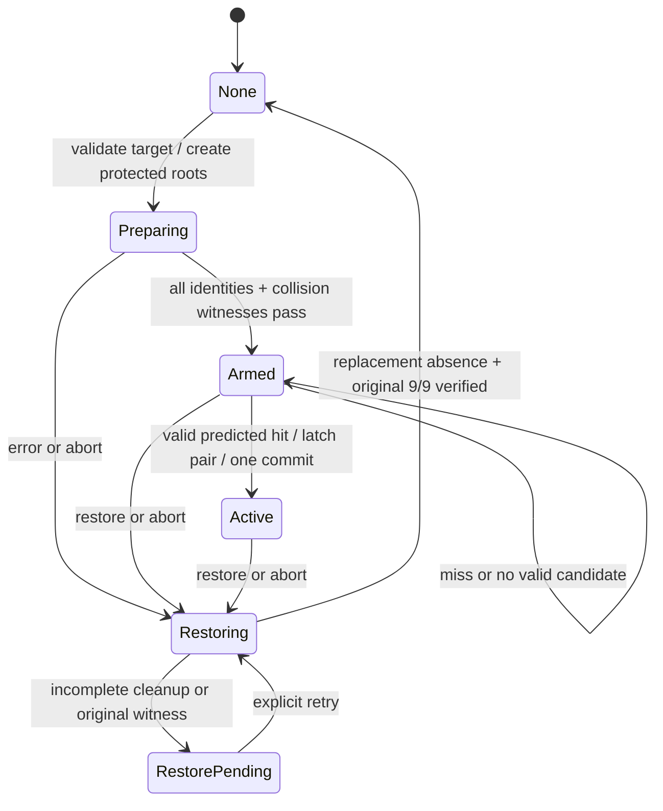

# X7.2c: smallest safe impact-selected native fracture experiment

Date: October 22, 2026. Source baseline: [`a613f8e2987fba85e63c4444b61b8d037dc2b56c`](https://github.com/ComradeGenosse/LSA-Enhanced-essential-fork/commit/a613f8e2987fba85e63c4444b61b8d037dc2b56c), current X7 branch, draft [PR #296](https://github.com/ComradeGenosse/LSA-Enhanced-essential-fork/pull/296). This work adds an offline selector, deterministic tests, a generator reproducibility repair and this design. **No native transition changes, asset exports, installation, GTA launch, gameplay acceptance or merge.**

## Decision

Recommend **five weak independent native props, with per-object fracture enabled only for the two sections selected from the projected impact**. Each prop contains one sheet child, so object-level flags provide section-level control without editing the fragment hierarchy or changing authored thresholds at runtime. Keep all five sections visible and colliding after replacement; protect the three unselected sections for the entire Active lifetime. Retain the current root anchors and real RPG/native debris path.

This is the smallest candidate, not an accepted gameplay implementation. First prove that the existing three native protection flags actually isolate a *visible, colliding* weak section during a live RPG blast. If they do not, use **pre-staged strong/weak pairs**, activating exactly one prop per position. Both architectures use the same selector and require restore/reprepare between controlled shots initially.

Implementing and testing the pure selector is safe now. Wiring either native architecture before its discriminator test would turn an unverified protection assumption into runtime behavior. The checked-in X7.2b runtime is preserved byte-for-byte in this change.

## What the current branch establishes

Use the latest evidence rather than the older PR description or a uniform-threshold recommendation:

| Evidence | Observed result | What it establishes |
| --- | --- | --- |
| [X7.2 j1400](../evidence/x72/RESULTS.md) | Center repeat broke 4/5; +0.65 broke 5/5; physical walks passed | Uniform walk5 is walkable but does not reliably localize. |
| [X7.2 j1600](../evidence/x72-j1600/RESULTS.md) | Center and +0.65 each broke 0/5 | More uniform tuning has not found the desired regime. |
| [X7.2b phase 1](../evidence/x72b/RESULTS.md) | Fracture propagated sequentially, starting near the hit | Timing alone cannot distinguish blast arrival from physical chaining. |
| X7.2b independent uniform j1400 | Five separate roots still broke 5/5 | Separating roots alone did not solve localization in this setup. |
| X7.2b inverted profile | Weak outer strips broke while strong middle strips survived | Authored strength profile can dominate the break location. |
| X7.2b near-weak profiles | Weak pair broke at center and +0.65; +0.65 repeated; actual player crossed | A preselected mixed native profile can produce a real localized opening. |
| X7.2b -0.65 | Weak pair broke; existing static map object blocked passage | Fence fracture and traversability are separate outcomes. |

All X7.2b profiles were chosen at **prepare time using the intended aim**. There is no gameplay proof of selection from a tracked projectile during flight. These observations support a profile-controlled response at this site, weapon and small sample count; they do **not** measure a uniform force field, prove a RAGE falloff formula, establish cumulative j1800 durability, or cover other weapons/wider walls. j2400 is authored but untested. Earlier failed restoration and X7a/X7b acceptance results remain historical facts; these newer probes do not pass those gates or X8.

## Architecture comparison

| Concern | A: selective fracture on weak props (recommended candidate) | B: dormant strong/weak pair at each position (fallback) |
| --- | --- | --- |
| Prepared entities for one fence | 5 section roots + 5 existing anchors | 10 roots + 10 anchors; both variants include the post at position 0 |
| Authored assets | Existing j1400 `sec` and `secp` | Existing j1400 and j1800 `sec` and `secp` |
| Before commit | Every prop invisible, noncolliding and damage/break protected | Both members of every pair invisible, noncolliding and protected |
| At commit | All 5 present/colliding; only selected pair damage/break enabled | Selected positions activate weak member; other positions activate strong member; unused members stay dormant |
| Native thresholds | No threshold mutation; j1400 remains authored in each prop | No threshold mutation; choose an already authored model |
| Primary unknown | Do protection flags stop every relevant fracture/damage route while preserving collision and roots? | Do unused colocated dormant props stay inert, and is one-member-only collision/visibility reliable? |
| Evidence closest to behavior | Existing dormant protection is collision-off, so active neighbor immunity is unproven | Active mixed j1400/j1800 profiles already worked, but paired staging/switching did not run |
| Cleanup/identity cost | One root/anchor identity per position | Track both members/anchors plus exactly one active identity per position |
| Later ambient hits | Selected pair remains vulnerable; neighbors stay protected | Active strong members remain damageable and might accumulate damage |
| Commit work | 5 presentation/collision transitions + 5 explicit fracture policies + original hide | 5 activations + original hide; no spawn/delete/load at impact |
| Failure trigger | Switch to B after isolation discriminator fails; do not tune timers around it | If dormant duplication or strong survival fails, stop and preserve evidence |

Do not pre-stage every complete five-section profile: four possible adjacent pairs would need 20 roots/anchors for the same selection. Per-position pairs need only 10. Do not spawn or request models during flight/commit. There is no supported runtime per-fragment-child strength setter established by this research. The documented flags operate on an object; the independent-prop layout is essential.

Primary native/SHVDN sources and their limits are recorded in [native references](x72c-native-references.md). In particular, native names/signatures are not proof of GTA Enhanced behavior. Preserve the explicit `SET_ENTITY_COLLISION(handle, enabled, true)` form used here rather than silently substituting a wrapper with a different `keepPhysics` value.

## Offline implementation and geometry contract

The implementation is [ImpactSectionSelector.cs](../selection/ImpactSectionSelector.cs); [selection-tests](../selection-tests/) compiles that same source with no GTA references or test-framework packages. The constants match `spec.py`: five strips across 2.536 m, section width 0.5072 m, sheet height 2.131 m. The nominal 0.220 m non-sheet band up to the post height contains the rooted rail; it is outside the valid sheet impact surface. The plain section drawable is only 2.22 m high, while the post variant reaches 2.351 m.

Inputs are a projected impact in the fence's local sheet coordinates: U=0 at whole-fence center, V=0 at sheet bottom. Reject nonfinite values and points outside the closed sheet rectangle; **never clamp a miss into an edge section**. Choose the contiguous two-strip window whose midpoint is closest to U. Exact midpoint ties choose the lower physical section index. This deliberately matches the tested center profile.

| Projected U (m) | Selected physical positions, negative U to positive U | Weak mask |
| --- | --- | --- |
| `[-1.268, -0.5072]` | 0, 1 | `00011` / 3 |
| `(-0.5072, 0]` | 1, 2 | `00110` / 6 |
| `(0, +0.5072]` | 2, 3 | `01100` / 12 |
| `(+0.5072, +1.268]` | 3, 4 | `11000` / 24 |

Thus U=-0.65 selects 0/1, U=0 selects 1/2, U=+0.65 selects 3/4. Return stable position indices and a mask, not entities or a list offset. The API uses strict double bounds. Widened GTA floats can sit slightly outside nominal decimal edges (for example `(double)(float)1.268 > 1.268`), or on one side of a mathematical tie. These inputs keep their actual numerical meaning: reject the out-of-bounds sample and apply the ordinary pair rule, without a broad epsilon or miss-clamping. Float-origin regression tests preserve this fail-closed policy.

Two missing strips span 1.0144 m and remove about 2.162 m² of authored sheet, leaving 60%; this is geometry, not proof of a walkable collision opening. Discrete ties create a boundary at U=0; use the single result latched at commit, not continuous profile switching.

The pure projection helper mirrors the existing local linear calculation:

```text
secondsToFace = (faceT - currentT) / velocityT
impactU = currentU + velocityU * secondsToFace
impactV = currentV + velocityV * secondsToFace
```

It validates finite inputs, forward approach above the existing 3 m/s normal-speed threshold, a face not already crossed and a bounded caller-supplied positive horizon, then applies strict sheet selection. This is constant-velocity extrapolation, not a ballistic collision solver. At the face itself geometry can be selected, but the runtime adapter must reject it when it cannot satisfy the required lead of at least one game frame. The helper caps the caller-supplied horizon at 250 ms as an explicit proposed policy; the current driver uses `40 ms + frameMs * 1.5` without that cap. The cap is not a stale-sample detector. The horizon policy and this lead require gameplay measurement. The helper does not establish projectile identity, sample freshness, line-of-sight, collision authority, explosion attribution or state transitions.

Integration must normalize the current frame correctly: `impactU = uc - (T.U0 + T.U1)/2`, `impactV = vc - T.V0`. `uc/vc` are the extrapolated coordinates, not the current projectile `u/v`, and neither is the commanded `aimU/aimV`. Use the same explicit U/T axes for the transform and section placement, including the source driver's `Thin` case.

## Runtime audit and minimum integration delta

The [detailed audit](x72c-runtime-audit.md) contains source-line references. The following repairs are prerequisites to a later native implementation, not changes secretly included in this PR update.

1. **Retain a real projected hit and select eligible candidates first.** Current code computes `uc/vc` then discards them, keeps only current coordinates/on-course status, and ranks by distance to the plane even for a miss. A nearer off-course rocket can suppress a valid one. Validate weapon/owner or another measured current-shot identity, finite/fresh samples, direction and physical sheet hit before choosing a candidate. Rank eligible candidates by nonnegative TTC, with stable identity tie-break. Do not reuse position/velocity history after a handle incarnation changes. The current `.4 m` inflated course rectangle and `.6 m` already-crossed tolerance cannot be selection authority. Keep no synthetic blast or reactive manufactured breach.
2. **Assign physical position independently of debris ownership.** Current `x7SecLabs` order is `[2,0,1,3,4]`; `Lab.Index` is 0 for all sections to aggregate debris. Add an explicit five-position map and keep debris owner 0 as a separate concept. Use this map for selection, activation, masks, logging and cleanup. A fallback map holds both members and its active handle.
3. **Close preparation's unprotected interval.** `Spawn` currently sets only invisible/collision-off before its first 12 yields; `ConfigureWall` subsequently enables damage. Apply complete protection immediately after creation, before any yield/anchor setup, and ensure later setup never unmasks it. Witness every section, including edges, independently; the inherited nine rays are sparse.
4. **Separate presentation/collision from fracture permission.** `X7SetDormant(false)` enables all three damage/break flags on every section. Do not call it globally then try to protect neighbors afterward. A dedicated fracture helper sets all three flags explicitly on every position before enabling collision. Nonselected neighbors must remain visible and solid, so `Dormant(true)` is not their Active state.
5. **Preflight before the no-yield commit.** Revalidate original model/transform/world and every root/anchor handle/incarnation/attachment. Compute selection and preload everything before entering the hot path. Reject missing members/ambiguous identity; keep original intact. Inside commit perform only bounded native calls, latch the mask/projectile once, enable all replacement collision, then hide original. Queue logs for afterward. Existing no-yield ordering is useful but is not an engine transaction or proof of atomic rendering/physics.
6. **Make partial failure recoverable.** Record hide/activation intent before calls that can partially succeed; catch partial activation/hide failures at the X7 operation boundary. Stop further shots, preserve a restoration-pending state and reconcile replacement/original visibility/collision. Never infer successful cleanup merely because dictionaries were cleared. Native exception compensation and script abort must be tested separately from normal restoration.

Proposed primary flag table (`disableFragDamage`, `disableBreaking`, `canBeDamaged`):

| State | Visible | Collision (`keepPhysics=true`) | Three flags |
| --- | --- | --- | --- |
| Preparing/Armed, every root | false | false | true, true, false |
| Active selected pair | true | true | false, false, true |
| Active other three | true | true | true, true, false |
| Fallback unused pair members | false | false | true, true, false |
| Fallback active weak/strong members | true | true | false, false, true |

Protection does not replace physical anchoring. The end-post root remains anchored whether its sheet is selected or not. Do not detach/delete children, alter explosion damage, disable selected collision to fake a hole, or delete debris to manufacture traversal. Ownership-verified deletion during final restoration remains legitimate cleanup.

## State, restoration and second impact



This is the proposed safe lifecycle. The current source has `None/Preparing/Armed/Active`, no explicit `Restoring/RestorePending`, and normal exception logging does not automatically implement rollback. It currently accepts 8/9 original witnesses; X7.2c acceptance must require the later evidence's **9/9**, plus visible original and no surviving replacement roots/anchors/collision. Reacquire the original by model/position because model hiding invalidates the old handle; verify its transform and witness rather than trusting the old wrapper. Model-hide radius is model/position scoped, so verify no matching neighboring map prop is affected. Restoration currently removes replacement roots before unhiding original and then waits 60 frames: keep the player clear during restoration and do not interpret that gap as traversal.

Cleanup already distinguishes verified native descendants of owned roots from newly streamed ambient props. Preserve this check, revalidate identity immediately before deletion, and leave unknown nearby/static-map obstacles alone. A zero twin mask does not mean zero collision from debris or other map entities. Record all collision classes, a full-height lane and actual within-footprint player crossing. In-world restoration and filesystem hash rollback are separate requirements.

**One controlled impact per preparation is the smallest safe scope.** Current `x7shot` rejects Active state, but manual/ambient second explosions can still hit the active native objects. Primary A leaves the chosen pair vulnerable and the three neighbors protected until restoration; never timer-rearm neighbors after a guessed 300/500 ms. Fallback B preserves the same active model choices and cannot assume j1800 survives repeated damage. A second shot through the existing opening must not respawn sheets or choose a new profile. An impact on a protected neighbor is outside this first experiment's dynamic-breach promise; report it accurately.

Multi-impact support is later work: track each physical section as intact/protected, enabled, detached or unknown from current native/collision evidence; maintain a monotonic breached set; never recreate a missing section; isolate outstanding blast damage before enabling another intact pair; preserve original hide exactly once. A union of selected masks or a cooldown timer alone does not establish those conditions. Simultaneous projectiles, ricochets, back-side fire and wider structures remain outside this first adapter.

## Required gameplay discriminators and acceptance

No row below is satisfied by this task's offline tests. Run only in a separately authorized later gameplay session using the isolated installer and restoration receipts.

| Gate | Required physical observation / stop condition |
| --- | --- |
| A1 protection discriminator | Same five weak independent props; all colliding/visible, selected pair enabled, neighbors protected. Real RPG: selected children fracture natively; three protected sheets, roots and post retain collision/transform. If protected neighbors break, switch to B; do not compensate with a timer. |
| A2 dormant integrity | Ambient blast while Preparing/Armed cannot silently fracture dormant sheets. Dense per-section witnesses and native child counts agree before arming. |
| A3 commit-time selection | Unspecified/manual target choice and oblique flight; log identity, projected U/V/TTC, selected indices, commit and explosion frames. Pair must follow projection rather than prepared aim; show U=-0.65, 0, +0.65 and both sides of every tie boundary. |
| A4 misses and timing | Side/top-band misses, reverse/parallel flight, already-crossed/late samples, tracking loss and unrelated projectiles do not select an edge. Commit is at least one measured game frame before real impact. Correlate explosion spatially/temporally; a recent global explosion sphere is not proof of this rocket's hit. |
| A5 collision and passage | Only selected pair loses sheet collision; unselected sheet/root/post remains; dense bidirectional masks retain debris/other blockers. Actual player crosses a full-height >=0.9 m lane within the footprint with <=0.45 m rise. Retest -0.65 at an unobstructed site or report the static obstacle failure. |
| A6 repeated/late blast | Verify first opening persists and neighbors remain protected during delayed damage/manual second hit; no respawn/re-arm. Controlled second `x7shot` is rejected until restore. This does not certify multi-impact support. |
| A7 restoration/abort | Normal, miss, preflight failure, partial native failure, abort, reload and repeated restore: original visible + 9/9, no surviving owned roots/anchors/verified debris, ambient sentinels preserved, model hide removed. Stop on any restoration failure; do not reset to None while recovery is unverified. |
| A8 performance | Measure actual selection+commit and full +/-1 second event window under target frame conditions: commit <=0.2 ms, no frame >50 ms. Existing shorter windows and old static profiles do not certify the new adapter. Include pool counts/abort leakage; paired fallback doubles prepared roots/anchors. |
| B discriminator if needed | Strong/weak pairs coexist inertly while Armed; activate exactly one collider/visual per position. Real shots reproduce selected weak breaks and strong retention; unused members remain intact through blast. Reject any duplicate collider, ghost sheet, cleanup leak or unmeasured cumulative durability claim. |

The full-height two-strip experiment has its own geometry oracle; it does not silently replace the frozen X7a 30-piece or X7b torn36 band/classifier gates. Preserve their failed/not-run status. Neither architecture authorizes X8 or production promotion.

## Reproduction and implementation boundary

Local results: [offline validation receipt](x72c-offline-validation.md) — 15 C# test groups / 120,221 assertions and 12 existing Python tests passed, along with source validators and unchanged-runtime regeneration.

Run from repository root, without GTA, Blender, game DLLs or native invocation:

```powershell
dotnet run --project native/fragment-x7/selection-tests/SelectionTests.csproj --configuration Release
python -m unittest discover -s native/fragment-x7 -p 'test_*.py' -v
python native/fragment-x7/build_x7.py
git diff --exit-code -- native/fragment-x7/WpsBreachLabX7.3.cs
python native/fragment-x7/validate_x7.py
python native/fragment-x7/validate_x7b.py
python native/fragment-x7/validate_x7c.py
python native/fragment-x7/validate_x7d.py
```

The C# harness exercises actual source, not a Python reimplementation. It covers strict edges/ties, finite validation, oblique projection, miss rejection, deterministic sweeps and authored-dimension consistency. Native lifecycle, frame scheduling, identity/filtering and fracture isolation remain gameplay/integration gates. CI also regenerates the runtime from frozen X6 plus checked X7 transformations and checks that it is unchanged. Before this repair the generator omitted X7.2b's independent-section/probe delta and would silently remove it; repairing reproduction does not implement X7.2c runtime behavior.
