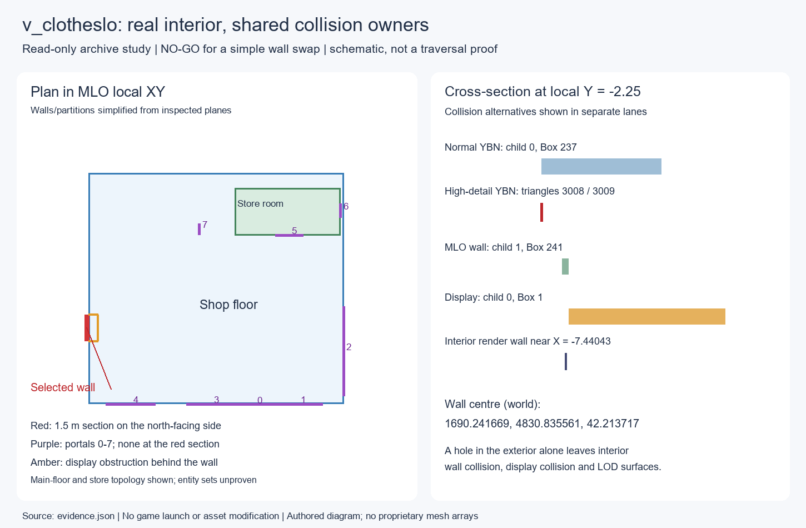

# v_clotheslo at 1693.5, 4823.7 — polygon-level feasibility

2026-10-23. Read-only archive investigation, stacked on PR #319 at `6a906c77b071b9ee552c17616b2f89b2ad33a3f9`. Operator/publisher: Codex. No game launch, P2 request, RPG, deployment, asset modification or merge.

## Decision

**NO-GO for a simple wall/entity replacement or deployment.** This building has a real interior immediately behind the selected wall, but the opening is not an independently owned asset. Both exterior collision resolutions, the shared MLO wall, interior displays, visual overlays and LODs intersect it. Deleting whole owners would remove other wall sections, other building geometry, or affect other instances of this shop interior. A carefully partitioned, instance-specific replacement may be possible; preservation has **not** been demonstrated.

The smallest next implementation is an **offline, in-memory cut/remainder verifier** for the exact section below. It should split the identified box/triangle owners, preserve their remainder, and identify an instance-specific MLO clone/placement strategy. Emit a partition manifest and area/volume/remainder checks; do not save game assets, deploy, or begin fracture work. A new GO would require that verifier to preserve the rest of the building, displays/floor/roof and every non-target MLO instance, plus a coherent portal/LOD plan.

## Exact investigated wall section

North-facing side, local negative-X wall. Reference rectangle: **1.5000003 m wide × 2.3000000 m high**, on the actual plane of `cs2_01_clothshop.ydr`, model 0, geometry 3, triangle 68. These are section coordinates, not a claim that the existing triangles already form a detachable rectangular panel. Mesh vertices are quantized; displayed precision is for reproducibility, not submillimetre placement accuracy.

| Corner | World X | World Y | World Z |
| --- | ---: | ---: | ---: |
| A, lower | 1689.498215 | 4830.736683 | 41.063717 |
| B, lower | 1690.985123 | 4830.934439 | 41.063717 |
| C, upper | 1690.985123 | 4830.934439 | 43.363717 |
| D, upper | 1689.498215 | 4830.736683 | 43.363717 |

Centre `(1690.241669, 4830.835561, 42.213717)`. Approximate outward normal `(-0.131216, +0.991354, 0)`; the exact face plane and corner computations are in `evidence.json`. Local section runs Y = −3.0…−1.5, Z = 0.18…2.48, X = −7.5213618…−7.5223021. Local-to-world origin is `(1693.4592, 4823.674, 40.883717)`, MLO quaternion `(0,0,-0.6590842,0.7520692)`.

The wall-cut inspection prism is X = −7.8…−7.1; the interior passage inspection extends to X = −5.5. These prisms select intersections for investigation; they are **not** a proposed safe deletion volume.

## Actual asset ownership

Path abbreviations used below:

- **E** = `x64r.rpf\levels\gta5\_hills\country_02\cs2_01.rpf\`
- **M** = `x64r.rpf\levels\gta5\_hills\country_02\country_02_metadata.rpf\`
- **L** = `x64r.rpf\levels\gta5\_hills\country_02\country_02.rpf\`
- **I** = `x64h.rpf\levels\gta5\interiors\v_int_51.rpf\`

| Role | Actual resource / placement | Finding |
| --- | --- | --- |
| Exterior shell | E `cs2_01_clothshop.ydr` | 1,278 triangles across 21 geometries; pivot `(1692.7816,4822.917,43.169857)`, identity orientation. M `cs2_01_strm_1.ymap` entity 5, GUID 2224805978. Whole-building shell, not a wall prop. |
| Exterior attachments | E `cs2_01_clothshop_obja.ydr` | 4,652 triangles, 15 geometries; entity 10, GUID 4186488152. Not the selected wall's primary owner. |
| Exterior decoration | E `cs2_01_clothshop_dec.ydr`; E `cs2_01_shop_dec2.ydr` | 31 and 847 triangles respectively. `shop_dec2`, entity 23/GUID 2617734303, has actual triangles crossing the selected section; removing the main shell alone leaves decoration. |
| Exterior YTYP | M `country_02_metadata_006_strm.ytyp` | Defines shell, attachments and decoration. Shell asset type is DRAWABLE; physics dictionary hash is zero. Static world YBNs own the wall collision, not an embedded shell collider. |
| Exterior placement variants | M `cs2_01_strm_1.ymap`; corresponding `patchday2ng`, `patchday3ng`, `mpheist`/`hei_cs2_01_strm_1.ymap` | Archive alternatives, not independent simultaneous buildings. Exact transforms/GUIDs in evidence. |
| Normal world collision | E `cs2_01_5.ybn`, child 0, **Box polygon 237** | Intersects the section. Child 0 has 1,430 polygons. Box extends world `(1685.8843,4829.8477,40.751396)` to `(1695.8093,4831.5680,45.932407)`; deleting it removes much more than 1.5 m of wall. |
| High-detail collision | E `hi@cs2_01_8.ybn`, child 0, **Triangle polygons 3008 and 3009** | Actual clipped intersection, not just root-bounds overlap. Child 0 has 4,451 polygons and also covers other structures. Do not remove the child. |
| MLO definition and collision | I `v_int_51.ytyp`; I `v_clotheslo.ybn` | Interior physics dictionary is `v_clotheslo`. Child 0 has 99 primitives; child 1 has 278. Separate from world YBN ownership. |
| Interior wall | I `v_51_v_clotheslo.ydr`, model 0, geometry 8, triangles **47,48,49,51** | Both base and NVE shell variants intersect the section. Interior-facing plane near local X = −7.44043. |
| Interior wall collision | I `v_clotheslo.ybn`, child 1, **Box polygon 241** | Local box spans X = −7.450344…−7.4304075, Y = −6.677531…6.728055, Z = 0.1793859…3.666488. This is a **13.405586 m wall collider**, not a panel. |
| Display obstruction | I `v_clotheslo.ybn`, child 0, **Box polygon 1** | X = −7.4276533…−6.8884296, Y = −5.507884…−1.4135588, Z = 0.3276665…2.5699403. Blocks the investigated opening behind the wall. Display meshes `v_51_clothing02` / `v_51_clothing06` also intersect the passage. |

Exterior geometry 3 triangles **68,70,145,146** cross the cut prism, including its front/back surfaces. Other interior intersections include `v_51_main_det`, `v_51_main_ovl`, `v_51_v_shadowmap`, `v_51_ducttapeshad` and `v_51_reflectproxy`. These are separate layers of authored geometry; a hole in one drawable does not remove the others. `evidence.json` lists exact per-geometry triangle IDs and clipped areas, separately for base/NVE alternatives. Areas count surfaces, including both sides, and are not net hole area.

## Room geometry and portals against the exterior

The MLO has limbo plus two named rooms: room 1 `V_51_ShopFloorRm` and room 2 `V_51_StoreRm`. Eight portals exist; seven connect a room to limbo. The selected north-facing wall is backed by shop-floor shell geometry and display collision. It has **no existing portal at the selected section**. Cutting collision/render triangles alone would leave interior visibility and occlusion unaddressed.

| Portal | Rooms | World centre | Geometry relationship |
| --- | --- | --- | --- |
| 0 | 1 → 0 | `(1687.111,4820.610,42.656)` | Front elevation, local Y ≈ −6.695; not this side wall. |
| 1 | 1 → 0 | `(1687.443,4818.113,42.656)` | Same front elevation. |
| 2 | 1 → 0 | `(1690.846,4815.898,42.656)` | Opposite side, local X ≈ +7.366. |
| 3 | 1 → 0 | `(1686.788,4823.109,42.656)` | Front elevation. |
| 4 | 1 → 0 | `(1686.170,4827.747,42.656)` | Front elevation. |
| 5 | 1 → 2 | `(1697.109,4819.921,42.220)` | Shop/store connection; local Y ≈ 3.126, X ≈ 3.390…5.008. |
| 6 | 2 → 0 | `(1698.903,4817.152,42.184)` | Store-room exterior portal, not the selected wall. |
| 7 | 1 → 0 | `(1696.770,4825.134,42.221)` | Internal authoring partition near local X ≈ −1.013; limbo link does not prove outdoor access. |

Store/changing-room partitions were identified from actual shell triangle planes, not the room bounding boxes. The raw store-room box is offset relative to the visible store geometry; naively transforming that box is not adequate to locate the room. Portal 5 and shell partitions near local Y = 3.129 establish its relationship to the main floor. See the schematic and raw room/portal metadata in evidence.

Downward collision probes find interior floor surfaces near local Z = 0.1794/0.1909 and exterior ground near Z = 0.0762 at local X = −8.5. This suggests a roughly 0.10–0.12 m threshold difference at the sampled line. It does not establish a walkable capsule route; the display box occupies the route, and floor geometry must remain intact.

## LODs and shared ownership

The near exterior LOD is **not a standalone YDR**: `cs2_01_clothshop_lod`, hash 1095778734, is inside L `cs2_01_slod1_children.ydd` (33 dictionary entries). Its 209 triangles include geometry 0 triangles **169–173** crossing the section. HD entity 5 references entity 147 in `cs2_01.ymap`; entity 147's local parent is entity 18, `cs2_01_slod1`. Preserve the actual hierarchy and all unrelated dictionary entries.

The MLO's LOD is unresolved-name hash **1814693341**, the sole drawable in L `cs2_01_clotheslow_slod_children.ydd` (2,517 triangles). It is placed at `cs2_01.ymap` entity 137, with parent index 0. Geometry 0 triangles **2008,2009,2432,2433,2434** intersect the wall-cut prism. Ordinary-entity orientation is `(0,0,-0.6588043,0.7523143)`, the inverse of its raw stored quaternion. Treating every raw rotation like an MLO rotates this LOD incorrectly.

Entity 0 is `cs2_01_clotheslow_slod`, hash 1944137204, inside L `cs2_lod_123_slod2_children.ydd` (52 entries); its inspected drawable has 24 triangles. Both entity 0 and entity 18 link onward to `cs2_lod.ymap` entity 13, `cs2_lod_123_slod2`, in `cs2_lod_1234_slod3_children`. None of these shared resources can safely be removed wholesale to make the opening persistent at distance. Actual local-parent references are included in the final evidence; a `parentIndex` must not automatically be interpreted as an index in the parent YMAP. The large coarser group was identified by hierarchy/dictionary metadata; its entire district mesh was not surveyed.

## Adjacent structures and overrides

The query parsed **15,570 installed YBNs**, with zero failures, and retained nine resources whose bounds intersect the bounded shop region, plus their relevant children. Actual triangle clipping and oriented-box reconstruction identify the owners above. Forest North normal/high collision, `cs1_13_64`, `cs2_01_7`, `hi@cs2_01_9` and `cs2_roadsb_3` were considered rather than excluded by naming. Their examined primitives do not intersect the selected wall/pass-through prism. No capsule, cylinder or sphere broadphase candidate remains in that prism; all collision intersections there are handled triangles or oriented boxes.

Actual meshes for neighboring `cs2_01_markets2`, `cs2_01_markets2_obj1b`, `cs2_01_shop_dec1`, shop attachments and nearby placed props were read. The market building's triangles do not intersect the selected prism. **However**, the target's world YBN children cover the wider scene and `shop_dec2` contributes intersecting decoration. Neighbour non-intersection is not permission to disable the shared children.

NVE overrides are material to the design:

- `onigiri\dlcpacks\nve_lights\dlc.rpf\x64\lights_meta_sp.rpf\cs2_01_strm_1.ymap` supplies the shell, decoration and attachments, retaining their GUIDs and almost identical, rounded transforms. Editing only the vanilla YMAP may have no effect under that configuration.
- `onigiri\dlcpacks\nve_interiors\dlc.rpf\x64\binco.rpf\v_int_51.ytyp` and its YDRs replace the interior definition/meshes. The base/NVE `v_51_v_clotheslo` payload hashes differ; both have 778 triangles and the selected wall faces exist in both. Clothing meshes also differ: `v_51_clothing02` has 19,438 base versus 18,884 NVE triangles; `v_51_clothing06` has 15,605 versus 15,394. A vanilla-only patch cannot be assumed compatible.
- No same-name NVE replacement for the identified world YBNs or `v_clotheslo.ybn` was found in the installed archive inventory. Forest North has separate overlapping-region collision files, which were polygon/primitive checked. This does not prove which installed layer the game would load.

The same MLO archetype has seven catalogued world placements. Replacing `v_clotheslo` collision or its shell globally can alter other clothing shops. A target-specific clone/rebind strategy is required before authoring a physical hole.

## Evidence, validation and remaining risks

`evidence.json` contains source paths, extracted-resource SHA-256 values, transforms, wall corners, room/portal metadata, counts, source polygon IDs, actual clipped-surface intersections and nine horizontal probe traces. The traces are a **union of archive alternatives/resolutions**, not a claim that every layer is simultaneously loaded. `provenance.json` records the reader/runtime identities, raw-evidence digest and before/after archive inventory comparison. Private raw vertex/index/primitive arrays remain local and are not committed.

The reader compiled and completed on Windows/.NET 8 against CodeWalker.Core 30_dev48. `ShadersGen9Conversion.xml` must be beside the running assembly and in its working directory; omitting it initially produced null drawables in CodeWalker's exception-suppressing YDR loader. The final reader uses direct resource reads for YDRs, emits failures explicitly, and the final extraction has no errors. Four geometry tests pass: ordinary/MLO rotation distinction, oriented-box reconstruction/ray intersection, triangle-vs-bounds false positives and bounded ray segments. These are offline checks, not GTA acceptance.

Remaining risks: active DLC/NVE precedence and entity sets; visibility/portal authoring, occlusion and baked shadow/reflection layers; world/interior collision resolution switching; display relocation; floor/sill preservation; preservation of unrelated dictionary entries and all other MLO instances; runtime streaming/pop-in, fracture, performance and exact restoration. None is certified by a successful archive parse.

**Handoff:** findings-only draft PR; no installed or loaded candidate, no request/session IDs, no game/world mutation to restore. Continue only with the offline partition verifier described in the decision. Destructive authoring/deployment/gameplay remains a separate gate.
